# MỞ ĐẦU

## 1. Lý do chọn đề tài

Năm 2026 là một năm đáng nhớ đối với cả công nghệ lẫn thị trường vốn Việt Nam. Ngày 01/3/2026, Luật Trí tuệ nhân tạo (Luật số 134/2025/QH15) chính thức có hiệu lực, trở thành văn bản luật đầu tiên của Việt Nam điều chỉnh toàn diện lĩnh vực trí tuệ nhân tạo (Artificial Intelligence – AI) [@vn_ai_law2025]. Ngày 21/9/2026, thị trường chứng khoán Việt Nam được FTSE Russell nâng hạng từ "cận biên" lên "mới nổi thứ cấp", sau quyết định công bố ngày 07/10/2025 [@ftse2025]. Nâng hạng đồng nghĩa với việc các quỹ đầu tư theo chỉ số trên toàn cầu bắt đầu phân bổ vốn vào cổ phiếu Việt Nam, và thị trường sẽ ngày càng chuyên nghiệp, cạnh tranh hơn. Trong bối cảnh đó, câu hỏi "AI có thể giúp gì cho người làm đầu tư, và giới hạn của nó nằm ở đâu?" không còn là câu hỏi lý thuyết.

Tài chính cũng là lĩnh vực đi cùng AI từ rất sớm. Lý thuyết danh mục của Markowitz năm 1952 đặt nền móng cho đầu tư định lượng [@markowitz1952]; mô hình Z-score của Altman năm 1968 dùng thống kê để cảnh báo phá sản doanh nghiệp [@altman1968]; đến những năm 2020, học máy đã được dùng để định giá tài sản [@gu2020], mạng tích chập được dạy "đọc" biểu đồ giá giống nhà phân tích kỹ thuật [@jiang2023], còn các mô hình nền tảng chuyên cho dữ liệu nến giá xuất hiện từ năm 2025 [@shi2026kronos]. Mỗi bước tiến của AI gần như đều nhanh chóng được thử nghiệm trên thị trường tài chính.

Tuy vậy, tài chính lại là "bài kiểm tra khó" của AI. Theo giả thuyết thị trường hiệu quả, giá đã phản ánh phần lớn thông tin công khai, nên tín hiệu dự báo, nếu có, thường rất nhỏ so với nhiễu [@fama1970]. Dữ liệu tài chính còn chứa nhiều bẫy: dùng nhầm thông tin của tương lai, trộn ngẫu nhiên dữ liệu theo thời gian, hay đánh giá lợi nhuận mà bỏ quên phí giao dịch [@lopezdeprado2018]. Một mô hình đạt độ chính xác 97% có thể vô dụng nếu lớp cần phát hiện chỉ chiếm 3%; một chiến lược đoán đúng 55% số ngày vẫn có thể thua lỗ. Vì thế, học AI qua bài toán tài chính buộc người học phải hiểu cả **cách mô hình hoạt động** lẫn **cách đánh giá mô hình một cách trung thực**. Đó là lý do tiểu luận chọn chủ đề "Trí tuệ nhân tạo trong đầu tư tài chính" làm sợi chỉ đỏ xuyên suốt các chương của môn Phát triển hệ thống thông minh.

## 2. Mục tiêu nghiên cứu

Tiểu luận hoàn chỉnh gồm sáu chương, hướng tới các mục tiêu:

1. Hệ thống hóa lịch sử phát triển của AI và lịch sử song hành của AI trong tài chính – đầu tư, từ năm 1943 đến năm 2026.
2. Trình bày các kỹ thuật học máy cơ bản, mạng nơ-ron tích chập (CNN) và mạng nơ-ron hồi quy (RNN) theo trình tự trực giác → ví dụ số tính tay → công thức → mã nguồn, để người không chuyên cũng có thể theo dõi.
3. Cài đặt cùng một mô hình theo ba cách – tự viết bằng NumPy, Keras và PyTorch – và chứng minh định lượng rằng ba bản cài đặt tương đương nhau.
4. Đánh giá các mô hình trên năm bộ dữ liệu tài chính thật bằng quy trình chống rò rỉ dữ liệu, có đường cơ sở, khoảng tin cậy và phân tích kinh tế có tính phí giao dịch.
5. Đóng gói mô hình thành ứng dụng minh họa, xây dựng KB/KG và RAG cho dữ liệu bệnh tiểu đường và báo cáo tài chính.
6. Minh họa hệ đa Agent theo vai trò, có thông điệp, trạng thái và cơ chế dừng; trình bày hợp các hàm và giải thích từng hàm.
7. Bổ sung CNN, RNN và LSTM sáu lớp học được cho cả NumPy tự viết, Keras và PyTorch, kèm kiểm chứng triển khai.

## 3. Câu hỏi nghiên cứu

Các mục tiêu trên được cụ thể hóa thành sáu câu hỏi, sẽ được trả lời bằng số liệu ở phần Kết luận:

- **CH1.** Ba bản cài đặt (NumPy, Keras, PyTorch) của cùng một kiến trúc có cho kết quả tương đương không? Chúng khác nhau ở điểm nào?
- **CH2.** Trên dữ liệu bảng về rủi ro doanh nghiệp và rủi ro tín dụng, hồi quy logistic, rừng ngẫu nhiên hay mạng nơ-ron nhiều lớp phân biệt rủi ro tốt nhất?
- **CH3.** CNN (học từ ảnh của chuỗi giá) và RNN (học trực tiếp từ chuỗi lợi suất) có dự báo hướng đi ngày kế tiếp của S&P 500, VN-Index và Bitcoin tốt hơn đoán ngẫu nhiên không?
- **CH4.** Nếu có khả năng dự báo, khả năng đó có chuyển thành lợi nhuận sau phí giao dịch không?

- **CH5.** KG và hybrid retrieval hỗ trợ truy vết, tìm bằng chứng và sinh câu trả lời như thế nào?
- **CH6.** Hệ đa Agent theo vai trò phối hợp ra sao, và kiểm tra cấu trúc có bảo đảm câu trả lời đúng không?

## 4. Đối tượng và phạm vi nghiên cứu

**Đối tượng nghiên cứu** là các kỹ thuật học máy cơ bản (hồi quy logistic, cây quyết định và rừng ngẫu nhiên, mạng nơ-ron nhiều lớp), mạng tích chập và các mạng hồi quy SimpleRNN, LSTM, GRU, cùng cách áp dụng chúng vào hai nhóm bài toán đầu tư: đánh giá rủi ro trên dữ liệu bảng và dự báo hướng biến động của chỉ số thị trường.

**Phạm vi dữ liệu** gồm năm bộ dữ liệu: hai bộ dữ liệu bảng của kho UCI (phá sản doanh nghiệp Đài Loan; vỡ nợ thẻ tín dụng Đài Loan) và ba chuỗi chỉ số đại diện cho ba kiểu thị trường – S&P 500 (thị trường phát triển), VN-Index (thị trường Việt Nam) và Bitcoin (tài sản số giao dịch 24/7). Dữ liệu thị trường được chốt đến ngày 30/09/2026. **Phạm vi nội dung** gồm sáu chương: nền tảng AI, học máy, CNN, RNN–LSTM, Knowledge Graph–RAG và hệ đa Agent. Phần mở rộng dùng thêm dữ liệu UCI về lượt điều trị bệnh tiểu đường và FinQA về báo cáo tài chính. Thí nghiệm thị trường gốc được giữ riêng với kiểm chứng mô hình sâu và demo Agent; học sâu trên đồ thị không thuộc phạm vi bắt buộc của bản này. Tiểu luận không xây dựng hệ thống giao dịch thật và không đưa ra khuyến nghị đầu tư.

## 5. Phương pháp nghiên cứu

Tiểu luận kết hợp hai phương pháp. **Nghiên cứu tài liệu** dựa trên các công trình gốc, giáo trình kinh điển [@russell2021; @goodfellow2016] và các công bố mới nhất đến năm 2026; mọi thông tin về công trình đều được dẫn nguồn và đối chiếu với nơi xuất bản. **Thực nghiệm định lượng** được thiết kế như Hình 0.1: từ năm bộ dữ liệu, tiểu luận tạo ba cách biểu diễn (bảng, ảnh, chuỗi), huấn luyện các mô hình tương ứng với từng chương, mỗi mô hình đại diện được cài đặt theo ba cách, rồi đánh giá và triển khai.

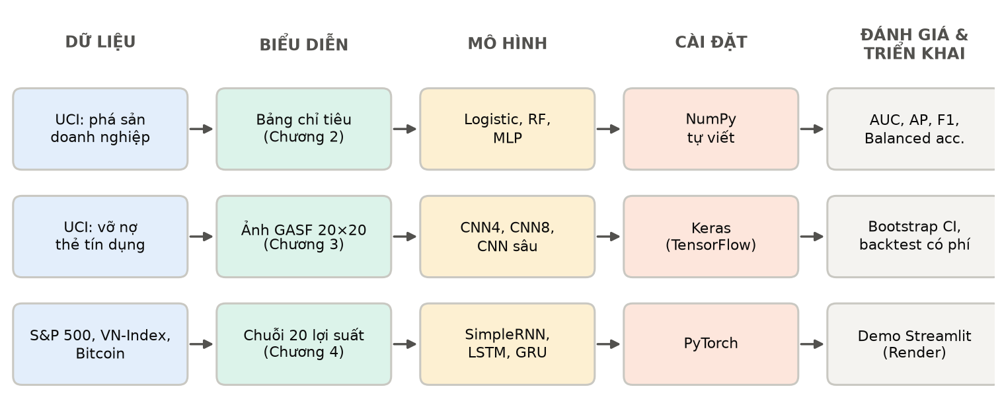

Toàn bộ thực nghiệm tuân thủ năm nguyên tắc: (i) dữ liệu theo thời gian được chia theo thời gian, nhãn không được vượt ranh giới giữa các tập; (ii) mọi phép tiền xử lý chỉ "học" trên tập huấn luyện; (iii) ngưỡng quyết định và số vòng huấn luyện chỉ được chọn trên tập xác thực, tập kiểm tra chỉ dùng một lần ở cuối; (iv) mọi mô hình đều được so với đường cơ sở đơn giản; (v) mỗi cấu hình chạy với ba hạt giống ngẫu nhiên, kèm khoảng tin cậy bootstrap. Riêng thực nghiệm nền tảng ở Chương 2–4 có 128 bản ghi thực nghiệm (120 lượt huấn luyện và 8 đường cơ sở), tất cả được lưu kèm mã nguồn và dự báo từng mẫu để có thể kiểm tra lại.

## 6. Đóng góp của tiểu luận

- Xây dựng bộ dữ liệu VN-Index được **kiểm chứng chéo giữa ba nguồn** (SSI, DNSE, VNDirect). Quá trình này phát hiện và xử lý ba vấn đề: 39 phiên lệch giá giữa các nguồn, một lỗ hổng 26 phiên năm 2009 tạo ra mức "tăng 23%" không có thật, và giai đoạn giá bị làm tròn trước năm 2009.
- Tự cài đặt một thư viện học sâu nhỏ bằng NumPy (lớp kết nối đầy đủ, tích chập, gộp, SimpleRNN, LSTM, GRU, Adam). Thư viện được kiểm tra gradient bằng sai phân và đối chiếu với Keras, PyTorch khi dùng **cùng trọng số khởi tạo, cùng thứ tự dữ liệu**.
- Đưa ra kết quả trung thực, có kiểm định thống kê: mô hình phân biệt rủi ro tín dụng rất tốt trên dữ liệu bảng; với thị trường, chỉ VN-Index cho thấy khả năng dự báo nhỏ nhưng có ý nghĩa thống kê, còn S&P 500 và Bitcoin thì không; và sau phí giao dịch, không chiến lược nào vượt rõ chiến lược mua và giữ.
- Đóng gói mô hình thành ứng dụng web Streamlit trên Render: đối chiếu dự báo theo ngày, tải giá mới để dự báo phiên tới, nhập hồ sơ tín dụng và xem mô phỏng bằng tiền; giải thích kết quả và giới hạn cho người không chuyên.

## 7. Cấu trúc tiểu luận

Ngoài Mở đầu, Kết luận, Tài liệu tham khảo và Phụ lục, tiểu luận gồm sáu chương. **Chương 1** trình bày lịch sử phát triển của AI và của AI trong tài chính, đồng thời giới thiệu ba chuỗi chỉ số dùng xuyên suốt. **Chương 2** trình bày các kỹ thuật học máy cơ bản và thực nghiệm trên hai bộ dữ liệu rủi ro. **Chương 3** trình bày mạng tích chập và thử nghiệm "đọc" ảnh của chuỗi giá. **Chương 4** trình bày mạng hồi quy, so sánh với Chương 3 và phân tích giá trị kinh tế của dự báo. **Chương 5** xây dựng KB/KG, so sánh truy hồi và sinh trên hai miền dữ liệu, rồi triển khai Agent công cụ. **Chương 6** trình bày hệ đa Agent theo vai trò, thông điệp và kế hoạch demo nhóm. Phụ lục hướng dẫn tái lập, cung cấp mã ba công cụ cho mô hình sáu lớp và mã hệ đa Agent.


# CHƯƠNG 1. LỊCH SỬ PHÁT TRIỂN CỦA TRÍ TUỆ NHÂN TẠO

## 1.1. Trí tuệ nhân tạo là gì?

Năm 1950, Alan Turing mở đầu bài báo "Computing Machinery and Intelligence" bằng câu hỏi "Máy móc có thể suy nghĩ không?". Vì "suy nghĩ" khó định nghĩa, ông đề xuất một phép thử: nếu qua trao đổi bằng văn bản, người hỏi không phân biệt được đâu là máy, đâu là người, thì có thể coi máy đã hành xử thông minh [@turing1950]. Năm năm sau, cụm từ "artificial intelligence" lần đầu xuất hiện trong đề xuất hội thảo Dartmouth của McCarthy, Minsky, Rochester và Shannon [@mccarthy1955].

Ngày nay, giáo trình phổ biến nhất của ngành định nghĩa AI theo bốn hướng: máy suy nghĩ như người, hành động như người, suy nghĩ hợp lý và hành động hợp lý; hướng được dùng rộng rãi nhất là xem AI như một **tác tử hợp lý** (rational agent) – hệ thống nhận thông tin từ môi trường và chọn hành động tốt nhất theo mục tiêu đã đặt [@russell2021]. Trong AI có hai nhánh con quen thuộc. **Học máy** (machine learning – ML) là cách xây dựng hệ thống thông minh bằng cách cho máy học từ dữ liệu thay vì viết sẵn mọi quy tắc. **Học sâu** (deep learning – DL) là nhánh của học máy dùng mạng nơ-ron nhiều tầng, tự học ra các đặc trưng từ dữ liệu thô [@goodfellow2016].

> **Hiểu nhanh.** Hãy hình dung một ngân hàng muốn tự động duyệt hồ sơ vay. Cách "AI cổ điển" là mời chuyên gia viết ra hàng trăm quy tắc *nếu – thì* ("nếu trễ hạn quá 90 ngày thì từ chối"). Cách "học máy" là đưa cho máy hàng chục nghìn hồ sơ cũ đã biết kết quả để máy tự tìm ra quy luật. Cách "học sâu" đi xa hơn: máy tự học cả việc nên chú ý đến những đặc điểm nào, kể cả từ dữ liệu thô như ảnh hay chuỗi thời gian.

Các hệ thống hiện nay đều là **AI hẹp**: giỏi một nhóm nhiệm vụ cụ thể như nhận dạng ảnh, dịch thuật hay chấm điểm tín dụng. AI tổng quát, có năng lực ngang con người trên mọi nhiệm vụ, vẫn là mục tiêu nghiên cứu và chủ đề tranh luận.

## 1.2. Giai đoạn hình thành và lạc quan (1943–1969)

Mốc khởi đầu thường được nhắc đến là mô hình nơ-ron nhân tạo của McCulloch và Pitts năm 1943: một nơ-ron được mô tả như một phép toán logic, "bật" khi tổng tín hiệu đầu vào vượt ngưỡng [@mcculloch1943]. Mùa hè năm 1956, hội thảo Dartmouth quy tụ những người sáng lập ngành với tham vọng mô tả mọi khía cạnh của trí thông minh chính xác đến mức máy có thể mô phỏng [@mccarthy1955]. Năm 1958, Rosenblatt công bố **perceptron**, mô hình đầu tiên tự điều chỉnh trọng số từ ví dụ để phân loại [@rosenblatt1958]. Năm 1966, chương trình hội thoại ELIZA của Weizenbaum khiến nhiều người dùng tin rằng máy "hiểu" họ, dù thực chất nó chỉ khớp mẫu câu và lặp lại từ khóa [@weizenbaum1966].

Những thành công ban đầu tạo ra làn sóng lạc quan: nhiều nhà nghiên cứu dự đoán máy sẽ đạt trí thông minh như người chỉ trong một thế hệ. Bài học đầu tiên của lịch sử AI nằm ở đây: thành công trên các bài toán "đồ chơi" thường bị ngoại suy quá mức sang thế giới thực.

## 1.3. Hệ chuyên gia và hai "mùa đông AI" (1969–1993)

Năm 1969, cuốn sách *Perceptrons* của Minsky và Papert chứng minh perceptron một lớp không thể học những quan hệ đơn giản như phép XOR [@minsky1969]. Năm 1973, báo cáo Lighthill gửi Hội đồng Nghiên cứu Khoa học Anh kết luận AI chưa đạt được các hứa hẹn ban đầu [@lighthill1973]. Kinh phí bị cắt giảm mạnh ở cả Anh và Mỹ, mở ra **mùa đông AI** thứ nhất, kéo dài khoảng từ giữa những năm 1970 đến đầu những năm 1980.

AI hồi sinh nhờ **hệ chuyên gia**: tri thức của chuyên gia được mã hóa thành các quy tắc *nếu – thì*. MYCIN (Đại học Stanford) tư vấn chẩn đoán nhiễm trùng máu và kê kháng sinh [@shortliffe1976]; hệ R1/XCON giúp hãng DEC cấu hình máy tính VAX theo đơn đặt hàng [@mcdermott1982]. Những năm 1980 chứng kiến làn sóng thương mại hóa, kể cả trong ngân hàng và bảo hiểm. Nhưng hệ chuyên gia sớm bộc lộ điểm yếu: tốn kém khi thu thập và bảo trì tri thức, "giòn" (brittle) trước tình huống nằm ngoài các quy tắc, và không tự học thêm được. Khi thị trường máy tính chuyên dụng cho AI sụp đổ năm 1987, mùa đông thứ hai bắt đầu và kéo dài tới đầu những năm 1990.

## 1.4. Học máy thống kê và sự trở lại của mạng nơ-ron (1986–2011)

Trong mùa đông, một số hướng đi quan trọng vẫn âm thầm phát triển. Năm 1986, Rumelhart, Hinton và Williams phổ biến thuật toán **lan truyền ngược** (backpropagation), cho phép huấn luyện mạng nơ-ron nhiều lớp và vượt qua giới hạn mà Minsky – Papert chỉ ra [@rumelhart1986]. LeCun và cộng sự phát triển mạng tích chập LeNet; hệ thống đọc séc dùng mạng này đã được triển khai thương mại và xử lý hàng triệu tờ séc ngân hàng mỗi ngày [@lecun1998]. Đây có lẽ là một trong những ứng dụng học sâu thực tế đầu tiên, và nó thuộc ngành tài chính.

Thập niên 1990–2000 là thời của **học máy thống kê**: máy vector hỗ trợ (SVM) [@cortes1995], rừng ngẫu nhiên [@breiman2001] và các phương pháp có nền tảng toán học chặt chẽ. Năm 1997 có hai sự kiện đáng chú ý. Siêu máy tính Deep Blue của IBM thắng nhà vô địch cờ vua thế giới Garry Kasparov, chủ yếu nhờ tìm kiếm quy mô lớn [@campbell2002]. Cùng năm, Hochreiter và Schmidhuber công bố LSTM, kiến trúc mạng hồi quy sẽ trở thành trọng tâm của Chương 4 [@hochreiter1997]. Năm 2006, Hinton và cộng sự chỉ ra cách huấn luyện hiệu quả mạng nhiều tầng [@hinton2006], làm sống lại thuật ngữ "học sâu". Năm 2009, bộ dữ liệu ImageNet với hơn một triệu ảnh có nhãn ra đời [@deng2009]. Dữ liệu lớn, sức mạnh tính toán của GPU và thuật toán tốt hơn trở thành ba trụ cột cho giai đoạn tiếp theo.

## 1.5. Kỷ nguyên học sâu (2012–2021)

Năm 2012, mạng tích chập AlexNet thắng cuộc thi ImageNet với tỉ lệ lỗi top-5 là 15,3%, trong khi đội xếp thứ hai có 26,2% [@krizhevsky2012]. Khoảng cách lớn đến mức cộng đồng thị giác máy tính gần như chuyển hẳn sang học sâu. Các năm sau đó liên tục có đột phá: mạng đối nghịch sinh dữ liệu (GAN) năm 2014 [@goodfellow2014gan]; ResNet với kết nối tắt cho phép huấn luyện mạng hơn 150 lớp [@he2016]; AlphaGo thắng kỳ thủ cờ vây hàng đầu Lee Sedol năm 2016 [@silver2016]; kiến trúc Transformer năm 2017 dựa hoàn toàn vào cơ chế chú ý (attention) [@vaswani2017], làm nền cho BERT [@devlin2019] và GPT-3 với 175 tỉ tham số [@brown2020]. Năm 2020–2021, AlphaFold 2 dự đoán cấu trúc protein với độ chính xác gần thực nghiệm [@jumper2021], cho thấy AI bắt đầu đóng góp trực tiếp vào khoa học.

## 1.6. AI tạo sinh, mô hình nền tảng và tác tử (2022–2026)

Ngày 30/11/2022, OpenAI ra mắt ChatGPT [@openai2022chatgpt] và đưa AI tạo sinh đến hàng trăm triệu người dùng. GPT-4 (2023) mở rộng sang đầu vào hình ảnh [@openai2023gpt4]. Từ cuối năm 2024, các **mô hình suy luận** được huấn luyện để "nghĩ" nhiều bước trước khi trả lời; DeepSeek-R1 (01/2025) cho thấy học tăng cường quy mô lớn có thể tự hình thành năng lực suy luận nhiều bước, và mô hình được công bố mở trọng số [@deepseek2025]. Tháng 7/2025, một phiên bản của Gemini Deep Think giải được 5/6 bài thi Olympic Toán quốc tế, đạt 35/42 điểm, tương đương huy chương vàng, chỉ bằng ngôn ngữ tự nhiên [@deepmind2025imo].

Giới khoa học cũng chính thức ghi nhận đóng góp của AI. Giải Nobel Vật lý 2024 được trao cho John Hopfield và Geoffrey Hinton vì những phát minh nền tảng cho học máy bằng mạng nơ-ron [@nobel2024physics]; Giải Nobel Hóa học 2024 được trao cho David Baker, Demis Hassabis và John Jumper, trong đó hai người sau được vinh danh nhờ AlphaFold [@nobel2024chemistry]. Giải Turing năm 2024, công bố ngày 05/3/2025, thuộc về Andrew Barto và Richard Sutton – những người đặt nền móng cho học tăng cường [@acm2025turing].

Song song với công nghệ là khung pháp lý. Đạo luật AI của Liên minh châu Âu (Quy định 2024/1689) là bộ luật toàn diện đầu tiên về AI trên thế giới [@euaiact2024]. Tại Việt Nam, sau Chiến lược quốc gia về AI năm 2021 [@vn_ai_strategy2021], Quốc hội thông qua Luật Trí tuệ nhân tạo ngày 10/12/2025, có hiệu lực từ 01/3/2026 [@vn_ai_law2025]. Tháng 2/2026, Hội nghị Thượng đỉnh Tác động AI tại New Delhi kết thúc với Tuyên bố New Delhi được 88 quốc gia và tổ chức tán thành [@newdelhi2026]. Về kỹ thuật, xu hướng nổi bật của giai đoạn 2024–2026 là **tác tử AI** (AI agent) tự lập kế hoạch và dùng công cụ, cùng sự trở lại của các kiến trúc hồi quy hiện đại như Mamba và xLSTM – chủ đề sẽ quay lại ở mục 4.10.

Hình 1.1 và Bảng 1.1 tóm tắt các mốc chính; dải gạch chéo ở Hình 1.1 đánh dấu hai mùa đông AI.

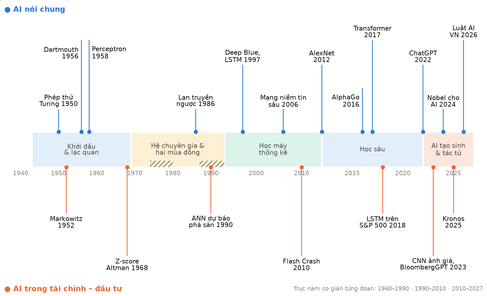

Bảng 1.1. Một số mốc phát triển tiêu biểu của AI và ý nghĩa của chúng.
| Năm | Sự kiện | Ý nghĩa |
|---|---|---|
| 1943 | Nơ-ron McCulloch–Pitts [@mcculloch1943] | Mô hình toán học đầu tiên của nơ-ron |
| 1950 | Phép thử Turing [@turing1950] | Đặt câu hỏi "máy có thể suy nghĩ không?" |
| 1956 | Hội thảo Dartmouth [@mccarthy1955] | Khai sinh ngành AI và thuật ngữ AI |
| 1958 | Perceptron [@rosenblatt1958] | Mô hình đầu tiên tự học trọng số từ ví dụ |
| 1974–1980 | Mùa đông AI thứ nhất [@lighthill1973] | Kỳ vọng vượt xa năng lực, kinh phí bị cắt |
| 1980–1987 | Hệ chuyên gia [@shortliffe1976; @mcdermott1982] | AI thương mại dựa trên luật *nếu – thì* |
| 1986 | Lan truyền ngược [@rumelhart1986] | Huấn luyện được mạng nhiều lớp |
| 1997 | Deep Blue; LSTM [@campbell2002; @hochreiter1997] | Máy thắng vua cờ; bộ nhớ dài cho chuỗi |
| 2012 | AlexNet [@krizhevsky2012] | Mở đầu kỷ nguyên học sâu |
| 2017 | Transformer [@vaswani2017] | Nền tảng của các mô hình ngôn ngữ lớn |
| 2022 | ChatGPT [@openai2022chatgpt] | AI tạo sinh phổ cập đến công chúng |
| 2024 | Nobel Vật lý và Hóa học [@nobel2024physics; @nobel2024chemistry] | Khoa học chính thức ghi nhận AI |
| 2026 | Luật Trí tuệ nhân tạo có hiệu lực [@vn_ai_law2025] | Hành lang pháp lý cho AI tại Việt Nam |

## 1.7. AI trong tài chính – đầu tư: một lịch sử song hành

Tài chính là một trong những lĩnh vực áp dụng tư duy định lượng sớm nhất. Năm 1952, Markowitz chứng minh nhà đầu tư nên đánh giá danh mục bằng cả lợi nhuận kỳ vọng lẫn rủi ro (phương sai) [@markowitz1952]. Năm 1968, Altman dùng phân tích phân biệt trên các chỉ số tài chính để dự báo phá sản doanh nghiệp, tiền thân của bài toán ở Chương 2 [@altman1968]. Năm 1970, Fama tổng kết giả thuyết thị trường hiệu quả [@fama1970]: nếu giá đã phản ánh thông tin sẵn có thì việc dự báo giá bằng dữ liệu quá khứ gần như không mang lại lợi thế. Giả thuyết này là "đối thủ" mà mọi mô hình dự báo ở Chương 3 và 4 phải vượt qua.

Mạng nơ-ron được đưa vào tài chính ngay khi chúng hồi sinh: năm 1990, Odom và Sharda dùng mạng nơ-ron dự báo phá sản và cho kết quả tốt hơn phân tích phân biệt truyền thống [@odom1990]. Giao dịch bằng thuật toán phát triển mạnh trong những năm 2000 và đi kèm rủi ro mới: ngày 06/5/2010, chỉ số Dow Jones mất gần 1.000 điểm trong vài phút rồi hồi phục trong sự kiện "Flash Crash", nơi các nhà giao dịch tần suất cao đóng vai trò khuếch đại biến động [@kirilenko2017]. Với học sâu, Krauss và cộng sự (2017) so sánh mạng nơ-ron sâu, cây tăng cường và rừng ngẫu nhiên trong chiến lược kinh doanh chênh lệch giá trên S&P 500 [@krauss2017]. Fischer và Krauss (2018) cho thấy LSTM vượt các phương pháp khác, nhưng lợi nhuận suy giảm mạnh từ khoảng năm 2010 [@fischer2018]. Nghiên cứu này là minh chứng rõ cho việc thị trường "học" và triệt tiêu các quy luật dễ khai thác. Gu, Kelly và Xiu (2020) cho thấy học máy, đặc biệt là cây hồi quy và mạng nơ-ron, đem lại lợi ích kinh tế lớn trong định giá tài sản – trong một số trường hợp tăng gấp đôi hiệu quả của các chiến lược dựa trên hồi quy truyền thống [@gu2020].

Giai đoạn gần đây đánh dấu bước chuyển sang mô hình lớn. Năm 2023, Jiang, Kelly và Xiu dạy mạng tích chập "đọc" ảnh biểu đồ giá và đạt hiệu quả vượt các tín hiệu kỹ thuật truyền thống [@jiang2023]; cùng năm, Bloomberg công bố BloombergGPT, mô hình ngôn ngữ 50 tỉ tham số chuyên cho tài chính [@wu2023bloomberggpt]. Năm 2024, TradingAgents mô phỏng cả một công ty đầu tư bằng nhiều tác tử mô hình ngôn ngữ lớn đóng vai nhà phân tích, nhà nghiên cứu và nhà giao dịch [@xiao2024tradingagents]. Năm 2025, Kronos – mô hình nền tảng mã nguồn mở đầu tiên cho dữ liệu nến giá (K-line), được tiền huấn luyện trên hơn 12 tỉ bản ghi nến của 45 sàn giao dịch – được chấp nhận tại hội nghị AAAI 2026 [@shi2026kronos].

Nhìn lại, mỗi làn sóng AI đều nhanh chóng được thử nghiệm trong tài chính, nhưng cũng mang theo rủi ro mới: mô hình học thuộc quá khứ, chiến lược bị khai thác cạn, hay hành vi tự động khuếch đại biến động. Đây là lý do các chương sau luôn đặt kết quả cạnh đường cơ sở và tính đến chi phí giao dịch.

## 1.8. Dữ liệu minh họa: ba chỉ số thị trường

Theo yêu cầu của tiểu luận, mỗi chương đều gắn với dữ liệu thật. Chương này giới thiệu ba chuỗi chỉ số được dùng xuyên suốt ở Chương 3 và Chương 4; hai bộ dữ liệu bảng được giới thiệu ở Chương 2.

**Nguồn và cách thu thập.** S&P 500 (mã ^GSPC, đại diện 500 doanh nghiệp lớn của Mỹ) và Bitcoin (mã BTC-USD) được tải từ [Yahoo Finance](https://finance.yahoo.com/) [@yahoo2026]. VN-Index (chỉ số của Sở Giao dịch Chứng khoán TP. Hồ Chí Minh) không có trên Yahoo Finance nên được tải từ API biểu đồ công khai của ba công ty chứng khoán SSI, DNSE và VNDirect [@ssi2026]. Mỗi file đều được lưu kèm thời điểm tải và mã băm SHA-256 để có thể kiểm tra lại. Dữ liệu chốt đến ngày 30/09/2026.

**Kiểm chứng chéo VN-Index.** Khi đặt các nguồn cạnh nhau, tiểu luận phát hiện ba vấn đề:

- Trên 4.217 phiên có ở cả SSI và DNSE, giá đóng cửa khớp ở 99,08% số phiên. 39 phiên còn lại lệch nhau (đều thuộc 2020–2023). Dùng VNDirect làm "trọng tài", cả 39/39 phiên đều khớp với SSI, nên SSI được chọn làm nguồn chính.
- SSI thiếu dữ liệu từ 20/07 đến 24/08/2009, khiến phiên 25/08/2009 hiển thị một mức "tăng 23%" giả. Lỗ hổng này và các phiên lẻ SSI bỏ sót (54 phiên) được bổ sung từ DNSE.
- Trước tháng 7/2009, chỉ DNSE có dữ liệu, nhưng giá đã bị làm tròn đến số nguyên. Hệ quả là hàng trăm phiên "đứng giá" giả (riêng năm 2003 có 106 phiên) và giá mở cửa, cao nhất, thấp nhất trùng nhau. Vì vậy thực nghiệm chỉ dùng VN-Index từ năm 2010, năm đầy đủ đầu tiên có dữ liệu chất lượng tốt.

Sau khi làm sạch, giai đoạn phân tích của S&P 500, VN-Index và Bitcoin lần lượt có 6.726, 4.175 và 4.397 phiên. Bảng 1.2 tóm tắt thống kê mô tả, Bảng 1.3 trích các dòng dữ liệu gốc, còn Hình 1.2 và Hình 1.3 cho thấy diễn biến giá và phân phối lợi suất.

Bảng 1.2. Thống kê mô tả lợi suất logarit theo ngày trong giai đoạn phân tích (tính từ dữ liệu của tiểu luận).
| Chỉ số | Giai đoạn | Số phiên | TB (%) | Độ lệch chuẩn (%) | Biến động năm (%) | Nhỏ nhất (%) | Lớn nhất (%) | Độ nhọn dư | Phiên tăng |
|---|---|---|---|---|---|---|---|---|---|
| S&P 500 | 03/01/2000 – 30/09/2026 | 6.726 | 0,025 | 1,21 | 19,2 | −12,8 | 11,0 | 10,7 | 53,7% |
| VN-Index | 04/01/2010 – 30/09/2026 | 4.175 | 0,029 | 1,18 | 18,8 | −6,9 | 6,5 | 3,9 | 54,7% |
| Bitcoin | 17/09/2014 – 30/09/2026 | 4.397 | 0,118 | 3,48 | 66,5 | −46,5 | 22,5 | 12,0 | 52,3% |

Bảng 1.3. Hai dòng dữ liệu gốc đầu tiên của mỗi chuỗi trong giai đoạn phân tích.
| Chỉ số | Ngày | Mở cửa | Cao nhất | Thấp nhất | Đóng cửa | Khối lượng |
|---|---|---|---|---|---|---|
| S&P 500 | 03/01/2000 | 1.469,25 | 1.478,00 | 1.438,36 | 1.455,22 | 931.800.000 |
| S&P 500 | 04/01/2000 | 1.455,22 | 1.455,22 | 1.397,43 | 1.399,42 | 1.009.000.000 |
| VN-Index | 04/01/2010 | 501,70 | 517,10 | 501,70 | 517,10 | 42.051.600 |
| VN-Index | 05/01/2010 | 538,80 | 539,40 | 530,20 | 532,50 | 66.619.450 |
| Bitcoin | 17/09/2014 | 465,86 | 468,17 | 452,42 | 457,33 | 21.056.800 |
| Bitcoin | 18/09/2014 | 456,86 | 456,86 | 413,10 | 424,44 | 34.483.200 |

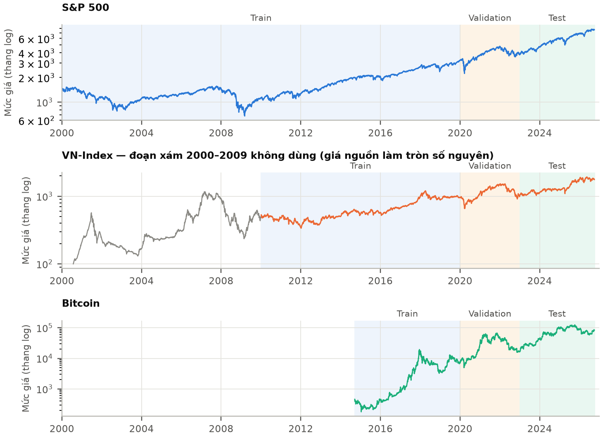

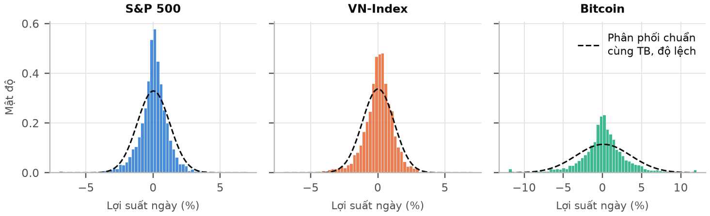

**Nhận xét.** Thứ nhất, Bitcoin biến động mạnh hơn hẳn hai chỉ số chứng khoán: độ biến động năm 66,5%, gấp khoảng 3,5 lần S&P 500 (19,2%) và VN-Index (18,8%), đồng thời giao dịch cả cuối tuần nên "một phiên" của Bitcoin là một ngày lịch. Thứ hai, cả ba chuỗi đều có "đuôi béo": độ nhọn dư lớn hơn 0 và Hình 1.3 cho thấy các ngày biến động cực đoan xuất hiện thường xuyên hơn nhiều so với phân phối chuẩn. Đây là lý do mô hình tài chính không nên giả định lợi suất có phân phối chuẩn. Thứ ba, tỉ lệ phiên tăng của cả ba chuỗi đều trên 50%, phản ánh xu hướng tăng dài hạn. Một mô hình "luôn đoán tăng" vì thế đã đạt độ chính xác trên 50% mà không cần học gì. Do đó các chương sau luôn so sánh với đường cơ sở và dùng các thước đo không bị đánh lừa bởi tỉ lệ lớp như ROC-AUC.

## 1.9. Tiểu kết chương

Lịch sử AI để lại ba bài học cho phần còn lại của tiểu luận. Thứ nhất, các chu kỳ "hưng phấn – thất vọng" nhắc nhở rằng thành công trên một bài toán hẹp không đảm bảo thành công ở mọi nơi; tài chính, với tín hiệu yếu và thị trường luôn thích nghi, là nơi bài học này thể hiện rõ nhất. Thứ hai, các bước nhảy vọt đều đến từ sự kết hợp của dữ liệu, sức tính toán và thuật toán, chứ không đến từ thuật toán đơn lẻ; chất lượng dữ liệu, như trường hợp VN-Index ở trên, cũng quan trọng không kém mô hình. Thứ ba, các phương pháp cũ hơn không biến mất mà trở thành nền móng: học máy thống kê vẫn là đường cơ sở mạnh trên dữ liệu bảng, còn ý tưởng hồi quy của LSTM đang được tái sinh trong các kiến trúc mới. Chương 2 bắt đầu từ chính nền móng đó: các kỹ thuật học máy cơ bản.


Hành trình của tiểu luận tiếp tục từ mô hình dự đoán sang hệ khai thác tri thức: Chương 5 tổ chức tài liệu và nguồn bằng KB/KG, Chương 6 phân công tác tử để truy hồi, diễn đạt và kiểm tra. Sự phát triển về cách tổ chức hệ thống không thay thế yêu cầu kiểm chứng nội dung và dữ liệu.


# CHƯƠNG 2. CÁC KỸ THUẬT HỌC MÁY CƠ BẢN

## 2.1. Học máy là gì?

Theo định nghĩa kinh điển của Mitchell, một chương trình được gọi là **học** từ kinh nghiệm E đối với nhiệm vụ T và thước đo P nếu hiệu quả của nó trên T, đo bằng P, tăng lên nhờ E [@mitchell1997]. Áp vào bài toán của chương này: nhiệm vụ T là dự báo doanh nghiệp nào sắp phá sản; kinh nghiệm E là hàng nghìn hồ sơ doanh nghiệp cũ đã biết kết quả; thước đo P là khả năng xếp đúng doanh nghiệp rủi ro lên trên doanh nghiệp an toàn. Điều cốt lõi là máy không được "dạy" quy tắc nào cụ thể: nó tự rút ra quy luật từ ví dụ.

Có ba kiểu học chính (Bảng 2.1). **Học có giám sát** dùng dữ liệu có đáp án; nếu đáp án là một con số (giá nhà, tổn thất) thì đó là bài toán **hồi quy**, nếu đáp án là một nhóm (vỡ nợ / không vỡ nợ) thì đó là bài toán **phân loại**. **Học không giám sát** chỉ có dữ liệu mà không có đáp án; máy tự tìm cấu trúc như các nhóm khách hàng giống nhau. **Học tăng cường** cho một tác tử thử – sai trong môi trường và học từ phần thưởng, ví dụ một tác tử giao dịch được "thưởng" khi danh mục tăng giá trị.

Bảng 2.1. Ba kiểu học máy và ví dụ trong tài chính – đầu tư.
| Kiểu học | Dữ liệu huấn luyện | Ví dụ tài chính | Đầu ra |
|---|---|---|---|
| Có giám sát – phân loại | Hồ sơ kèm nhãn | Khách hàng có vỡ nợ tháng sau không? | Xác suất và nhãn |
| Có giám sát – hồi quy | Hồ sơ kèm giá trị số | Mức tổn thất của khoản vay là bao nhiêu? | Một con số |
| Không giám sát | Chỉ có đặc trưng | Chia nhà đầu tư thành các nhóm hành vi | Mã nhóm |
| Tăng cường | Tương tác và phần thưởng | Tác tử học cách phân bổ danh mục | Hành động |

> **Hiểu nhanh.** Học có giám sát giống học sinh luyện đề có đáp án ở cuối sách: làm bài, so với đáp án, sửa cách làm. Học không giám sát giống việc tự xếp một chồng ảnh thành các nhóm "trông giống nhau" mà không ai cho biết tên nhóm. Học tăng cường giống tập đi xe đạp: không ai đưa đáp án, chỉ có cảm giác "ngã" hay "giữ được thăng bằng".

## 2.2. Quy trình xây dựng một mô hình học máy

Một dự án học máy thường đi qua sáu bước: (1) xác định bài toán và nhãn; (2) thu thập và làm sạch dữ liệu; (3) chia dữ liệu thành tập huấn luyện (train), tập xác thực (validation) và tập kiểm tra (test); (4) tiền xử lý như điền giá trị thiếu và chuẩn hóa; (5) huấn luyện và chọn cấu hình; (6) đánh giá lần cuối rồi triển khai. Ba tập dữ liệu có ba vai trò tách bạch: train để mô hình học tham số, validation để người làm chọn cấu hình (số vòng học, ngưỡng quyết định), còn test chỉ được mở **một lần** ở cuối để ước lượng hiệu quả trên dữ liệu mới.

Mục tiêu thật sự của học máy là **tổng quát hóa**: dự báo đúng trên dữ liệu chưa từng thấy. Mô hình quá đơn giản sẽ **thiếu khớp** (underfitting), không nắm được quy luật ngay cả trên dữ liệu học. Mô hình quá phức tạp có thể **quá khớp** (overfitting), tức học thuộc cả nhiễu ngẫu nhiên của tập train nên dự báo kém trên dữ liệu mới. Dấu hiệu dễ nhận ra của quá khớp là sai số trên train tiếp tục giảm trong khi sai số trên validation bắt đầu tăng.

> **Hiểu nhanh.** Quá khớp giống học sinh "học vẹt": thuộc lòng đáp án của đúng các đề đã luyện nên điểm luyện tập rất cao, nhưng gặp đề mới thì lúng túng. Tập test chính là "đề thi thật", và đề thi thật chỉ được làm một lần.

Đặc biệt nguy hiểm trong tài chính là **rò rỉ dữ liệu** (data leakage): mô hình vô tình được nhìn thấy thông tin mà khi dự báo thật sẽ không có. Ba dạng thường gặp là: dùng biến chỉ biết sau sự kiện (như tình trạng thu hồi nợ để dự báo vỡ nợ); chuẩn hóa dữ liệu bằng trung bình tính trên toàn bộ dữ liệu, kể cả tập test; và trộn ngẫu nhiên dữ liệu chuỗi thời gian khiến tương lai lọt vào tập train [@lopezdeprado2018]. Toàn bộ thực nghiệm của tiểu luận được thiết kế để loại trừ cả ba dạng này.

## 2.3. Hồi quy tuyến tính, hàm mất mát và hạ gradient

Mô hình đơn giản nhất là **hồi quy tuyến tính**: dự báo là tổng có trọng số của các đặc trưng cộng với một hệ số chặn [@hastie2009].

$$\hat{y} = w_1x_1 + w_2x_2 + \cdots + w_dx_d + b = \mathbf{w}^{\top}\mathbf{x} + b$$ (2.1)

Để biết bộ trọng số nào "tốt", ta cần một **hàm mất mát** đo mức sai của dự báo. Với hồi quy, lựa chọn phổ biến là sai số bình phương trung bình (MSE):

$$\mathrm{MSE} = \frac{1}{n}\sum_{i=1}^{n}\left(\hat{y}_i - y_i\right)^2$$ (2.2)

Huấn luyện chính là tìm trọng số làm hàm mất mát nhỏ nhất. Thuật toán nền tảng là **hạ gradient** (gradient descent): gradient ∇L chỉ hướng làm mất mát tăng nhanh nhất, nên ta bước một bước nhỏ theo hướng ngược lại. Độ dài bước η gọi là **tốc độ học**.

$$\theta \leftarrow \theta - \eta\,\nabla_{\theta}L(\theta)$$ (2.3)

**Ví dụ tính tay.** Xét mô hình một tham số ŷ = w·x, một mẫu x = 2, y = 6, mất mát L = (wx − y)²/2. Khởi đầu w = 1: dự báo ŷ = 2, mất mát L = 8. Đạo hàm ∂L/∂w = (wx − y)·x = (2 − 6)·2 = −8. Với η = 0,1, trọng số mới là w = 1 − 0,1·(−8) = 1,8; dự báo mới 3,6 và mất mát giảm còn 2,88. Dấu âm của đạo hàm cho biết tăng w sẽ làm mất mát giảm, và thuật toán đã tự "tìm" ra hướng đó. Trong thực tế, gradient được ước lượng trên từng nhóm nhỏ dữ liệu (mini-batch); đi hết một lượt tập train gọi là một **epoch**. Với 6.400 mẫu và batch 64, mỗi epoch có 100 lần cập nhật.

> **Hiểu nhanh.** Hạ gradient giống người xuống núi trong sương mù dày đặc: không thấy chân núi, chỉ cảm nhận được độ dốc dưới chân, nên mỗi bước đều đi theo hướng dốc xuống nhất. Bước quá dài dễ trượt qua đáy thung lũng; bước quá ngắn thì rất lâu mới tới nơi.

## 2.4. Hồi quy logistic cho xác suất rủi ro

Với bài toán phân loại "có rủi ro / không có rủi ro", ta cần đầu ra là một xác suất trong khoảng (0, 1). **Hồi quy logistic** tính một điểm tuyến tính z rồi "nén" nó vào khoảng (0, 1) bằng hàm sigmoid σ:

$$p = \sigma(z) = \frac{1}{1 + e^{-z}}, \qquad z = \mathbf{w}^{\top}\mathbf{x} + b$$ (2.4)

Ví dụ: giả sử mô hình học được z = −2 + 0,8·m, với m là số tháng trễ hạn. Khách hàng trễ ba tháng có z = 0,4, nên p = σ(0,4) ≈ 0,599. Nếu ngưỡng quyết định là 0,5, khách hàng này được xếp vào nhóm rủi ro; nếu nâng ngưỡng lên 0,7 thì không. Ngưỡng là quyết định kinh doanh, tách biệt với mô hình.

Hàm mất mát phù hợp cho xác suất là **entropy chéo nhị phân** (binary cross-entropy – BCE):

$$L = -\frac{1}{n}\sum_{i=1}^{n}\left[\,y_i\ln p_i + (1 - y_i)\ln(1 - p_i)\,\right]$$ (2.5)

Với một khách hàng thực sự vỡ nợ (y = 1), dự báo p = 0,8 bị phạt −ln 0,8 ≈ 0,223, còn dự báo p = 0,2 bị phạt −ln 0,2 ≈ 1,609. BCE phạt nặng những dự báo "tự tin nhưng sai". Hồi quy logistic gọn, nhanh và dễ giải thích, nên là đường cơ sở tiêu chuẩn trong chấm điểm tín dụng. Hạn chế của nó là ranh giới quyết định tuyến tính, không tự nắm được tương tác kiểu "dư nợ cao chỉ đáng lo khi lịch sử trả nợ cũng xấu".

## 2.5. Cây quyết định và phương pháp tổ hợp

**Cây quyết định** chia dữ liệu bằng chuỗi câu hỏi có/không, chẳng hạn "trễ hạn quá 1 tháng?", rồi "tỷ lệ nợ trên 0,6?" [@breiman1984]. Mỗi lá của cây chứa một nhóm hồ sơ, và tỉ lệ vỡ nợ trong nhóm là xác suất dự báo. Để chọn câu hỏi, thuật toán tìm cách chia làm các nút con "thuần nhất" nhất, đo bằng chỉ số Gini:

$$G = 1 - \sum_{k} p_k^{2}$$ (2.6)

Nút có 50% vỡ nợ và 50% không vỡ nợ có G = 1 − (0,5² + 0,5²) = 0,5, mức hỗn tạp lớn nhất; nút chỉ gồm một lớp có G = 0. Cây đơn lẻ dễ đọc nhưng dễ quá khớp. **Rừng ngẫu nhiên** (random forest) khắc phục bằng cách trồng hàng trăm cây, mỗi cây học trên một mẫu bootstrap (lấy mẫu có hoàn lại) và chỉ được xét một tập con ngẫu nhiên các đặc trưng ở mỗi lần chia; dự báo cuối là trung bình của các cây [@breiman2001]. Vì các cây mắc lỗi khác nhau, phép lấy trung bình làm giảm phương sai: ba cây dự báo 0,2; 0,4; 0,6 cho kết quả chung 0,4. **Tăng cường gradient** (gradient boosting) trồng cây nối tiếp nhau, cây sau sửa phần sai của các cây trước [@friedman2001]. Các thư viện như XGBoost đã đưa phương pháp này thành tiêu chuẩn trên dữ liệu bảng [@chen2016xgboost]. Một nghiên cứu đối chuẩn năm 2022 xác nhận các mô hình dạng cây vẫn thường vượt học sâu trên dữ liệu bảng điển hình [@grinsztajn2022]. Đây là giả thuyết sẽ được kiểm chứng ở mục 2.10.

## 2.6. Một số thuật toán cơ bản khác

Bảng 2.2 tóm tắt bốn thuật toán kinh điển khác. Chúng không được đưa vào thực nghiệm của chương nhưng là kiến thức nền cần biết.

Bảng 2.2. Bốn thuật toán học máy kinh điển khác.
| Thuật toán | Ý tưởng chính | Ví dụ tài chính | Lưu ý |
|---|---|---|---|
| k láng giềng gần nhất (kNN) [@cover1967] | Dự báo theo k mẫu giống nhất | Xếp hạng tín dụng theo hồ sơ tương tự | Phải chuẩn hóa thang đo |
| Máy vector hỗ trợ (SVM) [@cortes1995] | Tìm ranh giới có lề rộng nhất | Phân loại doanh nghiệp an toàn/rủi ro | Điểm số chưa phải xác suất |
| k-means [@macqueen1967] | Gom điểm quanh k tâm cụm | Phân nhóm nhà đầu tư theo hành vi | Phải chọn trước số cụm k |
| Phân tích thành phần chính (PCA) [@pearson1901] | Nén nhiều biến tương quan thành ít trục | Tóm tắt hàng chục chỉ số tài chính | Không nhìn nhãn khi nén |

## 2.7. Mạng nơ-ron nhiều lớp và lan truyền ngược

Một **nơ-ron nhân tạo** tính tổng có trọng số của đầu vào rồi đưa qua một **hàm kích hoạt** phi tuyến (Hình 2.1a). Xếp nhiều nơ-ron thành lớp và nối các lớp với nhau ta được **mạng nơ-ron nhiều lớp** (multilayer perceptron – MLP), như Hình 2.1b. Với một lớp ẩn dùng hàm ReLU(a) = max(0, a) [@nair2010] và đầu ra sigmoid, MLP được viết là:

$$\mathbf{h} = \mathrm{ReLU}(W_1\mathbf{x} + \mathbf{b}_1), \qquad p = \sigma(\mathbf{w}_2^{\top}\mathbf{h} + b_2)$$ (2.7)

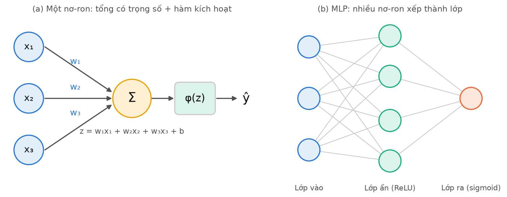

Ví dụ: một nơ-ron có trọng số 0,8 và 0,4, hệ số chặn −0,3, nhận đầu vào (1; 0,5) sẽ tính 0,8·1 + 0,4·0,5 − 0,3 = 0,7, rồi ReLU giữ nguyên 0,7. Hàm kích hoạt phi tuyến là bắt buộc: nếu bỏ nó đi, chồng bao nhiêu lớp tuyến tính cũng chỉ tương đương một phép biến đổi tuyến tính duy nhất.

Mạng được huấn luyện bằng **lan truyền ngược** [@rumelhart1986]: sau khi tính dự báo (lan truyền xuôi), ta áp dụng quy tắc đạo hàm của hàm hợp (chain rule) đi ngược từ đầu ra về đầu vào để biết mỗi trọng số đóng góp bao nhiêu vào sai số. Với sigmoid kết hợp BCE, đạo hàm theo điểm z ở lớp ra rút gọn rất đẹp:

$$\frac{\partial L}{\partial z} = p - y$$ (2.8)

Nếu khách hàng vỡ nợ (y = 1) mà mô hình chỉ cho p = 0,2, đạo hàm bằng −0,8, và cập nhật sẽ đẩy xác suất của mẫu này lên. Trong tiểu luận, trọng số được khởi tạo theo Glorot [@glorot2010] và được cập nhật bằng thuật toán Adam – một biến thể của hạ gradient tự điều chỉnh độ dài bước cho từng tham số [@kingma2015adam].

Khi tự viết lan truyền ngược, rất dễ sai một chỉ số hay một dấu cộng mà chương trình vẫn chạy bình thường. Cách kiểm chứng chuẩn là **kiểm tra gradient**: so đạo hàm giải tích với đạo hàm số tính bằng sai phân trung tâm [@goodfellow2016]:

$$\frac{\partial L}{\partial \theta} \approx \frac{L(\theta + \varepsilon) - L(\theta - \varepsilon)}{2\varepsilon}$$ (2.9)

## 2.8. Đánh giá mô hình phân loại

Kết quả phân loại được tóm tắt trong **ma trận nhầm lẫn** gồm bốn ô: dương thật (TP – phát hiện đúng ca rủi ro), âm giả (FN – bỏ sót ca rủi ro), dương giả (FP – báo động nhầm) và âm thật (TN). Giả sử tập test có 100 hồ sơ, trong đó 10 hồ sơ vỡ nợ; mô hình phát hiện đúng 6, bỏ sót 4 và báo động nhầm 9. Bảng 2.3 tính các thước đo từ ví dụ này.

Bảng 2.3. Các thước đo phân loại, minh họa với TP = 6, FN = 4, FP = 9, TN = 81.
| Thước đo | Công thức | Ý nghĩa | Giá trị |
|---|---|---|---|
| Accuracy | (TP + TN) / N | Tỉ lệ dự báo đúng | 87% |
| Precision | TP / (TP + FP) | Trong số bị báo động, bao nhiêu là thật | 40% |
| Recall | TP / (TP + FN) | Trong số ca rủi ro, phát hiện được bao nhiêu | 60% |
| Specificity | TN / (TN + FP) | Nhận đúng ca an toàn | 90% |
| F1 | 2·Precision·Recall / (Precision + Recall) | Cân bằng precision và recall | 48% |
| Balanced accuracy | (Recall + Specificity) / 2 | Trung bình độ đúng của hai lớp | 75% |

Một mô hình "luôn đoán an toàn" trong ví dụ trên đạt accuracy 90%, cao hơn mô hình đang xét, nhưng recall bằng 0 vì không phát hiện được ca nào. Với dữ liệu mất cân bằng, accuracy vì thế rất dễ gây hiểu lầm. Tiểu luận dùng các thước đo không phụ thuộc tỉ lệ lớp. **ROC-AUC** là xác suất một mẫu dương ngẫu nhiên được mô hình chấm điểm cao hơn một mẫu âm ngẫu nhiên: 0,5 tương đương đoán ngẫu nhiên, 1,0 là hoàn hảo [@hanley1982]. **AP** (average precision) tóm tắt đường precision–recall và nhạy hơn ROC-AUC khi lớp dương rất hiếm [@saito2015]. **Balanced accuracy** là trung bình độ đúng trên hai lớp. ROC-AUC và AP dùng xác suất liên tục nên không phụ thuộc ngưỡng; balanced accuracy, F1 và recall phụ thuộc ngưỡng, và ngưỡng này được chọn trên tập validation.

## 2.9. Dữ liệu thực nghiệm

Chương này dùng hai bộ dữ liệu công khai của kho UCI, đều đại diện cho các quyết định đầu tư có thật (Bảng 2.4; Bảng 2.5 trích ba dòng đầu của mỗi bộ).

- **Phá sản doanh nghiệp Đài Loan** ([archive.ics.uci.edu/dataset/572](https://archive.ics.uci.edu/dataset/572/taiwanese+bankruptcy+prediction)) [@uci572]: 95 chỉ số tài chính (khả năng sinh lời, đòn bẩy, thanh khoản, dòng tiền…) của các doanh nghiệp niêm yết giai đoạn 1999–2009; nhãn 1 nếu doanh nghiệp phá sản theo quy định của Sở Giao dịch Chứng khoán Đài Loan [@liang2016]. Đây là bài toán **sàng lọc cổ phiếu và trái phiếu** của nhà đầu tư theo phân tích cơ bản.
- **Vỡ nợ thẻ tín dụng Đài Loan** ([archive.ics.uci.edu/dataset/350](https://archive.ics.uci.edu/dataset/350/default+of+credit+card+clients)) [@uci350]: 23 đặc trưng của 30.000 khách hàng (hạn mức, nhân khẩu học, trạng thái trả nợ 6 tháng, dư nợ và số tiền đã trả); nhãn 1 nếu vỡ nợ ở tháng kế tiếp [@yeh2009]. Đây là bài toán **đầu tư tín dụng**: ngân hàng hay nhà đầu tư cho vay ngang hàng cần biết khoản vay nào rủi ro.

Bảng 2.4. Hai bộ dữ liệu bảng của Chương 2 (số liệu kiểm kê trực tiếp từ file tải về).
| Thuộc tính | Phá sản doanh nghiệp | Vỡ nợ thẻ tín dụng |
|---|---|---|
| Nguồn | UCI, mã 572 [@uci572] | UCI, mã 350 [@uci350] |
| Đơn vị quan sát | Một doanh nghiệp niêm yết (Đài Loan, 1999–2009) | Một khách hàng thẻ tín dụng (Đài Loan, 2005) |
| Số dòng × số đặc trưng | 6.819 × 95 | 30.000 × 23 |
| Nhãn dương (lớp 1) | Phá sản: 220 (3,23%) | Vỡ nợ tháng sau: 6.636 (22,12%) |
| Ô dữ liệu thiếu | 0 | 0 |
| Giấy phép | CC BY 4.0 | CC BY 4.0 |

Bảng 2.5. Ba dòng đầu của mỗi bộ dữ liệu (trích ba – bốn đặc trưng; nhãn 1 là có rủi ro).
| Bộ dữ liệu | Dòng | Nhãn | Một số đặc trưng |
|---|---|---|---|
| Phá sản doanh nghiệp | 1 | 1 | ROA(C) = 0,3706; tỷ lệ nợ = 0,2076; lãi ròng/tổng tài sản = 0,7168 |
| Phá sản doanh nghiệp | 2 | 1 | ROA(C) = 0,4643; tỷ lệ nợ = 0,1712; lãi ròng/tổng tài sản = 0,7953 |
| Phá sản doanh nghiệp | 3 | 1 | ROA(C) = 0,4261; tỷ lệ nợ = 0,2075; lãi ròng/tổng tài sản = 0,7747 |
| Vỡ nợ thẻ tín dụng | 1 | 1 | hạn mức = 20.000 TWD; tuổi = 24; PAY_0 = 2; dư nợ tháng 9 = 3.913 TWD |
| Vỡ nợ thẻ tín dụng | 2 | 1 | hạn mức = 120.000 TWD; tuổi = 26; PAY_0 = -1; dư nợ tháng 9 = 2.682 TWD |
| Vỡ nợ thẻ tín dụng | 3 | 0 | hạn mức = 90.000 TWD; tuổi = 34; PAY_0 = 0; dư nợ tháng 9 = 29.239 TWD |

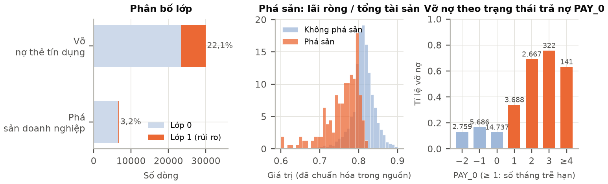

**Nhận xét.** Hai bộ dữ liệu đều **mất cân bằng**: chỉ 3,23% doanh nghiệp phá sản và 22,12% khách hàng vỡ nợ. Một mô hình luôn đoán "an toàn" đạt accuracy 96,77% và 77,88% mà không phát hiện được rủi ro nào, nên accuracy không được dùng làm thước đo chính. Hình 2.2 cho thấy dữ liệu chứa tín hiệu rõ: doanh nghiệp phá sản tập trung ở vùng lãi ròng trên tổng tài sản thấp; tỉ lệ vỡ nợ khoảng 13–17% ở nhóm trả đúng hạn, nhưng tăng lên 34% khi trễ hạn một tháng và khoảng 70% khi trễ từ hai tháng (PAY_0 ≥ 2). Khi khảo sát dữ liệu còn phát hiện ba điểm cần lưu ý. Thứ nhất, 71/95 chỉ số của bộ phá sản nằm trong khoảng [0, 1], nhưng 24 chỉ số còn lại trộn hai thang đo: phần lớn giá trị nhỏ, xen lẫn giá trị cực lớn tới 10¹⁰ (chẳng hạn 88% giá trị của tốc độ tăng tổng tài sản vượt 1.000). Đây là dấu hiệu của khác biệt đơn vị hoặc mã lỗi ở nguồn; ảnh hưởng của nó được kiểm tra riêng ở mục 2.11. Thứ hai, các cột như giới tính, học vấn, trạng thái trả nợ là mã nhóm chứ không phải số đo; tiểu luận giữ chúng ở dạng số cho cả ba mô hình để phép so sánh công bằng. Thứ ba, cả hai bộ dữ liệu không có ô thiếu.

**Tiền xử lý và chia dữ liệu.** Mỗi dòng là một doanh nghiệp hay một khách hàng độc lập, không có trục thời gian, nên dữ liệu được chia ngẫu nhiên **phân tầng** theo tỉ lệ 60/20/20 (giữ tỉ lệ nhãn như nhau ở ba tập, hạt giống 2026). Giá trị trung vị để điền khuyết và trung bình, độ lệch chuẩn để chuẩn hóa z = (x − μ)/σ đều chỉ tính trên tập train rồi áp dụng nguyên cho validation và test (Bảng 2.6).

Bảng 2.6. Kích thước các tập sau khi chia phân tầng 60/20/20 (trong ngoặc: tỉ lệ lớp dương).
| Bộ dữ liệu | Train | Validation | Test |
|---|---|---|---|
| Phá sản doanh nghiệp | 4.091 (3,2%) | 1.364 (3,2%) | 1.364 (3,2%) |
| Vỡ nợ thẻ tín dụng | 18.000 (22,1%) | 6.000 (22,1%) | 6.000 (22,1%) |

## 2.10. Cài đặt bằng ba cách: NumPy, Keras và PyTorch

Mô hình đại diện của chương là MLP có một lớp ẩn 16 nơ-ron: d đầu vào → Dense(16) → ReLU → Dense(1) → logit, với hàm mất mát BCE (2.5). Cùng một kiến trúc được cài đặt theo ba cách. Bản **NumPy tự viết** [@harris2020numpy] cài đặt thủ công từng phép tính xuôi và ngược. Bản **Keras** (giao diện cấp cao của TensorFlow [@chollet2015keras; @abadi2016]) chỉ cần khai báo các lớp. Bản **PyTorch** [@paszke2019] khai báo mô hình và tự viết vòng huấn luyện, để thư viện tự tính đạo hàm. Đoạn mã dưới trích từ mã nguồn thực nghiệm (thư mục `src/tieuluan`).

Lớp kết nối đầy đủ tự viết: lan truyền xuôi y = xWᵀ + b, lan truyền ngược trả về gradient của trọng số, hệ số chặn và đầu vào.

```python
class Dense(Module):
    def forward(self, x):
        self._x = x
        return x @ self.weight.value.T + self.bias.value
    def backward(self, grad):                      # grad = ∂L/∂y
        self.weight.grad += grad.T @ self._x         # ∂L/∂W
        self.bias.grad += grad.sum(axis=0)           # ∂L/∂b
        return grad @ self.weight.value              # ∂L/∂x, chuyển cho lớp trước
```

Cùng MLP trong Keras và PyTorch:

```python
# Keras (backend TensorFlow)
inputs = keras.Input(shape=(d,))
z = keras.layers.Dense(16, activation="relu")(inputs)
model = keras.Model(inputs, keras.layers.Dense(1)(z))
# PyTorch
model = nn.Sequential(nn.Linear(d, 16), nn.ReLU(), nn.Linear(16, 1))
loss = nn.BCEWithLogitsLoss()(model(x), y); loss.backward(); optimizer.step()
```

**Thiết kế để so sánh công bằng.** Nếu mỗi thư viện tự khởi tạo trọng số theo cách riêng, khác biệt cuối cùng có thể chỉ do "điểm xuất phát" khác nhau. Vì vậy trọng số được rút **một lần** bằng NumPy rồi chép nguyên sang Keras và PyTorch; cả ba dùng cùng thứ tự mini-batch, cùng Adam (tốc độ học 0,001), cùng cắt chuẩn gradient ở mức 1,0, batch 64, tối đa 60 epoch và dừng sớm khi BCE trên validation không giảm sau 8 epoch. Mỗi cấu hình chạy với ba hạt giống 11, 22, 33. Môi trường gồm Python 3.12.0, NumPy 2.5.2, Keras 3.15.1 với TensorFlow 2.21.0, PyTorch 2.13.0 và scikit-learn 1.9.0 [@pedregosa2011], chạy trên CPU.

**Kiểm chứng tính đúng.** Kiểm tra gradient (2.9) trên MLP tự viết cho sai số tương đối lớn nhất 2,0 × 10⁻⁸. Trước huấn luyện, với cùng trọng số và cùng đầu vào, logit của ba bản cài đặt lệch nhau tối đa 2,4 × 10⁻⁷, đúng bằng cỡ sai số làm tròn của số thực 32-bit.

## 2.11. Kết quả và thảo luận

**So sánh ba bản cài đặt.** Bảng 2.7 và Hình 2.3 cho thấy ba bản cài đặt cho kết quả gần như đồng nhất. Bản NumPy và PyTorch dừng ở cùng epoch với cả ba hạt giống, ROC-AUC theo từng hạt giống chênh nhau dưới 0,0001; sau huấn luyện, xác suất dự báo của chúng trên tập test chỉ lệch tối đa 4,6 × 10⁻⁷ (bộ phá sản). Bản Keras lệch nhiều hơn một chút: ROC-AUC chênh tối đa 0,0011, xác suất lệch tới 1,1 × 10⁻², và đôi khi dừng ở epoch khác. Nguyên nhân là Keras đặt hằng số ε của Adam ở vị trí hơi khác và thực hiện phép toán theo thứ tự khác; sai khác cực nhỏ ở mỗi bước tích lũy dần qua hàng nghìn lần cập nhật. Về tốc độ, bản NumPy nhanh nhất trên mạng rất nhỏ này vì không phải trả chi phí điều phối của thư viện cho mỗi batch; kết quả này chỉ đúng với mô hình nhỏ chạy trên CPU và không phải bảng xếp hạng chung về tốc độ của các thư viện.

Bảng 2.7. Cùng một MLP cài đặt bằng ba cách (trung bình ± độ lệch chuẩn qua 3 seed, đánh giá trên test).
| Dữ liệu | Cài đặt | ROC-AUC | AP | Balanced acc. | Tham số | Epoch tốt nhất | Giây/lượt |
|---|---|---|---|---|---|---|---|
| Phá sản doanh nghiệp | NumPy tự viết | 0,926 ± 0,004 | 0,507 ± 0,054 | 0,878 ± 0,021 | 1.553 | 37/28/31 | 0,7 |
| Phá sản doanh nghiệp | PyTorch | 0,926 ± 0,004 | 0,507 ± 0,054 | 0,878 ± 0,021 | 1.553 | 37/28/31 | 3,2 |
| Phá sản doanh nghiệp | Keras | 0,927 ± 0,004 | 0,508 ± 0,053 | 0,877 ± 0,021 | 1.553 | 37/28/31 | 7,1 |
| Vỡ nợ thẻ tín dụng | NumPy tự viết | 0,778 ± 0,001 | 0,552 ± 0,001 | 0,712 ± 0,002 | 401 | 39/21/27 | 2,2 |
| Vỡ nợ thẻ tín dụng | PyTorch | 0,778 ± 0,001 | 0,553 ± 0,001 | 0,713 ± 0,002 | 401 | 39/21/27 | 11,0 |
| Vỡ nợ thẻ tín dụng | Keras | 0,778 ± 0,001 | 0,552 ± 0,002 | 0,711 ± 0,003 | 401 | 39/21/40 | 24,7 |

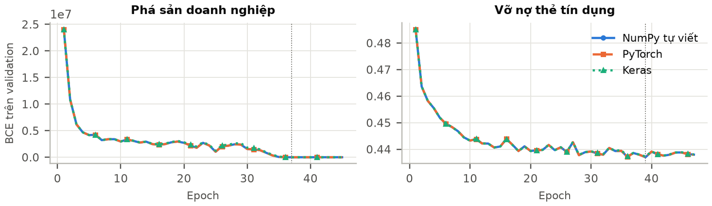

**So sánh ba thuật toán.** Bảng 2.8 và Hình 2.4 so sánh hồi quy logistic, rừng ngẫu nhiên và MLP với đường cơ sở luôn đoán lớp đa số. Cả ba mô hình đều vượt xa đường cơ sở (AUC 0,5), với khoảng tin cậy 95% nằm hoàn toàn trên 0,7. Ở bộ phá sản, rừng ngẫu nhiên tốt nhất với AUC 0,975, so với 0,926 của MLP và 0,918 của hồi quy logistic. Tuy nhiên, khoảng tin cậy của hiệu AUC giữa rừng ngẫu nhiên và MLP là 0,044 [−0,001; 0,110], vẫn chạm 0: với chỉ 44 doanh nghiệp phá sản trong tập test, chưa đủ bằng chứng để khẳng định ưu thế. Ở bộ vỡ nợ, rừng ngẫu nhiên (0,781) và MLP (0,778) gần như ngang nhau và cùng vượt hồi quy logistic (0,738); hiệu AUC giữa MLP và logistic là 0,044 [0,032; 0,057], khác 0 có ý nghĩa thống kê. Điều này cho thấy quan hệ giữa các đặc trưng và rủi ro vỡ nợ có tính phi tuyến, như bước nhảy của tỉ lệ vỡ nợ theo PAY_0 ở Hình 2.2.

Bảng 2.8. So sánh ba thuật toán trên tập test. CI 95%: bootstrap phân tầng 2.000 lần cho dự báo trung bình 3 seed.
| Bộ dữ liệu | Mô hình | ROC-AUC | AUC [CI 95%] | AP | Balanced acc. | Recall lớp 1 |
|---|---|---|---|---|---|---|
| Phá sản doanh nghiệp | Hồi quy logistic | 0,918 ± 0,000 | 0,918 [0,851; 0,969] | 0,465 ± 0,000 | 0,869 ± 0,000 | 0,818 ± 0,000 |
| Phá sản doanh nghiệp | Rừng ngẫu nhiên | 0,975 ± 0,001 | 0,976 [0,957; 0,989] | 0,600 ± 0,022 | 0,921 ± 0,005 | 0,962 ± 0,013 |
| Phá sản doanh nghiệp | MLP | 0,926 ± 0,004 | 0,931 [0,867; 0,977] | 0,507 ± 0,054 | 0,878 ± 0,021 | 0,856 ± 0,073 |
| Phá sản doanh nghiệp | Cơ sở: luôn đoán lớp đa số | 0,500 | — | 0,032 | 0,500 | 0,000 |
| Vỡ nợ thẻ tín dụng | Hồi quy logistic | 0,738 ± 0,000 | 0,738 [0,720; 0,754] | 0,520 ± 0,000 | 0,700 ± 0,000 | 0,585 ± 0,000 |
| Vỡ nợ thẻ tín dụng | Rừng ngẫu nhiên | 0,781 ± 0,000 | 0,782 [0,766; 0,796] | 0,561 ± 0,001 | 0,718 ± 0,002 | 0,622 ± 0,027 |
| Vỡ nợ thẻ tín dụng | MLP | 0,778 ± 0,001 | 0,782 [0,766; 0,796] | 0,553 ± 0,001 | 0,713 ± 0,002 | 0,626 ± 0,054 |
| Vỡ nợ thẻ tín dụng | Cơ sở: luôn đoán lớp đa số | 0,500 | — | 0,221 | 0,500 | 0,000 |

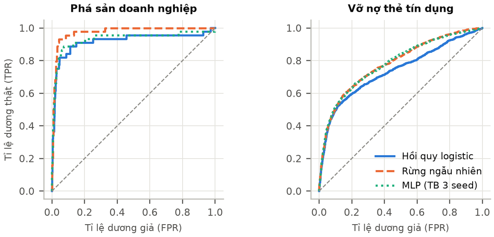

Kết quả phù hợp với nhận định của Grinsztajn và cộng sự: trên dữ liệu bảng cỡ vừa, mô hình dạng cây là đối thủ rất mạnh của học sâu [@grinsztajn2022]. Về mặt thực tiễn, với ngưỡng chọn trên validation, MLP phát hiện được trung bình 85,6% số doanh nghiệp phá sản và 62,6% số khách hàng vỡ nợ trong tập test. Đổi lại là một tỉ lệ báo động nhầm đáng kể: đây chính là đánh đổi giữa chi phí bỏ sót một khoản vay xấu và chi phí từ chối nhầm một khách hàng tốt.

**Độ nhạy theo cách tiền xử lý.** Mục 2.9 đã chỉ ra rằng 24 chỉ số của bộ phá sản trộn hai thang đo, còn các cột số tiền của bộ vỡ nợ lệch phải rất mạnh. Để kiểm tra kết luận trên có phụ thuộc vào cách xử lý này hay không, ba thuật toán được huấn luyện lại sau khi biến đổi log có dấu x′ = sign(x)·ln(1 + |x|) trước bước chuẩn hóa, giữ nguyên cách chia dữ liệu và mọi thiết lập khác (Bảng 2.9). Rừng ngẫu nhiên gần như không đổi, đúng như lý thuyết: cây chỉ so sánh thứ tự các giá trị nên không bị ảnh hưởng bởi một phép biến đổi đơn điệu. Hồi quy logistic cải thiện ở bộ vỡ nợ (0,738 → 0,754) vì phép log làm các cột số tiền bớt lệch, nhưng giảm nhẹ ở bộ phá sản (0,918 → 0,908). MLP thay đổi chưa tới 0,01. Thứ hạng của ba thuật toán vì thế được giữ nguyên, và ưu thế của rừng ngẫu nhiên ở bộ phá sản không phải là hệ quả của cách xử lý thang đo.

Bảng 2.9. Độ nhạy theo tiền xử lý: ROC-AUC trên test khi chuẩn hóa trực tiếp (thực nghiệm chính) và khi biến đổi log có dấu trước khi chuẩn hóa.
| Bộ dữ liệu | Mô hình | AUC – chuẩn hóa trực tiếp | AUC – log rồi chuẩn hóa | AUC log [CI 95%] |
|---|---|---|---|---|
| Phá sản doanh nghiệp | Hồi quy logistic | 0,918 | 0,908 | 0,908 [0,839; 0,962] |
| Phá sản doanh nghiệp | Rừng ngẫu nhiên | 0,975 | 0,975 | 0,975 [0,956; 0,989] |
| Phá sản doanh nghiệp | MLP | 0,926 | 0,920 | 0,939 [0,883; 0,974] |
| Vỡ nợ thẻ tín dụng | Hồi quy logistic | 0,738 | 0,754 | 0,754 [0,738; 0,770] |
| Vỡ nợ thẻ tín dụng | Rừng ngẫu nhiên | 0,781 | 0,781 | 0,782 [0,766; 0,796] |
| Vỡ nợ thẻ tín dụng | MLP | 0,778 | 0,780 | 0,782 [0,767; 0,796] |

## 2.12. Xu hướng mới: mô hình nền tảng cho dữ liệu bảng

Nếu học sâu từng thua cây trên dữ liệu bảng, thì giai đoạn 2025–2026 chứng kiến một hướng tiếp cận khác: **mô hình nền tảng cho dữ liệu bảng**. TabPFN, công bố trên tạp chí *Nature* tháng 01/2025, là một Transformer được tiền huấn luyện trên hàng triệu bài toán bảng tổng hợp. Khi gặp bảng dữ liệu mới, nó không cần huấn luyện lại mà "đọc" các dòng có nhãn như ngữ cảnh rồi dự báo dòng mới ngay trong một lần suy luận; với bảng đến 10.000 mẫu, nó vượt các mô hình cây đã được tinh chỉnh nhiều giờ [@hollmann2025]. TabPFN-2.5 (11/2025) mở rộng giới hạn lên 50.000 mẫu và 2.000 đặc trưng [@tabpfn25], đủ bao trùm cả bộ dữ liệu vỡ nợ 30.000 dòng của chương này. Ở hướng khác, TabM (ICLR 2025) cho thấy một MLP được "tổ hợp hóa" khéo léo, nhiều nhánh dùng chung phần lớn tham số, có thể cạnh tranh với cây [@gorishniy2025tabm]; mạng Kolmogorov–Arnold (KAN) đề xuất đặt hàm kích hoạt học được lên các cạnh thay vì nút của mạng [@liu2025kan]. Thử nghiệm TabPFN-2.5 trên hai bộ dữ liệu rủi ro là một hướng mở rộng tự nhiên của chương này.

## 2.13. Tiểu kết chương

Chương 2 đã trình bày các viên gạch nền của học máy: quy trình train – validation – test, hàm mất mát và hạ gradient, hồi quy logistic, cây và rừng ngẫu nhiên, MLP và lan truyền ngược, cùng các thước đo phù hợp cho dữ liệu mất cân bằng. Thực nghiệm trên hai bộ dữ liệu rủi ro cho thấy ba điều. Thứ nhất, một MLP tự viết bằng NumPy, nếu được kiểm tra gradient cẩn thận, cho kết quả trùng với Keras và PyTorch. Thứ hai, trên dữ liệu bảng, rừng ngẫu nhiên là đối thủ rất mạnh: tốt nhất ở bộ phá sản và ngang MLP ở bộ vỡ nợ. Thứ ba, khi có tín hiệu thật, như lịch sử trả nợ, cả ba thuật toán đạt ROC-AUC từ 0,738 đến 0,975, cao hơn hẳn mức 0,5 của đoán ngẫu nhiên. Câu hỏi của hai chương tiếp theo khó hơn nhiều: liệu tín hiệu như vậy có tồn tại trong chính chuỗi giá thị trường hay không.


Các nguyên tắc đánh giá ở chương này được dùng cho phần mở rộng: không dùng dữ liệu chuẩn của đánh giá làm đầu vào triển khai, tách kiểm tra phần mềm khỏi đánh giá mô hình và phân biệt đầu ra tính toán với đầu ra sinh. Với yêu cầu CNN, RNN và LSTM trên 5 lớp, kiến trúc sáu lớp và mã ba công cụ được bổ sung trong Chương 3–4 và Phụ lục C.


# CHƯƠNG 3. MẠNG NƠ-RON TÍCH CHẬP (CNN)

## 3.1. Vì sao cần mạng tích chập?

MLP ở Chương 2 nối **mọi** đầu vào với **mọi** nơ-ron. Với dữ liệu bảng vài chục cột, điều đó không thành vấn đề. Nhưng một ảnh xám nhỏ 20 × 20 đã có 400 điểm ảnh; nối thẳng tới 64 nơ-ron ẩn cần 400 × 64 + 64 = 25.664 tham số. Với ảnh màu 224 × 224, con số đó vượt chín triệu cho riêng lớp đầu. Tệ hơn, MLP coi một nét gạch ở góc trái và cùng nét gạch đó ở giữa ảnh là hai thứ hoàn toàn khác nhau, nên phải học lại từ đầu ở mỗi vị trí.

Mạng nơ-ron tích chập (convolutional neural network – CNN) giải quyết vấn đề bằng hai ý tưởng lấy cảm hứng từ thị giác sinh học. Hubel và Wiesel phát hiện mỗi tế bào ở vỏ não thị giác chỉ phản ứng với một vùng nhỏ của trường nhìn [@hubel1962]; Fukushima hiện thực hóa ý tưởng này trong mạng Neocognitron [@fukushima1980]; LeCun và cộng sự kết hợp nó với lan truyền ngược thành LeNet [@lecun1998]. Ý tưởng thứ nhất là **kết nối cục bộ**: mỗi nơ-ron chỉ nhìn một vùng nhỏ của ảnh. Ý tưởng thứ hai là **dùng chung trọng số**: cùng một bộ lọc nhỏ được trượt qua mọi vị trí, nên một mẫu hình học được ở một chỗ sẽ được nhận ra ở mọi chỗ khác.

> **Hiểu nhanh.** CNN giống một người cầm kính lúp soi từng ô nhỏ của bức ảnh để tìm một chi tiết quen thuộc, chẳng hạn một cạnh thẳng hay một góc nhọn. Mỗi "chiếc kính lúp" (bộ lọc) chuyên tìm một loại chi tiết. Các lớp đầu tìm chi tiết đơn giản; các lớp sau ghép chúng thành hình phức tạp hơn, như nét ghép thành chữ và chữ ghép thành từ.

## 3.2. Phép tích chập

### 3.2.1. Bộ lọc trượt trên ảnh

Một **bộ lọc** (kernel) là một bảng trọng số nhỏ, ví dụ 3 × 3. Đặt bộ lọc lên một vùng của ảnh, nhân từng cặp số tương ứng rồi cộng lại (cộng thêm hệ số chặn b) ta được một số. Trượt bộ lọc sang vị trí kế tiếp và lặp lại, ta thu được một **bản đồ đặc trưng** (feature map). Với ảnh nhiều kênh (ảnh màu có 3 kênh), bộ lọc có độ sâu bằng số kênh và tổng được lấy trên cả các kênh:

$$Y[i,j] = \sum_{c}\sum_{u}\sum_{v} X[c,\,i+u,\,j+v]\;K[c,u,v] + b$$ (3.1)

Hình 3.1 minh họa phép tính trên ảnh 3 × 3 với bộ lọc 2 × 2. Ô đầu tiên của đầu ra bằng 1·1 + 2·0 + 0·0 + 1·(−1) = 0; trượt sang phải ta được 2·1 + 0·0 + 1·0 + 3·(−1) = −1; tương tự hai ô hàng dưới là −1 và 1. Bộ lọc này cho giá trị lớn khi điểm ảnh trên-trái sáng hơn điểm ảnh dưới-phải, tức nó là một "máy dò" cạnh chéo đơn giản. Trong CNN, các trọng số bộ lọc không do con người chọn mà được **học** từ dữ liệu. Về mặt toán học, phép tính trong các thư viện là tương quan chéo (không lật bộ lọc), nhưng theo thông lệ vẫn được gọi là tích chập [@goodfellow2016].

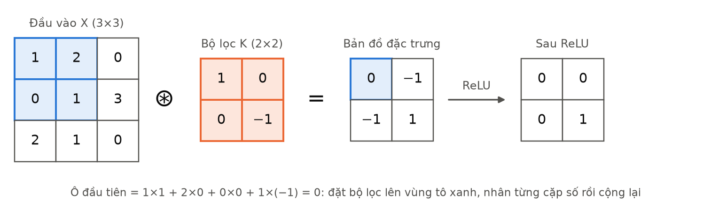

### 3.2.2. Số tham số và tính dùng chung trọng số

Một lớp tích chập có C_in kênh vào, C_out bộ lọc kích thước K × K thì có (K·K·C_in + 1)·C_out tham số. Ví dụ, 8 bộ lọc 3 × 3 trên ảnh một kênh chỉ cần (9 + 1)·8 = 80 tham số, bất kể ảnh lớn đến đâu. So với 25.664 tham số của MLP ở mục 3.1, mức tiết kiệm là hơn 300 lần. Đây chính là lợi ích của việc dùng chung trọng số.

### 3.2.3. Bước trượt, phần đệm và kích thước đầu ra

**Bước trượt** S (stride) là số ô bộ lọc dịch sau mỗi lần tính; S = 2 làm đầu ra nhỏ đi khoảng một nửa. **Phần đệm** P (padding) là số hàng/cột số 0 thêm quanh viền để giữ kích thước hoặc để các điểm ở mép được xét đủ. Với ảnh cạnh N, bộ lọc cạnh K, kích thước đầu ra là [@dumoulin2016]:

$$O = \left\lfloor \frac{N + 2P - K}{S} \right\rfloor + 1$$ (3.2)

Bảng 3.1 áp dụng công thức này cho ảnh 20 × 20 dùng trong thực nghiệm.

Bảng 3.1. Kích thước đầu ra của một kênh với ảnh vào 20 × 20 (tính theo công thức 3.2).
| Bộ lọc K | Bước S | Đệm P | Đầu ra | Ghi chú |
|---|---|---|---|---|
| 3 × 3 | 1 | 0 | 18 × 18 | Cấu hình "valid" dùng trong thực nghiệm |
| 3 × 3 | 1 | 1 | 20 × 20 | Cấu hình "same": giữ nguyên kích thước |
| 3 × 3 | 2 | 0 | 9 × 9 | Bước 2 giảm kích thước khoảng một nửa |
| 5 × 5 | 1 | 0 | 16 × 16 | Bộ lọc lớn hơn nhìn vùng rộng hơn |

### 3.2.4. Vùng tiếp nhận

**Vùng tiếp nhận** (receptive field) của một nơ-ron là phần ảnh đầu vào có thể ảnh hưởng tới nó. Một lớp 3 × 3 nhìn vùng 3 × 3; hai lớp 3 × 3 chồng lên nhau nhìn vùng 5 × 5; ba lớp nhìn vùng 7 × 7. Nhờ vậy, mạng sâu ghép các mẫu nhỏ thành cấu trúc lớn mà mỗi bộ lọc vẫn nhỏ và ít tham số. Đây là ý tưởng cốt lõi của các kiến trúc như VGG [@simonyan2015].

## 3.3. Hàm kích hoạt, phép gộp và lớp phân loại

Sau mỗi lớp tích chập, giá trị đi qua hàm kích hoạt phi tuyến, phổ biến nhất là ReLU, giữ số dương và đưa số âm về 0 (ô cuối Hình 3.1). Tiếp theo thường là lớp **gộp** (pooling) để giảm kích thước và giữ lại phản ứng nổi bật. Gộp cực đại (max pooling) 2 × 2 lấy giá trị lớn nhất trong mỗi ô 2 × 2; với vùng [[1, 3], [2, 0]], gộp cực đại cho 3, còn gộp trung bình cho 1,5. Phép gộp không có tham số nhưng giúp mạng ít nhạy với dịch chuyển nhỏ của mẫu hình. Cuối cùng, các bản đồ đặc trưng được **duỗi phẳng** (flatten) thành một vector rồi đưa qua lớp kết nối đầy đủ và hàm sigmoid để ra xác suất, giống phần cuối của MLP ở Chương 2.

**Bốn kỹ thuật thường đi kèm CNN.** **Chuẩn hóa theo lô** (batch normalization) chuẩn hóa đầu ra của mỗi lớp trong từng mini-batch về trung bình 0, phương sai 1 rồi học thêm hệ số co giãn, giúp mạng sâu huấn luyện ổn định và nhanh hơn [@ioffe2015]. **Dropout** ngẫu nhiên "tắt" một phần nơ-ron (ví dụ một nửa) trong lúc huấn luyện, buộc mạng không dựa vào vài nơ-ron duy nhất và giảm hiện tượng học thuộc [@srivastava2014]. **Tăng cường dữ liệu** (data augmentation) tạo thêm ảnh huấn luyện bằng cách lật, xoay, cắt hoặc đổi độ sáng ảnh gốc [@shorten2019]. **Học chuyển giao** (transfer learning) dùng lại các bộ lọc đã học trên tập rất lớn như ImageNet rồi chỉ huấn luyện lại phần cuối cho bài toán mới, rất hữu ích khi dữ liệu ít [@yosinski2014]. Thư viện NumPy tự viết của tiểu luận có cài sẵn chuẩn hóa theo lô và Dropout; CNN4 đủ nhỏ nên thực nghiệm không cần dùng. Với ảnh GASF của chuỗi giá, lật hoặc xoay ảnh tương đương đảo ngược thứ tự thời gian của chuỗi, làm đổi ý nghĩa của nhãn, nên tăng cường dữ liệu kiểu này không phù hợp.

## 3.4. Huấn luyện CNN và kỹ thuật im2col

CNN được huấn luyện bằng lan truyền ngược như MLP, với một điểm đặc biệt: vì mỗi trọng số của bộ lọc được dùng ở **mọi** vị trí, gradient của nó là **tổng** đóng góp từ mọi vị trí. Ví dụ, nếu trọng số w nhân với các điểm ảnh 2, 1 và −1 ở ba vị trí, và gradient từ lớp sau tại ba vị trí đều bằng 1, thì ∂L/∂w = 2 + 1 − 1 = 2; với tốc độ học 0,01, w = 0,50 được cập nhật thành 0,48. Qua lớp gộp cực đại, gradient chỉ đi về đúng vị trí đã đạt cực đại; qua ReLU, gradient bị chặn ở những nơi đầu vào âm.

Cài đặt tích chập bằng bốn vòng lặp lồng nhau trong Python rất chậm. Bản NumPy của tiểu luận dùng kỹ thuật **im2col**: mỗi vùng ảnh mà bộ lọc phủ lên được "duỗi" thành một hàng của một ma trận lớn, nhờ đó cả phép tích chập trở thành **một phép nhân ma trận** – thao tác mà NumPy thực hiện rất nhanh. Lan truyền ngược làm điều ngược lại ("col2im"): cộng gradient của từng vị trí trong bộ lọc trở về đúng điểm ảnh gốc. Đoạn mã dưới trích từ lớp `Conv2d` tự viết:

```python
# windows: mọi vùng KH×KW của ảnh, lấy bằng "cửa sổ trượt" không sao chép dữ liệu
windows = as_strided(xp, shape=(n, oh, ow, c, kh, kw), strides=(...))
cols = windows.reshape(n * oh * ow, c * kh * kw)          # im2col: mỗi vùng là một hàng
out = cols @ self.weight.value.reshape(f, -1).T + self.bias.value
# lan truyền ngược: gradient trọng số cũng chỉ là một phép nhân ma trận
self.weight.grad += (g.T @ cols).reshape(self.weight.value.shape)
```

Kiểm tra gradient (công thức 2.9) trên mạng tích chập tự viết cho sai số tương đối lớn nhất 6,8 × 10⁻⁸, khẳng định phần lan truyền ngược được cài đặt đúng.

## 3.5. Các kiến trúc CNN tiêu biểu và xu hướng mới

Bảng 3.2 tóm tắt những bước tiến chính. LeNet-5 đặt nền móng cho mẫu "tích chập – gộp – kết nối đầy đủ" [@lecun1998]. AlexNet chứng minh sức mạnh của mạng sâu khi có GPU và dữ liệu lớn [@krizhevsky2012]. VGG cho thấy chồng nhiều bộ lọc 3 × 3 là đủ [@simonyan2015]. GoogLeNet ghép nhiều kích thước bộ lọc song song [@szegedy2015]. ResNet thêm **kết nối tắt** (đầu ra = đầu vào + phần dư) để huấn luyện được mạng hàng trăm lớp [@he2016]. EfficientNet tìm cách tăng đồng thời chiều sâu, chiều rộng và độ phân giải [@tan2019].

Năm 2021, Vision Transformer (ViT) cho thấy kiến trúc Transformer áp lên các mảnh ảnh có thể vượt CNN khi được huấn luyện trên dữ liệu rất lớn [@dosovitskiy2021], làm dấy lên câu hỏi CNN còn cần thiết không. Câu trả lời của cộng đồng là "có": ConvNeXt (2022) hiện đại hóa ResNet theo các lựa chọn thiết kế của Transformer và đạt kết quả ngang bằng [@liu2022convnext]; ConvNeXt V2 (2023) bổ sung tiền huấn luyện tự giám sát [@woo2023convnextv2]. Đến năm 2025, MambaOut (CVPR 2025) chỉ ra rằng với bài toán phân loại ảnh, có thể bỏ hẳn khối Mamba (mô hình không gian trạng thái) khỏi các kiến trúc thị giác dựa trên Mamba mà kết quả còn tốt hơn; mô hình thu được chủ yếu dựa trên tích chập [@yu2025mambaout]. CNN cũng được dùng cho chuỗi thời gian: mạng tích chập thời gian (TCN) cạnh tranh tốt với mạng hồi quy [@bai2018tcn], còn TimesNet (ICLR 2023) biến chuỗi một chiều thành ảnh hai chiều theo chu kỳ rồi xử lý bằng tích chập 2D [@wu2023timesnet]. Ý tưởng "biến chuỗi thành ảnh" này cũng chính là cách tiếp cận của thực nghiệm trong chương.

Bảng 3.2. Một số kiến trúc CNN tiêu biểu.
| Năm | Kiến trúc | Ý tưởng chính | Bài học |
|---|---|---|---|
| 1998 | LeNet-5 [@lecun1998] | Tích chập – gộp – kết nối đầy đủ | Khuôn mẫu chung của CNN |
| 2012 | AlexNet [@krizhevsky2012] | Mạng sâu, ReLU, huấn luyện trên GPU | Dữ liệu lớn và GPU tạo đột phá |
| 2015 | VGG [@simonyan2015] | Chồng nhiều bộ lọc 3 × 3 | Bộ lọc nhỏ, mạng sâu |
| 2016 | ResNet [@he2016] | Kết nối tắt học phần dư | Huấn luyện được hàng trăm lớp |
| 2019 | EfficientNet [@tan2019] | Mở rộng cân đối sâu–rộng–phân giải | Hiệu quả trên mỗi tham số |
| 2022 | ConvNeXt [@liu2022convnext] | CNN thiết kế lại theo Transformer | CNN vẫn cạnh tranh với ViT |
| 2025 | MambaOut [@yu2025mambaout] | Bỏ khối Mamba, giữ tích chập | Tích chập vẫn rất mạnh cho ảnh |

## 3.6. CNN trong tài chính: bài học từ "(Re-)Imag(in)ing Price Trends"

Nghiên cứu nổi bật nhất về CNN trong đầu tư là công trình của Jiang, Kelly và Xiu đăng trên *The Journal of Finance* năm 2023 [@jiang2023]. Thay vì để nhà nghiên cứu tự định nghĩa tín hiệu kỹ thuật (đường trung bình, động lượng…), các tác giả vẽ lịch sử giá của từng cổ phiếu thành **ảnh đen trắng** giống biểu đồ mà nhà phân tích kỹ thuật vẫn xem, rồi để CNN tự học mẫu hình nào báo hiệu giá sắp tăng. Bảng 3.3 tóm tắt thiết kế và kết quả chính.

Bảng 3.3. Tóm tắt nghiên cứu của Jiang, Kelly và Xiu (2023).
| Thành phần | Thiết kế / kết quả |
|---|---|
| Dữ liệu | Toàn bộ cổ phiếu NYSE, AMEX, NASDAQ giai đoạn 1993–2019 |
| Ảnh đầu vào | Thanh giá mở – cao – thấp – đóng (OHLC), mỗi ngày rộng 3 điểm ảnh, kèm đường trung bình động và khối lượng; ảnh 5, 20, 60 ngày có kích thước 32 × 15, 64 × 60, 96 × 180 điểm ảnh |
| Nhãn | 1 nếu lợi suất 5, 20 hoặc 60 ngày tiếp theo dương |
| Chia dữ liệu | Huấn luyện và xác thực trên 1993–2000; kiểm tra ngoài mẫu 2001–2019 |
| Mạng CNN | Khối tích chập 5 × 3 → chuẩn hóa theo lô → LeakyReLU → gộp 2 × 1; 64 bộ lọc ở khối đầu, nhân đôi qua mỗi khối; mạng cho ảnh 20 ngày có 708.866 tham số |
| Kết quả | Danh mục mua nhóm 10% cổ phiếu có xác suất tăng cao nhất, bán nhóm 10% thấp nhất theo tuần, trọng số đều: Sharpe năm 7,15 trước chi phí; khoảng 4,0 sau chi phí 10–20 điểm cơ bản |
| So sánh | Vượt các tín hiệu động lượng, đảo chiều; không quy tắc nào trong 7.846 quy tắc kỹ thuật vượt được CNN ở kỳ hạn tuần |

Ba phát hiện của nghiên cứu này đặc biệt có giá trị khi áp dụng vào thị trường như Việt Nam. Thứ nhất, mô hình học trên dữ liệu Mỹ khi **chuyển giao** sang 26 thị trường quốc tế cho kết quả tốt hơn mô hình học tại chỗ ở 21 thị trường, nhưng kém hơn ở Trung Quốc, Ấn Độ và Hàn Quốc. Với các thị trường mới nổi lớn, việc học trên dữ liệu địa phương vẫn quan trọng. Thứ hai, các tác giả cho thấy yếu tố tạo khác biệt chủ yếu là **cách chuẩn hóa** dữ liệu khi vẽ ảnh: một CNN một chiều nhận chuỗi số được chuẩn hóa giống ảnh cho kết quả ngang CNN hai chiều. Nói cách khác, biểu diễn đầu vào quan trọng không kém kiến trúc. Thứ ba, chính các tác giả thừa nhận một mô hình chuỗi thời gian được thiết kế tốt như LSTM có thể vượt CNN, nên kết quả của họ chỉ là "cận dưới" của những gì học máy có thể khai thác [@jiang2023]. Nhận định này dẫn thẳng tới Chương 4.

Một hướng khác là biến chuỗi giá thành ảnh bằng phép biến đổi toán học thay vì vẽ biểu đồ. Wang và Oates đề xuất **trường góc Gram** (Gramian Angular Field – GAF) [@wang2015gaf]; Sezer và Ozbayoglu ghép 15 chỉ báo kỹ thuật trong 15 ngày thành ảnh 15 × 15 để CNN đưa ra tín hiệu mua – bán – giữ [@sezer2018]. Thực nghiệm của tiểu luận theo hướng GAF.

## 3.7. Dữ liệu thực nghiệm: ảnh GASF của ba chỉ số

### 3.7.1. Bài toán và lý do chọn GASF

Từ ba chuỗi chỉ số ở mục 1.8, mỗi mẫu là một **cửa sổ 20 phiên** kết thúc tại ngày t; nhãn y = 1 nếu giá đóng cửa phiên kế tiếp tăng (C(t+1) > C(t)), ngược lại y = 0. Đây là bài toán dự báo hướng đi ngắn hạn mà nhiều nhà đầu tư cá nhân quan tâm. Ảnh chỉ dùng **giá đóng cửa** vì hai lý do. Một là dữ liệu mở – cao – thấp của VN-Index trong lịch sử không đáng tin (mục 1.8), nên vẽ biểu đồ OHLC kiểu Jiang, Kelly và Xiu sẽ tạo ra thông tin giả. Hai là dùng cùng một quy trình cho cả ba thị trường giúp phép so sánh công bằng.

### 3.7.2. Cách tạo ảnh GASF

Cửa sổ giá x = (x₁, …, x₂₀) được chuẩn hóa min–max trong chính cửa sổ, đổi thành góc, rồi tạo ma trận 20 × 20 theo dạng tổng góc (GASF):

$$\tilde{x}_t = \frac{x_t - \min(\mathbf{x})}{\max(\mathbf{x}) - \min(\mathbf{x})}, \qquad \phi_t = \arccos(\tilde{x}_t)$$ (3.3)

$$G_{ij} = \cos(\phi_i + \phi_j) = \tilde{x}_i\tilde{x}_j - \sqrt{1-\tilde{x}_i^{2}}\,\sqrt{1-\tilde{x}_j^{2}}$$ (3.4)

Ví dụ với ba mức giá 100, 105, 110: chuẩn hóa được 0; 0,5; 1, tương ứng các góc 90°, 60°, 0°. Ô G₁₁ = cos(180°) = −1, ô G₃₃ = cos(0°) = 1, ô G₁₃ = cos(90°) = 0. Ảnh mã hóa quan hệ giữa **từng cặp thời điểm** trong cửa sổ: điểm ảnh hàng i, cột j cho biết giá ở hai thời điểm i và j cùng cao, cùng thấp hay trái chiều. Do chỉ dùng min và max của chính cửa sổ đến ngày t, phép chuẩn hóa không nhìn thấy tương lai.

**Một lựa chọn thiết kế quan trọng.** Wang và Oates cho phép chuẩn hóa về [−1, 1] hoặc [0, 1] [@wang2015gaf]. Phân tích công thức (3.4) cho thấy với khoảng [−1, 1], khi đổi dấu toàn bộ chuỗi chuẩn hóa (x̃ → −x̃) thì φ → π − φ, nên cos(φᵢ + φⱼ) không đổi. Hệ quả là một cửa sổ **tăng đều** và cửa sổ **giảm đều** đối xứng với nó cho ra **cùng một ảnh**: ảnh đánh mất đúng thông tin về chiều giá mà bài toán cần dự báo. Với khoảng [0, 1], góc chỉ nằm trong [0°, 90°], phép đổi sang góc là đơn ánh và hiện tượng trên không xảy ra. Tiểu luận vì vậy chọn [0, 1], và bộ kiểm thử tự động có một phép thử khẳng định ảnh của chuỗi tăng khác ảnh của chuỗi giảm. Hình 3.3 cho thấy ảnh GASF thật của ba thị trường: ô màu đỏ ứng với hai phiên cùng ở gần mức giá cao nhất của cửa sổ, ô xanh đậm ứng với hai phiên cùng ở gần mức thấp nhất, ô nhạt ứng với một phiên cao và một phiên thấp.

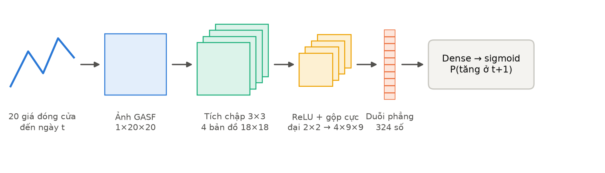

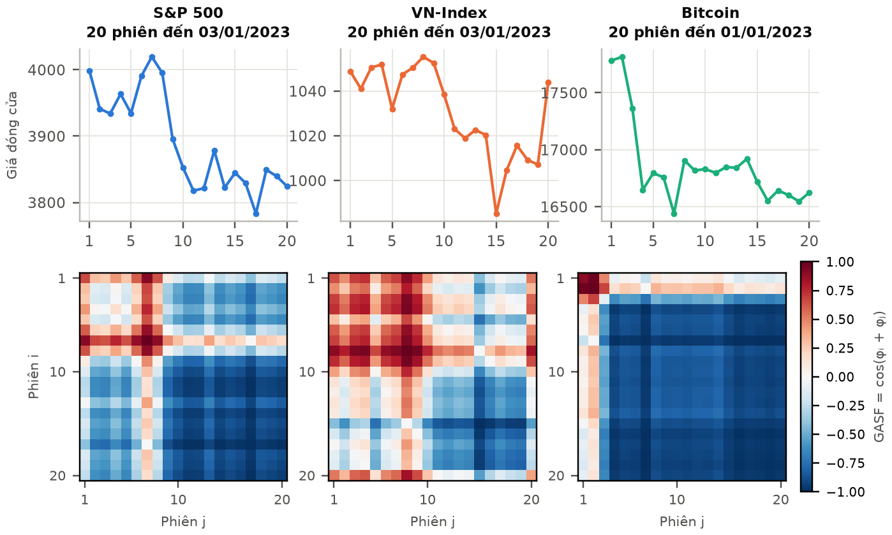

### 3.7.3. Nguồn, kích thước và phân bố dữ liệu

Ba bộ dữ liệu của chương là ba chuỗi giá ngày đã giới thiệu ở mục 1.8 (Bảng 1.2 và 1.3 cho thống kê mô tả và các dòng dữ liệu gốc, Hình 1.3 cho phân bố lợi suất). Mỗi chuỗi sinh ra một bộ ảnh GASF:

- **S&P 500 (thị trường Mỹ).** *Liên kết:* [Yahoo Finance, mã ^GSPC](https://finance.yahoo.com/quote/%5EGSPC/history/) [@yahoo2026]. *Kích thước:* 6.726 phiên từ 03/01/2000 đến 30/09/2026, tạo 6.703 ảnh GASF 20 × 20. *Mẫu đầu ra:* cột trái của Hình 3.3. *Phân bố:* tỉ lệ nhãn "tăng" là 53,6% (train), 52,3% (validation) và 55,4% (test). *Nhận xét:* thị trường lớn nhất thế giới, biến động 19,2% mỗi năm; hệ số tự tương quan bậc một âm (−0,099), tức phiên tăng thường được theo sau bởi phiên điều chỉnh.
- **VN-Index (thị trường Việt Nam).** *Liên kết:* [SSI iBoard](https://iboard.ssi.com.vn/), bổ sung bằng DNSE Entrade và đối chiếu với VNDirect [@ssi2026]. *Kích thước:* 4.175 phiên từ 04/01/2010 đến 30/09/2026, tạo 4.152 ảnh. *Mẫu đầu ra:* cột giữa của Hình 3.3. *Phân bố:* nhãn "tăng" chiếm 53,3%, 57,6% và 56,1%. *Nhận xét:* thị trường nhỏ hơn, có biên độ giá trần – sàn và nhiều nhà đầu tư cá nhân; hệ số tự tương quan bậc một dương (0,086), tức phiên tăng hay được nối tiếp bởi phiên tăng.
- **Bitcoin (tài sản số).** *Liên kết:* [Yahoo Finance, mã BTC-USD](https://finance.yahoo.com/quote/BTC-USD/history/) [@yahoo2026]. *Kích thước:* 4.397 ngày (giao dịch cả cuối tuần) từ 17/09/2014 đến 30/09/2026, tạo 4.374 ảnh. *Mẫu đầu ra:* cột phải của Hình 3.3. *Phân bố:* nhãn "tăng" chiếm 54,7%, 51,3% và 50,1%, gần cân bằng nhất ở validation và test. *Nhận xét:* biến động 66,5% mỗi năm, gấp khoảng 3,5 lần hai chỉ số chứng khoán; không có quán tính ngắn hạn rõ rệt (hệ số tự tương quan −0,022).

Dữ liệu được chia **theo thời gian**: train đến hết 2019, validation 2020–2022 (giai đoạn có cú sốc COVID-19 và đợt tăng lãi suất 2022), test từ 01/2023 đến 30/09/2026. Mẫu nào có ngày nhãn rơi sang tập sau thì bị loại khỏi tập trước, để nhãn không bao giờ "vượt rào". Bảng 3.4 cho thấy tỉ lệ nhãn "tăng" dao động quanh 50–58%; tỉ lệ này trên tập train được dùng làm đường cơ sở "luôn đoán lớp đa số".

Bảng 3.4. Số mẫu (cửa sổ 20 phiên) của mỗi tập; trong ngoặc là tỉ lệ mẫu có nhãn “tăng”.
| Chỉ số | Train (≤ 2019) | Validation (2020–2022) | Test (2023–09/2026) |
|---|---|---|---|
| S&P 500 | 5.010 (53,6%) | 755 (52,3%) | 938 (55,4%) |
| VN-Index | 2.473 (53,3%) | 750 (57,6%) | 929 (56,1%) |
| Bitcoin | 1.911 (54,7%) | 1.095 (51,3%) | 1.368 (50,1%) |

## 3.8. Cài đặt bằng ba cách

Mô hình đại diện **CNN4** gồm một lớp tích chập 4 bộ lọc 3 × 3 (không đệm, bước 1) → ReLU → gộp cực đại 2 × 2 → duỗi phẳng 4 × 9 × 9 = 324 số → lớp kết nối đầy đủ → logit, tổng cộng 365 tham số (Hình 3.2). Mạng được giữ nhỏ có chủ đích: mỗi thị trường chỉ có vài nghìn ảnh huấn luyện, tín hiệu rất yếu, và bản NumPy phải huấn luyện được trên CPU. CNN4 được cài đặt bằng NumPy, Keras và PyTorch với cùng giao thức như Chương 2: cùng trọng số khởi tạo, cùng thứ tự mini-batch, cùng Adam và dừng sớm. Một chi tiết kỹ thuật là Keras mặc định xếp kênh ở cuối (cao × rộng × kênh) còn PyTorch và bản NumPy xếp kênh ở đầu. Bản Keras vì thế đổi trục trước và sau khối tích chập để phép duỗi phẳng cho cùng thứ tự với hai bản kia; nếu bỏ qua, trọng số chép sang sẽ bị đặt sai vị trí.

```python
# PyTorch: ảnh vào dạng [batch, kênh, cao, rộng]
model = nn.Sequential(nn.Conv2d(1, 4, kernel_size=3), nn.ReLU(), nn.MaxPool2d(2),
                      nn.Flatten(), nn.Linear(4 * 9 * 9, 1))
# Keras: đổi trục sang [cao, rộng, kênh] rồi đổi lại trước khi duỗi phẳng
z = keras.layers.Permute((2, 3, 1))(inputs)
z = keras.layers.MaxPooling2D(2)(keras.layers.Conv2D(4, 3, activation="relu")(z))
z = keras.layers.Flatten()(keras.layers.Permute((3, 1, 2))(z))
outputs = keras.layers.Dense(1)(z)
```

Để so sánh kiến trúc, tiểu luận huấn luyện thêm (bằng PyTorch) **CNN8** (8 bộ lọc) và **CNN sâu** (hai khối tích chập 4 và 8 bộ lọc), cùng hai đường cơ sở không cần học: luôn đoán lớp đa số của tập train, và "lặp lại hướng phiên trước" (dự báo tăng nếu phiên gần nhất tăng).

## 3.9. Kết quả và thảo luận

**Ba bản cài đặt.** Bảng 3.5 và Hình 3.4 cho thấy ba bản cài đặt CNN4 gần như trùng khớp: cùng epoch tốt nhất với mọi hạt giống, ROC-AUC theo từng hạt giống chênh nhau tối đa 0,0002. Trên tập test, xác suất dự báo của bản NumPy và PyTorch lệch nhau tối đa 7,1 × 10⁻⁴ (VN-Index). Đây là bằng chứng mạnh cho thấy lớp tích chập, gộp và lan truyền ngược tự viết là đúng.

Bảng 3.5. Cùng một CNN4 cài đặt bằng ba cách (trung bình ± độ lệch chuẩn qua 3 seed, tập test).
| Dữ liệu | Cài đặt | ROC-AUC | AP | Balanced acc. | Tham số | Epoch tốt nhất | Giây/lượt |
|---|---|---|---|---|---|---|---|
| S&P 500 | NumPy tự viết | 0,515 ± 0,007 | 0,572 ± 0,014 | 0,502 ± 0,006 | 365 | 1/2/2 | 3,6 |
| S&P 500 | PyTorch | 0,515 ± 0,007 | 0,572 ± 0,014 | 0,502 ± 0,006 | 365 | 1/2/2 | 2,6 |
| S&P 500 | Keras | 0,515 ± 0,007 | 0,572 ± 0,014 | 0,495 ± 0,015 | 365 | 1/2/2 | 3,8 |
| VN-Index | NumPy tự viết | 0,519 ± 0,021 | 0,574 ± 0,025 | 0,511 ± 0,008 | 365 | 6/12/5 | 3,1 |
| VN-Index | PyTorch | 0,519 ± 0,021 | 0,574 ± 0,025 | 0,509 ± 0,007 | 365 | 6/12/5 | 2,2 |
| VN-Index | Keras | 0,519 ± 0,021 | 0,574 ± 0,025 | 0,510 ± 0,006 | 365 | 6/12/5 | 3,1 |
| Bitcoin | NumPy tự viết | 0,487 ± 0,018 | 0,487 ± 0,009 | 0,493 ± 0,011 | 365 | 4/2/2 | 2,1 |
| Bitcoin | PyTorch | 0,487 ± 0,018 | 0,487 ± 0,009 | 0,493 ± 0,011 | 365 | 4/2/2 | 1,1 |
| Bitcoin | Keras | 0,487 ± 0,018 | 0,487 ± 0,009 | 0,493 ± 0,011 | 365 | 4/2/2 | 2,1 |

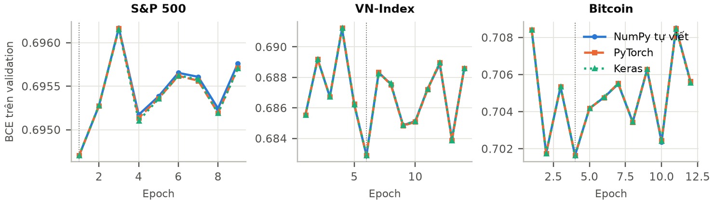

**Khả năng dự báo.** Bảng 3.6 và Hình 3.5 trả lời câu hỏi chính của chương. Mỗi đoạn ngang trong Hình 3.5 là khoảng tin cậy 95% của ROC-AUC, ước lượng bằng **bootstrap theo khối**: lấy mẫu lại từng khối 20 phiên liên tiếp để giữ tính phụ thuộc giữa các ngày gần nhau, thay vì coi mỗi ngày là độc lập [@kunsch1989]. Nếu đoạn ngang cắt qua đường 0,5 thì không thể khẳng định mô hình tốt hơn đoán ngẫu nhiên.

Bảng 3.6. So sánh kiến trúc CNN với hai đường cơ sở (PyTorch, 3 seed). CI 95%: bootstrap theo khối 20 phiên cho dự báo trung bình 3 seed.
| Chỉ số | Mô hình | Tham số | ROC-AUC (3 seed) | AUC [CI 95%] | Balanced acc. |
|---|---|---|---|---|---|
| S&P 500 | CNN4 | 365 | 0,515 ± 0,007 | 0,515 [0,476; 0,551] | 0,502 ± 0,006 |
| S&P 500 | CNN8 | 729 | 0,498 ± 0,007 | 0,493 [0,453; 0,527] | 0,497 ± 0,008 |
| S&P 500 | CNN sâu (2 khối) | 409 | 0,487 ± 0,019 | 0,477 [0,443; 0,506] | 0,494 ± 0,010 |
| S&P 500 | Cơ sở: lặp lại hướng phiên trước | 0 | 0,493 | 0,493 [0,462; 0,519] | 0,493 |
| S&P 500 | Cơ sở: luôn đoán lớp đa số | 0 | 0,500 | — | 0,500 |
| VN-Index | CNN4 | 365 | 0,519 ± 0,021 | 0,524 [0,491; 0,558] | 0,509 ± 0,007 |
| VN-Index | CNN8 | 729 | 0,533 ± 0,016 | 0,535 [0,503; 0,571] | 0,520 ± 0,010 |
| VN-Index | CNN sâu (2 khối) | 409 | 0,526 ± 0,004 | 0,530 [0,496; 0,564] | 0,516 ± 0,009 |
| VN-Index | Cơ sở: lặp lại hướng phiên trước | 0 | 0,518 | 0,518 [0,488; 0,551] | 0,518 |
| VN-Index | Cơ sở: luôn đoán lớp đa số | 0 | 0,500 | — | 0,500 |
| Bitcoin | CNN4 | 365 | 0,487 ± 0,018 | 0,479 [0,450; 0,509] | 0,493 ± 0,011 |
| Bitcoin | CNN8 | 729 | 0,487 ± 0,008 | 0,483 [0,454; 0,510] | 0,488 ± 0,013 |
| Bitcoin | CNN sâu (2 khối) | 409 | 0,480 ± 0,015 | 0,475 [0,445; 0,505] | 0,488 ± 0,006 |
| Bitcoin | Cơ sở: lặp lại hướng phiên trước | 0 | 0,485 | 0,485 [0,461; 0,509] | 0,485 |
| Bitcoin | Cơ sở: luôn đoán lớp đa số | 0 | 0,500 | — | 0,500 |

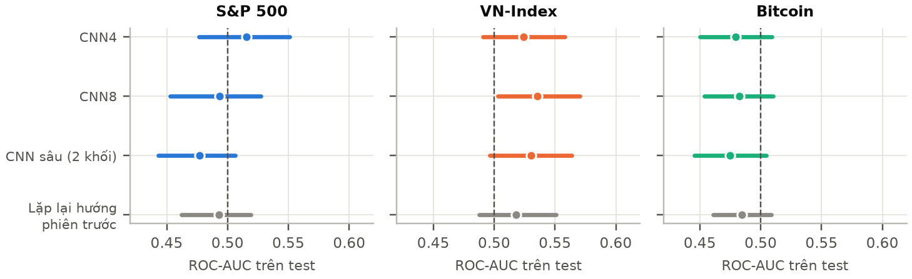

**Đọc kết quả.** Ở S&P 500 và Bitcoin, khoảng tin cậy của cả ba CNN đều chứa 0,5, chẳng hạn CNN4 đạt 0,515 [0,476; 0,551] trên S&P 500 và 0,479 [0,450; 0,509] trên Bitcoin: không có bằng chứng CNN dự báo hướng đi của hai thị trường này tốt hơn tung đồng xu. Ở VN-Index, cả ba CNN đều nhỉnh hơn đường cơ sở "lặp lại hướng phiên trước" (0,518 [0,488; 0,551]), nhưng chỉ CNN8 có khoảng tin cậy nằm hẳn trên 0,5 (0,535 [0,503; 0,571]); CNN4 (0,524 [0,491; 0,558]) và CNN sâu (0,530 [0,496; 0,564]) ở sát ranh giới. Kết quả của CNN8 cần được đọc thận trọng: khi kiểm định nhiều mô hình cùng lúc, một khoảng tin cậy nằm trên 0,5 vẫn có thể xuất hiện do may mắn, nên đây chỉ là tín hiệu yếu. Thêm bộ lọc hay thêm lớp cũng không cải thiện một cách nhất quán: CNN sâu kém CNN4 ở cả S&P 500 lẫn Bitcoin. Epoch tốt nhất của CNN4 phần lớn chỉ từ 1 đến 6 (Bảng 3.5), tức là chỉ sau vài lượt mạng đã bắt đầu học thuộc nhiễu của tập train và cơ chế dừng sớm phải dừng lại.

**Phép thử về cách chuẩn hóa GASF.** Để kiểm tra lựa chọn [0, 1] ở mục 3.7.2, CNN4 được huấn luyện lại trên ảnh GASF chuẩn hóa về [−1, 1], giữ nguyên mọi thiết lập khác (PyTorch, 3 hạt giống). ROC-AUC trung bình lần lượt là 0,512, 0,522 và 0,505 với S&P 500, VN-Index và Bitcoin, so với 0,515, 0,519 và 0,487 khi dùng [0, 1]; các khoảng tin cậy chồng lấn nhau hoàn toàn. Như vậy, dù về lý thuyết [−1, 1] làm mất thông tin chiều giá, trong thực nghiệm này khác biệt không đo được. Đây thêm một dấu hiệu cho thấy ảnh GASF của giá đóng cửa chứa rất ít thông tin về hướng đi của phiên kế tiếp. Tiểu luận vẫn giữ [0, 1] vì đúng về nguyên tắc.

Có ba lý do khiến kết quả khiêm tốn hơn nhiều so với Jiang, Kelly và Xiu. Một là **quy mô dữ liệu**: họ có hàng triệu ảnh từ hàng nghìn cổ phiếu, còn mỗi thị trường ở đây chỉ có vài nghìn ảnh của một chỉ số. Hai là **bản chất bài toán**: họ xếp hạng cổ phiếu với nhau trong cùng một tuần, nên phần biến động chung của thị trường bị triệt tiêu; ở đây phải dự báo chính hướng đi của cả thị trường – thứ chịu ảnh hưởng của tin tức vĩ mô vốn không có trong ảnh. Ba là **kỳ hạn một ngày** rất ngắn và nhiều nhiễu. Kết quả này phù hợp với giả thuyết thị trường hiệu quả ở dạng yếu đối với các thị trường lớn [@fama1970]. Khả năng dự báo nhỉnh hơn ở VN-Index cũng hợp lý: thị trường nhỏ hơn, có biên độ giá trần – sàn và tỉ trọng nhà đầu tư cá nhân cao, nên thông tin có thể được phản ánh vào giá chậm hơn.

## 3.10. CNN trên 5 lớp và biểu diễn bằng hợp các hàm

Để đáp ứng yêu cầu mô hình phải trên 5 layer, phần bổ sung sử dụng cách đếm chặt: **chỉ đếm lớp có tham số học được**, không tính Input, ReLU, Permute, Flatten hay sigmoid. CNN có bốn lớp tích chập và hai lớp Dense, tổng cộng sáu lớp học được. Các mô hình CNN4, CNN8 và CNN sâu hai khối ở phần thực nghiệm trước vẫn là các cấu hình đối chứng; số liệu của chúng không được gán cho kiến trúc mới.

Bảng 3.7. Kích thước và tham số của CNN sáu lớp học được, đầu vào một ảnh GASF 20 × 20.
| Lớp học được | Biến đổi | Đầu ra mỗi mẫu (C, H, W) | Số tham số |
|---|---|---|---|
| 1 | Conv2D, 1 → 4, kernel 3 × 3, valid | 4 × 18 × 18 | 40 |
| 2 | Conv2D, 4 → 4, kernel 3 × 3, valid | 4 × 16 × 16 | 148 |
| 3 | Conv2D, 4 → 8, kernel 3 × 3, valid | 8 × 14 × 14 | 296 |
| 4 | Conv2D, 8 → 8, kernel 3 × 3, valid | 8 × 12 × 12 | 584 |
| 5 | Flatten rồi Dense, 1.152 → 8 | 8 | 9.224 |
| 6 | Dense, 8 → 1 | 1 logit | 9 |
| Tổng | Bốn Conv và hai Dense | Xác suất sau sigmoid | 10.301 |

Với kernel 3, stride 1 và không padding, cạnh ảnh giảm hai đơn vị sau mỗi Conv; sau bốn lớp là 20 − 2 × 4 = 12. Tại lớp thứ năm, số chiều vào bằng 8 × 12 × 12 = 1.152. Công thức đếm tham số Conv là C_out × (C_in × 3 × 3 + 1); Dense là d_out × (d_in + 1). Mỗi Conv và Dense ẩn đi kèm ReLU. Không dùng pooling ở kiến trúc minh họa để giữ việc kiểm tra kích thước đơn giản; đây là lựa chọn thiết kế, không phải bằng chứng rằng bỏ pooling sẽ tốt hơn.

Gọi C₁, C₂, C₃, C₄ là bốn phép tích chập có bias; ρ là ReLU; V là Flatten; D₅, D₆ là hai phép affine. Mạng trả về logit z và xác suất p như sau:

$$z = (D_6 \circ \rho \circ D_5 \circ V \circ \rho \circ C_4 \circ \rho \circ C_3 \circ \rho \circ C_2 \circ \rho \circ C_1)(X), \qquad p=\sigma(z)$$ (3.10)

Đây là **hợp các hàm**, đọc từ phải sang trái: ảnh đi qua C₁ trước, D₆ sau cùng. Dấu ∘ không phải phép cộng hay phép nhân trọng số. Các hàm nối nhau vì miền giá trị của hàm trước phù hợp với miền xác định của hàm sau. Viết thành từng bước giúp kiểm tra: A₁ = ρ(C₁(X)); A₂ = ρ(C₂(A₁)); A₃ = ρ(C₃(A₂)); A₄ = ρ(C₄(A₃)); u = V(A₄); v = ρ(D₅(u)); z = D₆(v).

### 3.10.1. Giải thích từng hàm riêng

**Cᵢ – tích chập.** Mỗi bộ lọc tạo một kênh đặc trưng. Ở vị trí (u, v), đầu ra là tổng các tích giữa cửa sổ đầu vào và trọng số, cộng bias. Trong mã, thao tác thường gọi là convolution thực chất dùng tương quan chéo: không lật kernel trước khi nhân. Các bản Scratch, Keras và PyTorch phải cùng quy ước. Scratch tự thực hiện im2col, nhân ma trận và cộng dồn gradient của các cửa sổ chồng lấp trong backward.

**ρ – ReLU.** Hàm ρ(a) = max(0, a) giữ số dương, đưa số âm về không. Ví dụ (−2; 0; 3) thành (0; 0; 3). Backward nhân gradient với mặt nạ a > 0; tại a = 0 mã chọn đạo hàm bằng 0. ReLU tạo phi tuyến nhưng không thêm tham số học được.

**V – Flatten.** Hàm này chỉ đổi hình dạng 8 × 12 × 12 thành vector 1.152 phần tử. Nó không học trọng số và không trộn giá trị. Thứ tự trải kênh phải giống nhau ở ba bản. Keras dùng hai Permute để chuyển NCHW sang NHWC trước Conv và đưa về NCHW trước Flatten.

**D₅ và D₆ – Dense.** D₅(u) = W₅u + b₅ tổng hợp các đặc trưng cục bộ thành tám đặc trưng toàn cục. D₆(v) = W₆v + b₆ tạo một logit thực. Bias được tính đúng một lần ở mỗi phép affine.

**σ – sigmoid.** σ(z) = 1/(1 + exp(−z)). Logit 0 tương ứng xác suất 0,5; logit khoảng 1,099 tương ứng 0,75. Khi huấn luyện, truyền z trực tiếp vào BCEWithLogits, không sigmoid trước rồi lại dùng mất mát từ logit. Khi hiển thị demo mới áp dụng sigmoid để người xem đọc xác suất.

### 3.10.2. Ba bản cài đặt và cách kiểm chứng

Mã đầy đủ dựng kiến trúc nằm trong Phụ lục C, được đưa trực tiếp từ tệp `scripts/tieuluan/complete_models.py`. Scratch sử dụng thư viện NumPy tự viết trong `src/tieuluan/scratch/`; các lớp này tự cài forward và backward, không gọi autograd. Keras khai báo Functional API; PyTorch ghép các nn.Module. Cả ba đều có đầu vào batch × 1 × 20 × 20 và đầu ra batch × 1.

Việc dùng cùng seed chưa đủ để tạo cùng trọng số giữa ba thư viện. Hàm `align_weights` sao chép trọng số Scratch sang hai bản còn lại, chuyển trục kernel Conv và chuyển vị ma trận Dense theo quy ước tương ứng. Phép kiểm tra trong Phụ lục C so sánh logit trước khi học, gradient Scratch–PyTorch và ba bước tối ưu thật. Dữ liệu kiểm tra là mini-batch tổng hợp để phát hiện sai kích thước, sai thứ tự trọng số và sai đạo hàm; nó không dùng để kết luận khả năng dự báo thị trường.

### 3.10.3. Kịch bản biểu diễn CNN

Khi trình bày, trước hết chọn một cửa sổ 20 phiên trong ứng dụng tiểu luận, hiển thị chuỗi lợi suất và ảnh GASF. Giải thích vì sao cùng một cửa sổ tạo được ảnh 20 × 20; việc chuyển thành ảnh không tạo thêm thông tin gốc. Tiếp theo dùng bảng 3.7 để đi qua sáu lớp của bản bổ sung và chỉ rõ đầu vào–đầu ra ở mỗi bước. Chạy lệnh kiểm chứng Phụ lục C để thấy ba bản cho logit gần nhau. Cuối cùng quay về bảng thực nghiệm cũ để bàn luận AUC và phí giao dịch, nêu đúng tên kiến trúc đã tạo ra kết quả đó. Không trình bày xác suất tăng như một lệnh mua bán.


### 3.10.4. Cell notebook: dựng mạng và quan sát hợp hàm

Notebook `notebooks/tieuluan/complete/03_cnn_6_layers.ipynb` đã chạy Run All. Các cell dưới được chèn trực tiếp từ notebook, giữ nhãn cell để tra lại. Mỗi cell code đi cùng giải thích đầu vào, đầu ra và ý nghĩa của hàm; không chỉ đưa ảnh chụp code.

**Cell CNN-03 – notebook `03_cnn_6_layers.ipynb`.**

```python
# Cell CNN-03
from src.tieuluan.scratch.core import Sequential
from src.tieuluan.scratch.layers import Conv2d, Dense, Flatten, ReLU
from src.tieuluan.scratch.recurrent import SimpleRNN, LSTM, LastStep

def scratch_deep(kind, seed=42):
    rng = np.random.default_rng(seed)
    if kind == 'cnn':
        layers = []
        for cin, cout in [(1, 4), (4, 4), (4, 8), (8, 8)]:
            layers += [Conv2d(cin, cout, 3, rng=rng), ReLU()]
        return Sequential(*layers, Flatten(),
                          Dense(8*12*12, 8, rng=rng), ReLU(),
                          Dense(8, 1, rng=rng))
    cell = {'rnn': SimpleRNN, 'lstm': LSTM}[kind]
    layers = [cell(1, 8, rng=rng)]
    layers += [cell(8, 8, rng=rng) for _ in range(4)]
    return Sequential(*layers, LastStep(), Dense(8, 1, rng=rng))
```

**Giải thích hàm và liên hệ công thức.** scratch_deep nhận tên kiến trúc và seed, trả về Sequential. Bốn Conv và hai Dense là sáu lớp học được. ReLU tạo phi tuyến, Flatten đổi shape và không thêm tham số. Với ảnh 20 × 20, bốn Conv valid tạo 8 × 12 × 12 giá trị trước Dense. Mọi forward/backward của các lớp được tự cài bằng NumPy, không sử dụng autograd.

**Cell CNN-07 – notebook `03_cnn_6_layers.ipynb`.**

```python
# Cell CNN-07
# Quan sát hợp hàm bằng cách in shape sau từng hàm, trên một mẫu thật.
trace_model = scratch_deep(KIND)
value = data['train_x'][:1]
trace = []
for index, layer in enumerate(trace_model.layers, 1):
    before = value.shape
    value = layer.forward(value)
    trace.append({'step':index, 'function':type(layer).__name__,
                  'input':str(before), 'output':str(value.shape)})
display(pd.DataFrame(trace))
print('Logit:', value.ravel())
print('Sigmoid:', (0.5*(1+np.tanh(value/2))).ravel())
```

**Đầu ra đã chạy (trích phần văn bản):**

```text
step function           input          output
0      1   Conv2d  (1, 1, 20, 20)  (1, 4, 18, 18)
1      2     ReLU  (1, 4, 18, 18)  (1, 4, 18, 18)
2      3   Conv2d  (1, 4, 18, 18)  (1, 4, 16, 16)
3      4     ReLU  (1, 4, 16, 16)  (1, 4, 16, 16)
4      5   Conv2d  (1, 4, 16, 16)  (1, 8, 14, 14)
5      6     ReLU  (1, 8, 14, 14)  (1, 8, 14, 14)
6      7   Conv2d  (1, 8, 14, 14)  (1, 8, 12, 12)
7      8     ReLU  (1, 8, 12, 12)  (1, 8, 12, 12)
8      9  Flatten  (1, 8, 12, 12)       (1, 1152)
9     10    Dense       (1, 1152)          (1, 8)
10    11     ReLU          (1, 8)          (1, 8)
11    12    Dense          (1, 8)          (1, 1)
Logit: [-0.00505902]
Sigmoid: [0.49873525]
```

**Giải thích hàm và liên hệ công thức.** Vòng lặp áp dụng từng hàm forward vào kết quả của hàm trước, đúng với biểu thức hợp hàm đã trình bày. Cột input/output cho phép kiểm tra miền xác định và miền giá trị ở từng bước. Sigmoid chỉ áp dụng sau logit để hiển thị xác suất; nó không được chèn trước BCEWithLogits khi học.

**Cell CNN-09 – notebook `03_cnn_6_layers.ipynb`.**

```python
# Cell CNN-09
def train_batch(model, framework, x, y, optimizer):
    """One actual optimization step, binary classification on logits."""
    if framework == 'scratch':
        from src.tieuluan.scratch.losses import BCEWithLogitsLoss
        from src.tieuluan.scratch.optim import clip_grad_norm
        model.train()
        model.zero_grad()
        loss = BCEWithLogitsLoss()
        value = loss.forward(model.forward(x), y)
        model.backward(loss.backward())
        # One effective bias, matching Keras and the frozen Torch bias.
        for layer in model.layers:
            if isinstance(layer, (SimpleRNN, LSTM)):
                layer.bias_hh.grad[...] = 0
        clip_grad_norm(model.parameters(), 1.0)
        optimizer.step()
        return value
    if framework == 'pytorch':
        import torch
        model.train()
        optimizer.zero_grad()
        loss = torch.nn.functional.binary_cross_entropy_with_logits(
            model(torch.from_numpy(x)), torch.from_numpy(y))
        loss.backward()
        torch.nn.utils.clip_grad_norm_(model.parameters(), 1.0)
        optimizer.step()
        return float(loss.detach())
    import tensorflow as tf
    with tf.GradientTape() as tape:
        logits = model(x, training=True)
        loss = tf.reduce_mean(tf.nn.sigmoid_cross_entropy_with_logits(
            labels=y, logits=logits))
    grads = tape.gradient(loss, model.trainable_variables)
    grads, _ = tf.clip_by_global_norm(grads, 1.0)
    optimizer.apply_gradients(zip(grads, model.trainable_variables))
    return float(loss.numpy())
```

**Giải thích hàm và liên hệ công thức.** train_batch là hợp các bước zero_grad → forward → loss → backward → clip → cập nhật. Nhánh Scratch tự lan truyền ngược, PyTorch dùng loss.backward và Keras dùng GradientTape. Hàm nhận model, framework, tensor x, nhãn y và optimizer, trả về một số loss. BCE nhận logit trực tiếp; cắt chuẩn gradient trước Adam. Hàm dùng chung cho CNN, RNN và LSTM; bias hồi quy phụ được giữ không học để khớp một bias hiệu dụng giữa ba công cụ. Đây là cell định nghĩa nên chưa có output riêng; các cell -11 gọi nó nhiều lần trong vòng huấn luyện và lưu loss thực tế.

**Cell huấn luyện và kết quả trên dữ liệu thật.** Các cell CNN-09 đến CNN-12 chứa train_batch, các hàm lưu checkpoint, vòng huấn luyện ba công cụ và đồ thị loss. Thực nghiệm demo dùng 256 mẫu train, 128 validation và 256 test của VN-Index, giữ cách chia thời gian của dữ liệu gốc; ba epoch, batch 32, cùng trọng số hiệu dụng và cùng thứ tự batch. Checkpoint được chọn bằng BCE validation; test chỉ được đánh giá sau khi chọn checkpoint. Đây là tập con phục vụ trình bày, không thay thế kết quả toàn bộ dữ liệu trong chương.

- scratch: checkpoint epoch 1; validation BCE = 0.694502; test BCE = 0.694117; test AUC = 0.517641.
- keras: checkpoint epoch 2; validation BCE = 0.694458; test BCE = 0.694682; test AUC = 0.512691.
- pytorch: checkpoint epoch 1; validation BCE = 0.694502; test BCE = 0.694117; test AUC = 0.517641.

Các chỉ số trên đọc trực tiếp từ kết quả notebook. Không dùng AUC của tập con để kết luận có lợi nhuận, và không gán các số này cho mô hình nông đã đánh giá trên toàn bộ tập test.


## 3.11. Tiểu kết chương

Chương 3 đã trình bày nguyên lý của CNN – kết nối cục bộ, dùng chung trọng số, phép gộp – cùng các kiến trúc từ LeNet đến ConvNeXt và MambaOut, và nghiên cứu tiêu biểu về CNN trong đầu tư của Jiang, Kelly và Xiu. Về thực nghiệm, CNN tự viết bằng NumPy (với kỹ thuật im2col) cho kết quả trùng với Keras và PyTorch. Khi đọc ảnh GASF của chuỗi giá, CNN không dự báo được hướng đi của S&P 500 và Bitcoin tốt hơn đoán ngẫu nhiên, và chỉ cho tín hiệu yếu ở VN-Index. Chương cũng chỉ ra một điểm dễ bị bỏ qua về biểu diễn dữ liệu: cách chuẩn hóa [−1, 1] phổ biến của GASF làm mất thông tin về chiều giá, dù trong thực nghiệm này khác biệt về ROC-AUC không đáng kể. Chương 4 sẽ tiếp cận cùng dữ liệu theo cách tự nhiên hơn: đọc chuỗi lợi suất theo đúng thứ tự thời gian bằng mạng hồi quy.


# CHƯƠNG 4. MẠNG NƠ-RON HỒI QUY RNN VÀ LSTM

## 4.1. Dữ liệu chuỗi và vì sao thứ tự quan trọng

Hai chuỗi lợi suất +1%, +1%, −1%, −1% và +1%, −1%, +1%, −1% có cùng trung bình bằng 0, nhưng kể hai câu chuyện khác nhau: một bên là hai phiên tăng nối tiếp rồi đảo chiều, bên kia là giá giằng co luân phiên. MLP ở Chương 2 nhận đầu vào như một bảng số không có thứ tự; CNN ở Chương 3 phải biến chuỗi thành ảnh. **Mạng nơ-ron hồi quy** (recurrent neural network – RNN) đọc chuỗi theo đúng thứ tự thời gian và mang theo một **trạng thái ẩn** tóm tắt những gì đã đọc [@elman1990].

> **Hiểu nhanh.** RNN đọc chuỗi như người đọc một câu chuyện: đọc từng câu, sau mỗi câu cập nhật lại "trí nhớ" về diễn biến, và dùng trí nhớ đó để đoán điều gì xảy ra tiếp theo. Trạng thái ẩn chính là "trí nhớ" ấy – một vector số được học, không phải một bản ghi chép hoàn hảo.

## 4.2. Mạng hồi quy đơn giản (SimpleRNN)

Tại mỗi bước t, SimpleRNN kết hợp đầu vào mới xₜ với trạng thái cũ hₜ₋₁ để tạo trạng thái mới:

$$\mathbf{h}_t = \tanh\left(W_x\mathbf{x}_t + W_h\mathbf{h}_{t-1} + \mathbf{b}\right)$$ (4.1)

Ma trận Wₓ quyết định thông tin mới được đưa vào thế nào, Wₕ quyết định trí nhớ cũ được giữ lại thế nào, còn tanh giữ mỗi phần tử trạng thái trong khoảng (−1, 1). Điểm mấu chốt là **cùng một bộ trọng số** được dùng lại ở mọi bước thời gian. Nhờ vậy chuỗi dài hay ngắn thì số tham số vẫn như nhau: với d đầu vào và h phần tử trạng thái, lớp có h·d + h² + h tham số. Trong thực nghiệm (d = 1, h = 8) là 8 + 64 + 8 = 80 tham số. Khi "trải" mạng theo thời gian (Hình 4.1), ta thấy RNN thực chất là một mạng rất sâu, mỗi bước thời gian là một lớp, và các lớp dùng chung trọng số. Với bài toán "đọc 20 phiên, dự báo một lần", chỉ trạng thái cuối h₂₀ được đưa qua lớp kết nối đầy đủ và hàm sigmoid để ra xác suất tăng.

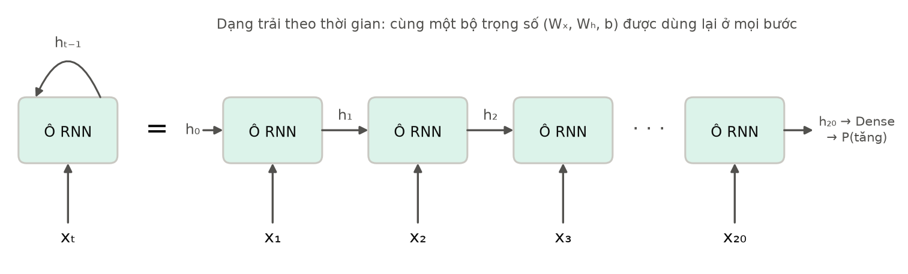

**Ví dụ tính tay** với trạng thái một chiều: Wₓ = 1, Wₕ = 0,5, b = 0, h₀ = 0 và chuỗi đầu vào 0,1; −0,2; 0,3 (Bảng 4.1). Trạng thái cuối 0,2218 không chỉ phụ thuộc x₃ mà còn mang dấu vết của x₁ và x₂; nếu đảo thứ tự ba giá trị, trạng thái cuối sẽ khác. Đây chính là khả năng "nhớ thứ tự" mà phép lấy trung bình không có.

Bảng 4.1. Lan truyền xuôi của SimpleRNN một chiều (Wₓ = 1, Wₕ = 0,5, b = 0, h₀ = 0).
| Bước t | xₜ | Tổng trước tanh | Trạng thái hₜ |
|---|---|---|---|
| 1 | 0,1 | 0,1 + 0,5 × 0 = 0,1 | 0,0997 |
| 2 | −0,2 | −0,2 + 0,5 × 0,0997 = −0,1502 | −0,1490 |
| 3 | 0,3 | 0,3 + 0,5 × (−0,1490) = 0,2255 | 0,2218 |

## 4.3. Lan truyền ngược theo thời gian và bài toán gradient

RNN được huấn luyện bằng **lan truyền ngược theo thời gian** (backpropagation through time – BPTT): trải mạng thành chuỗi các bước rồi áp dụng lan truyền ngược như một mạng sâu bình thường [@werbos1990]. Vì Wₕ được dùng ở mọi bước, gradient của nó là tổng đóng góp từ mọi bước. Để biết đầu vào ở bước đầu ảnh hưởng đến kết quả ra sao, gradient phải đi ngược qua tích của nhiều đạo hàm:

$$\frac{\partial \mathbf{h}_T}{\partial \mathbf{h}_1} = \prod_{t=2}^{T}\frac{\partial \mathbf{h}_t}{\partial \mathbf{h}_{t-1}}$$ (4.2)

Nếu mỗi thừa số có độ lớn khoảng 0,5, sau 20 bước tích còn 0,5²⁰ ≈ 0,00000095: tín hiệu học từ quá khứ xa gần như biến mất. Đó là hiện tượng **tiêu biến gradient** (vanishing gradient), được Bengio và cộng sự phân tích từ năm 1994 [@bengio1994]. Ngược lại, nếu mỗi thừa số khoảng 1,5, tích lên tới 1,5²⁰ ≈ 3.325, gây **bùng nổ gradient**: một bước cập nhật quá lớn có thể phá hỏng cả mô hình.

> **Hiểu nhanh.** Tiêu biến gradient giống trò chơi "tam sao thất bản": thông điệp truyền qua 20 người, mỗi người chỉ nói lại được một nửa, đến người cuối thì gần như không còn gì. Mạng vì thế khó học được rằng một sự kiện từ 20 phiên trước có liên quan đến hôm nay.

Bùng nổ gradient được xử lý đơn giản bằng **cắt chuẩn gradient** (gradient clipping) [@pascanu2013]: nếu độ dài vector gradient vượt ngưỡng c thì co nó lại về đúng độ dài c, giữ nguyên hướng.

$$\mathbf{g} \leftarrow \mathbf{g}\cdot\min\left(1,\ \frac{c}{\Vert\mathbf{g}\Vert}\right)$$ (4.3)

Ví dụ g = (6, 8) có độ dài 10; với c = 5, gradient được co thành (3, 4). Mọi mô hình trong thực nghiệm đều dùng c = 1. Tiêu biến gradient thì khó hơn nhiều, và lời giải nổi tiếng nhất là LSTM.

## 4.4. LSTM: bộ nhớ có cổng điều khiển

LSTM (long short-term memory) của Hochreiter và Schmidhuber [@hochreiter1997], với cổng quên do Gers và cộng sự bổ sung [@gers2000], thêm một **ô nhớ** cₜ chạy dọc theo chuỗi như một "băng chuyền", cùng ba **cổng** điều khiển việc ghi, xóa và đọc (Hình 4.2). Mỗi cổng là một lớp sigmoid cho giá trị từ 0 (đóng) đến 1 (mở), tính từ hₜ₋₁ và xₜ:

$$\mathbf{f}_t,\ \mathbf{i}_t,\ \mathbf{o}_t = \sigma\left(W_{\{f,i,o\}}[\mathbf{h}_{t-1},\mathbf{x}_t] + \mathbf{b}_{\{f,i,o\}}\right)$$
$$\mathbf{g}_t = \tanh\left(W_g[\mathbf{h}_{t-1},\mathbf{x}_t] + \mathbf{b}_g\right)$$ (4.4)

$$\mathbf{c}_t = \mathbf{f}_t\odot\mathbf{c}_{t-1} + \mathbf{i}_t\odot\mathbf{g}_t, \qquad \mathbf{h}_t = \mathbf{o}_t\odot\tanh(\mathbf{c}_t)$$ (4.5)

Ký hiệu ⊙ là phép nhân từng phần tử. **Cổng quên** fₜ quyết định giữ lại bao nhiêu phần trí nhớ cũ; **cổng vào** iₜ quyết định ghi bao nhiêu thông tin mới gₜ; **cổng ra** oₜ quyết định đưa bao nhiêu phần trí nhớ ra ngoài thành hₜ.

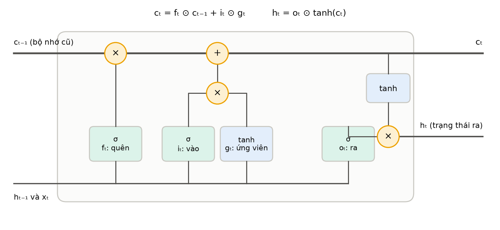

**Ví dụ.** Giả sử cₜ₋₁ = 0,8; fₜ = 0,9; iₜ = 0,2; gₜ = −0,5; oₜ = 0,7. Ô nhớ mới cₜ = 0,9 × 0,8 + 0,2 × (−0,5) = 0,62, và hₜ = 0,7 × tanh(0,62) ≈ 0,386. Thông tin mới mang dấu âm nhưng không xóa sạch trí nhớ, vì cổng quên giữ lại 90%. Nếu fₜ chỉ bằng 0,1, cₜ sẽ còn −0,02, tức mô hình gần như "quên" quá khứ để chạy theo thông tin mới.

Vì sao LSTM giảm được tiêu biến gradient? Trên băng chuyền ô nhớ, đạo hàm của cₜ theo cₜ₋₁ (theo đường trực tiếp) chính là fₜ. Khi cổng quên gần 1, gradient đi ngược qua nhiều bước mà không bị co lại theo cấp số nhân như ở (4.2). Cái giá phải trả là số tham số gấp bốn lần SimpleRNN: 4h(d + h + 1), tức 320 tham số với d = 1, h = 8.

> **Hiểu nhanh.** LSTM giống người ghi sổ tay có ba thói quen: trước khi ghi điều mới, cân nhắc xóa bớt điều đã cũ (cổng quên); chỉ ghi những gì thật sự quan trọng (cổng vào); và khi được hỏi, chỉ đọc phần liên quan (cổng ra).

## 4.5. GRU: phiên bản gọn hơn

GRU (gated recurrent unit) của Cho và cộng sự [@cho2014] gộp ô nhớ và trạng thái ẩn làm một, chỉ dùng hai cổng: **cổng đặt lại** rₜ (bao nhiêu trí nhớ cũ được dùng khi tạo ứng viên) và **cổng cập nhật** zₜ (trộn trí nhớ cũ với ứng viên mới theo tỉ lệ nào). Theo quy ước của PyTorch và cuDNN mà thực nghiệm sử dụng:

$$\mathbf{n}_t = \tanh\left(W_{in}\mathbf{x}_t + \mathbf{b}_{in} + \mathbf{r}_t\odot(W_{hn}\mathbf{h}_{t-1} + \mathbf{b}_{hn})\right)$$
$$\mathbf{h}_t = (1-\mathbf{z}_t)\odot\mathbf{n}_t + \mathbf{z}_t\odot\mathbf{h}_{t-1}$$ (4.6)

Ví dụ hₜ₋₁ = 0,8; ứng viên nₜ = −0,2; zₜ = 0,75 cho hₜ = 0,25 × (−0,2) + 0,75 × 0,8 = 0,55: trạng thái giữ 75% quá khứ. Bảng 4.2 so sánh ba kiến trúc hồi quy.

Bảng 4.2. So sánh SimpleRNN, LSTM và GRU (số tham số tính với d = 1, h = 8, chưa kể lớp đầu ra).
| Đặc điểm | SimpleRNN | LSTM | GRU |
|---|---|---|---|
| Trạng thái mang theo | hₜ | hₜ và ô nhớ cₜ | hₜ |
| Cổng | Không có | Quên, vào, ra | Đặt lại, cập nhật |
| Số tham số | 80 | 320 | 264 (hai vector bias) |
| Phụ thuộc dài hạn | Khó học | Tốt | Tốt |
| Chi phí tính toán | Thấp nhất | Cao nhất | Trung bình |

**Các mở rộng thường gặp.** RNN có thể **chồng nhiều lớp**: chuỗi trạng thái của lớp dưới là đầu vào của lớp trên, giúp học mẫu hình phức tạp hơn nhưng khó huấn luyện hơn. **RNN hai chiều** đọc chuỗi theo cả hai hướng rồi ghép kết quả [@schuster1997]; kỹ thuật này hiệu quả trong xử lý ngôn ngữ. Khi dự báo tài chính, hai chiều chỉ được đọc trong cửa sổ quá khứ đã biết đến thời điểm dự báo; đọc ngược trong chính cửa sổ này không tự gây rò rỉ, nhưng dùng dữ liệu sau thời điểm dự báo thì có. **Mô hình chuỗi sang chuỗi** (sequence-to-sequence) dùng một RNN mã hóa chuỗi vào thành một vector rồi một RNN khác giải mã thành chuỗi ra, như trong dịch máy [@sutskever2014]. Vì một vector khó chứa hết một câu dài, **cơ chế chú ý** (attention) cho bộ giải mã "nhìn lại" mọi trạng thái của bộ mã hóa [@bahdanau2015]; đây là tiền đề của Transformer được nhắc ở mục 4.10 [@vaswani2017].

## 4.6. Dữ liệu và cách chuẩn bị chuỗi tài chính cho mạng hồi quy

Mạng hồi quy dùng lại ba chuỗi giá ngày ở mục 1.8 với cùng cách chia theo thời gian của Chương 3 (Bảng 3.4), nhưng đầu vào là **chuỗi 20 lợi suất logarit** thay vì ảnh GASF:

- **S&P 500.** *Liên kết:* [Yahoo Finance, mã ^GSPC](https://finance.yahoo.com/quote/%5EGSPC/history/) [@yahoo2026]. *Kích thước:* 6.703 chuỗi (5.010 train, 755 validation, 938 test), mỗi chuỗi gồm 20 số. *Mẫu đầu ra:* chuỗi đầu tiên của tập test kết thúc ngày 03/01/2023, năm lợi suất đầu là −1,81%; −1,45%; −0,19%; 0,75%; −0,74%; phiên kế tiếp thay đổi 0,75% nên nhãn là "tăng". *Phân bố:* lợi suất ngày có đuôi béo (Hình 1.3); nhãn "tăng" chiếm 53,6% / 52,3% / 55,4% ở ba tập. *Nhận xét:* bộ nhiều dữ liệu nhất nhưng tự tương quan âm (−0,099), nên quy luật "tăng rồi tăng tiếp" không tồn tại.
- **VN-Index.** *Liên kết:* [SSI iBoard](https://iboard.ssi.com.vn/), bổ sung bằng DNSE Entrade, đối chiếu VNDirect [@ssi2026]. *Kích thước:* 4.152 chuỗi (2.473 / 750 / 929). *Mẫu đầu ra:* chuỗi đầu tiên của tập test kết thúc ngày 03/01/2023, năm lợi suất đầu là −4,20%; −0,73%; 0,91%; 0,12%; −1,89%; phiên kế tiếp thay đổi 0,23%, nhãn "tăng". *Phân bố:* nhãn "tăng" chiếm 53,3% / 57,6% / 56,1%. *Nhận xét:* tự tương quan dương (0,086) là nguồn của tín hiệu nhỏ được phân tích ở mục 4.8.
- **Bitcoin.** *Liên kết:* [Yahoo Finance, mã BTC-USD](https://finance.yahoo.com/quote/BTC-USD/history/) [@yahoo2026]. *Kích thước:* 4.374 chuỗi (1.911 / 1.095 / 1.368). *Mẫu đầu ra:* chuỗi đầu tiên của tập test kết thúc ngày 01/01/2023, năm lợi suất đầu là 3,29%; 0,19%; −2,56%; −4,22%; 0,88%; phiên kế tiếp thay đổi 0,38%, nhãn "tăng". *Phân bố:* nhãn "tăng" chiếm 54,7% / 51,3% / 50,1%. *Nhận xét:* biến động 66,5% mỗi năm nên có nhiều lợi suất ngoại lai; sau khi chuẩn hóa bằng thống kê của tập train, chuỗi vẫn chứa những giá trị rất lớn.

**Dự báo lợi suất, không dự báo mức giá.** Một sai lầm phổ biến là cho mạng dự báo trực tiếp giá đóng cửa ngày mai rồi khoe hệ số xác định R² rất cao. Vì giá hôm nay đã rất gần giá ngày mai, ngay cả dự báo "ngây thơ" Ĉ(t+1) = C(t) – không học gì – cũng đạt R² = 0,9978 trên tập test của S&P 500 (và 0,9964 với VN-Index). R² cao khi dự báo mức giá vì thế không chứng minh mô hình có khả năng dự báo. Tiểu luận dùng **lợi suất logarit** rₜ = ln(Cₜ/Cₜ₋₁), đại lượng có thang đo ổn định theo thời gian, và đặt bài toán là đoán **hướng** của phiên kế tiếp. Đây cũng chính là bài toán của Chương 3, nên có thể so sánh trực tiếp CNN với RNN.

**Chuẩn hóa không nhìn tương lai.** Mỗi mẫu là cửa sổ 20 lợi suất đến ngày t, chuẩn hóa z-score bằng trung bình và độ lệch chuẩn tính trên **tập train**. Validation và test dùng lại nguyên hai con số đó, vì lúc dự báo thật ta không biết thống kê của tương lai. Cách chia theo thời gian, cách loại mẫu ở ranh giới và hai đường cơ sở giống hệt Chương 3 (Bảng 3.4).

**Không trộn thời gian.** Hai cửa sổ liền kề chung 19/20 quan sát. Nếu trộn ngẫu nhiên các cửa sổ rồi mới chia train/test, gần như mọi cửa sổ test đều có "anh em sinh đôi" trong train, và kết quả sẽ đẹp một cách giả tạo [@lopezdeprado2018]. Việc trộn thứ tự mini-batch **bên trong** tập train thì vẫn hợp lệ, vì không có thông tin nào vượt khỏi tập train.

## 4.7. Cài đặt bằng ba cách

Mô hình đại diện của chương là LSTM với 8 phần tử trạng thái: chuỗi 20 × 1 → LSTM(8) → trạng thái cuối → lớp kết nối đầy đủ → logit, tổng cộng 329 tham số học. Bản NumPy tự viết toàn bộ lan truyền xuôi (4.4)–(4.5) và BPTT, với bố cục trọng số và thứ tự cổng (i, f, g, o) trùng PyTorch. Nhờ đó có thể chép nguyên trọng số giữa ba bản cài đặt; riêng GRU của Keras xếp cổng theo thứ tự (z, r, n) nên phải hoán vị khi chép. PyTorch có hai vector bias cộng dồn (b_ih + b_hh) còn Keras chỉ có một, nên ở SimpleRNN và LSTM, vector b_hh dư thừa được cố định bằng 0, để ba bản có cùng số tham số học. Đoạn mã dưới là một bước của LSTM tự viết, tiếp theo là cùng mô hình trong PyTorch và Keras:

```python
z = xw[:, t] + h @ self.weight_hh.value.T + self.bias_hh.value   # 4 khối cổng cùng lúc
i, f = sigmoid(z[:, :H]), sigmoid(z[:, H:2*H])                    # cổng vào, cổng quên
g, o = np.tanh(z[:, 2*H:3*H]), sigmoid(z[:, 3*H:])               # ứng viên, cổng ra
c = f * c + i * g                                                 # cập nhật ô nhớ (4.5)
h = o * np.tanh(c)                                                # trạng thái ẩn mới
```

```python
# PyTorch: nn.LSTM đọc cả chuỗi, lấy trạng thái ở bước cuối rồi qua lớp Linear
class LSTMNet(nn.Module):
    def __init__(self):
        super().__init__()
        self.lstm = nn.LSTM(input_size=1, hidden_size=8, batch_first=True)
        self.out = nn.Linear(8, 1)
    def forward(self, x):                      # x: [batch, 20, 1]
        sequence, _ = self.lstm(x)
        return self.out(sequence[:, -1])       # logit của bước cuối
# Keras: LSTM(8) mặc định chỉ trả về trạng thái ở bước cuối
inputs = keras.Input(shape=(20, 1))
outputs = keras.layers.Dense(1)(keras.layers.LSTM(8)(inputs))
model = keras.Model(inputs, outputs)
```

Hai thư viện chỉ cần vài dòng vì đã cài sẵn ô LSTM và tự tính đạo hàm; bản NumPy ở trên là phép tính mà chúng thực hiện bên trong.

Kiểm tra gradient cho sai số tương đối lớn nhất 1,6 × 10⁻⁷ với SimpleRNN, 3,6 × 10⁻⁵ với LSTM và 6,9 × 10⁻⁶ với GRU. Mức 10⁻⁵ của LSTM đến từ một số thành phần gradient rất nhỏ, nơi sai số làm tròn của phép sai phân trở nên đáng kể; tính trên toàn vector gradient, sai số tương đối chỉ còn 9,3 × 10⁻⁹. Trước huấn luyện, logit của ba bản cài đặt lệch nhau tối đa 4,5 × 10⁻⁸.

## 4.8. Kết quả và thảo luận

**Ba bản cài đặt.** Bảng 4.3 và Hình 4.3 cho thấy mức trùng khớp còn cao hơn Chương 2 và 3: ba bản LSTM dừng ở cùng epoch với mọi hạt giống, và ROC-AUC theo từng hạt giống chênh nhau dưới 0,0001. Xác suất dự báo trên tập test của bản NumPy và PyTorch lệch nhau tối đa 2,9 × 10⁻⁸ (S&P 500), của NumPy và Keras tối đa 4,9 × 10⁻⁵. Về thời gian, bản Keras chậm nhất vì chi phí điều phối cho mỗi lần gọi `train_on_batch` lớn so với một mạng chỉ có vài trăm tham số.

Bảng 4.3. Cùng một LSTM cài đặt bằng ba cách (trung bình ± độ lệch chuẩn qua 3 seed, tập test).
| Dữ liệu | Cài đặt | ROC-AUC | AP | Balanced acc. | Tham số | Epoch tốt nhất | Giây/lượt |
|---|---|---|---|---|---|---|---|
| S&P 500 | NumPy tự viết | 0,496 ± 0,004 | 0,556 ± 0,005 | 0,495 ± 0,005 | 329 | 21/31/25 | 8,1 |
| S&P 500 | PyTorch | 0,496 ± 0,004 | 0,556 ± 0,005 | 0,495 ± 0,005 | 329 | 21/31/25 | 6,8 |
| S&P 500 | Keras | 0,496 ± 0,004 | 0,556 ± 0,005 | 0,495 ± 0,005 | 329 | 21/31/25 | 17,3 |
| VN-Index | NumPy tự viết | 0,544 ± 0,001 | 0,594 ± 0,004 | 0,540 ± 0,018 | 329 | 8/7/6 | 2,0 |
| VN-Index | PyTorch | 0,544 ± 0,001 | 0,594 ± 0,004 | 0,540 ± 0,018 | 329 | 8/7/6 | 1,6 |
| VN-Index | Keras | 0,544 ± 0,001 | 0,594 ± 0,004 | 0,540 ± 0,018 | 329 | 8/7/6 | 5,7 |
| Bitcoin | NumPy tự viết | 0,505 ± 0,021 | 0,510 ± 0,017 | 0,507 ± 0,005 | 329 | 1/1/13 | 1,5 |
| Bitcoin | PyTorch | 0,505 ± 0,021 | 0,510 ± 0,017 | 0,507 ± 0,005 | 329 | 1/1/13 | 1,0 |
| Bitcoin | Keras | 0,505 ± 0,021 | 0,510 ± 0,017 | 0,507 ± 0,005 | 329 | 1/1/13 | 5,4 |

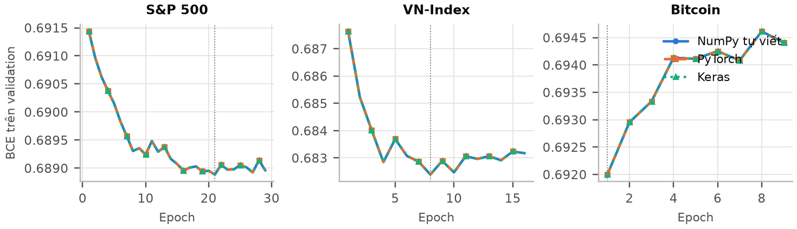

**Ba kiến trúc hồi quy.** Bảng 4.4 và Hình 4.4 so sánh SimpleRNN, LSTM và GRU với hai đường cơ sở. Bức tranh giống Chương 3. Ở S&P 500, cả ba mô hình đều có ROC-AUC dưới 0,5 (LSTM: 0,496 [0,461; 0,531]). Ở Bitcoin, GRU cao nhất với 0,522 [0,494; 0,552], nhưng khoảng tin cậy vẫn chứa 0,5. Chỉ ở VN-Index, LSTM (0,545 [0,506; 0,574]) và GRU (0,547 [0,510; 0,576]) có khoảng tin cậy nằm hoàn toàn trên 0,5 và cao hơn đường cơ sở "lặp lại hướng phiên trước" (0,518 [0,488; 0,551]). Khác biệt rõ nhất giữa các kiến trúc là **độ ổn định**: ROC-AUC của SimpleRNN dao động mạnh giữa các hạt giống (0,525 ± 0,020 ở VN-Index), trong khi LSTM và GRU gần như không đổi (0,544 ± 0,001 và 0,544 ± 0,003). Cơ chế cổng giúp quá trình học ít phụ thuộc vào điểm xuất phát, đúng như phân tích ở mục 4.3–4.5. Giữa LSTM và GRU không có khác biệt đáng kể; GRU đạt mức tương đương với ít tham số hơn.

Bảng 4.4. So sánh SimpleRNN, LSTM và GRU với hai đường cơ sở (PyTorch, 3 seed). CI 95%: bootstrap theo khối 20 phiên.
| Chỉ số | Mô hình | Tham số | ROC-AUC (3 seed) | AUC [CI 95%] | Balanced acc. |
|---|---|---|---|---|---|
| S&P 500 | SimpleRNN | 89 | 0,496 ± 0,007 | 0,496 [0,461; 0,528] | 0,497 ± 0,009 |
| S&P 500 | LSTM | 329 | 0,496 ± 0,004 | 0,496 [0,461; 0,531] | 0,495 ± 0,005 |
| S&P 500 | GRU | 273 | 0,490 ± 0,001 | 0,490 [0,454; 0,525] | 0,491 ± 0,001 |
| S&P 500 | Cơ sở: lặp lại hướng phiên trước | 0 | 0,493 | 0,493 [0,462; 0,519] | 0,493 |
| S&P 500 | Cơ sở: luôn đoán lớp đa số | 0 | 0,500 | — | 0,500 |
| VN-Index | SimpleRNN | 89 | 0,525 ± 0,020 | 0,529 [0,493; 0,563] | 0,512 ± 0,021 |
| VN-Index | LSTM | 329 | 0,544 ± 0,001 | 0,545 [0,506; 0,574] | 0,540 ± 0,018 |
| VN-Index | GRU | 273 | 0,544 ± 0,003 | 0,547 [0,510; 0,576] | 0,530 ± 0,020 |
| VN-Index | Cơ sở: lặp lại hướng phiên trước | 0 | 0,518 | 0,518 [0,488; 0,551] | 0,518 |
| VN-Index | Cơ sở: luôn đoán lớp đa số | 0 | 0,500 | — | 0,500 |
| Bitcoin | SimpleRNN | 89 | 0,511 ± 0,004 | 0,511 [0,483; 0,539] | 0,516 ± 0,011 |
| Bitcoin | LSTM | 329 | 0,505 ± 0,021 | 0,504 [0,480; 0,530] | 0,507 ± 0,005 |
| Bitcoin | GRU | 273 | 0,517 ± 0,008 | 0,522 [0,494; 0,552] | 0,505 ± 0,007 |
| Bitcoin | Cơ sở: lặp lại hướng phiên trước | 0 | 0,485 | 0,485 [0,461; 0,509] | 0,485 |
| Bitcoin | Cơ sở: luôn đoán lớp đa số | 0 | 0,500 | — | 0,500 |

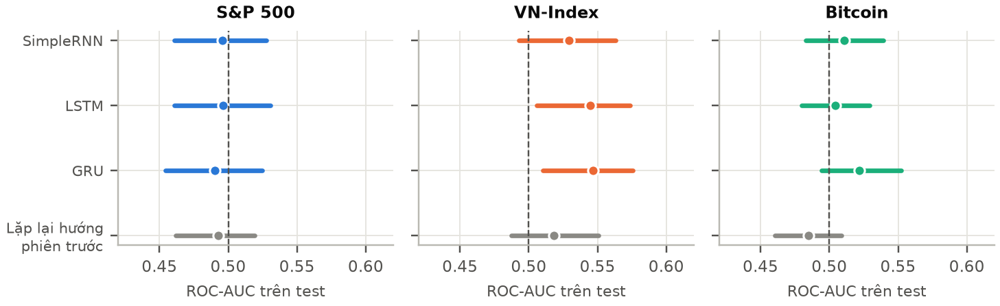

**Vì sao VN-Index khác hai thị trường còn lại?** Câu trả lời nằm ngay trong dữ liệu. Hệ số tự tương quan bậc một của lợi suất ngày VN-Index là 0,086: sau một phiên tăng, xác suất phiên kế tiếp cũng tăng là 56,4%, còn sau một phiên giảm chỉ là 52,6%. Với S&P 500, hệ số này âm (−0,099), còn với Bitcoin gần bằng 0 (−0,022). Nói cách khác, VN-Index có **quán tính ngắn hạn**. Hiện tượng lợi suất chỉ số tự tương quan dương đã được Lo và MacKinlay ghi nhận trên thị trường Mỹ từ cuối thập niên 1980 [@lo1988]; một cách giải thích phổ biến là giá cổ phiếu nhỏ, ít thanh khoản phản ứng với thông tin chậm hơn cổ phiếu lớn [@lo1990]. Đường cơ sở "lặp lại hướng phiên trước" khai thác đúng quán tính này, còn LSTM và GRU chỉ nhỉnh hơn nó một chút. Tín hiệu các mạng học được vì vậy chủ yếu là quán tính đơn giản, chứ không phải một quy luật phức tạp.

**So sánh với CNN.** Trên cùng dữ liệu, cùng nhãn và cùng cách chia, LSTM và GRU đọc trực tiếp chuỗi lợi suất cho kết quả nhỉnh hơn và ổn định hơn CNN đọc ảnh GASF ở VN-Index (ROC-AUC 0,544 ± 0,001 của LSTM so với 0,519 ± 0,021 của CNN4), dù chênh lệch còn nhỏ so với độ rộng khoảng tin cậy. Ở S&P 500 và Bitcoin, không mô hình nào vượt được đoán ngẫu nhiên. Kết quả ủng hộ nhận định của chính Jiang, Kelly và Xiu rằng một mô hình chuỗi thời gian tốt có thể vượt CNN trên ảnh [@jiang2023]. Nó cũng cho thấy với thông tin chỉ gồm giá quá khứ, kiến trúc mạng không thể tạo ra tín hiệu ở nơi tín hiệu không tồn tại.

## 4.9. Từ dự báo đến quyết định đầu tư

Một ROC-AUC có ý nghĩa thống kê chưa chắc đem lại lợi nhuận. Để kiểm tra, tiểu luận mô phỏng một chiến lược đơn giản trên tập test: cuối mỗi phiên, nếu xác suất tăng (trung bình ba hạt giống) không thấp hơn ngưỡng đã chọn trên validation thì nắm giữ chỉ số trong phiên kế tiếp, ngược lại đứng ngoài và giữ tiền mặt. Mỗi lần mua hoặc bán trả phí 0,05% với S&P 500 (giao dịch quỹ ETF), 0,20% với VN-Index (phí môi giới khoảng 0,15% mỗi chiều cộng thuế 0,1% trên giá trị bán, bình quân 0,2% mỗi chiều) và 0,10% với Bitcoin (phí sàn giao ngay phổ biến). Chiến lược so sánh là **mua và giữ** suốt giai đoạn test. Đây là mô phỏng lạc quan: giả định giao dịch được đúng giá đóng cửa vừa quan sát và không tính lãi tiền gửi khi đứng ngoài.

Bảng 4.5. Backtest minh họa trên tập test (01/2023–09/2026); tín hiệu từ dự báo trung bình 3 seed, ngưỡng chọn trên validation. Các cột sau “Lợi suất năm trước phí” đều đã trừ phí giao dịch.
| Chỉ số | Chiến lược | Lợi suất năm trước phí | Lợi suất năm sau phí | Sharpe | Biến động năm | Sụt giảm tối đa | Thời gian nắm giữ | Số lần mua |
|---|---|---|---|---|---|---|---|---|
| S&P 500 | Mua và giữ | 20,5% | 20,5% | 1,34 | 14,7% | 18,9% | 100% | 1 |
| S&P 500 | Lặp lại hướng phiên trước | 6,6% | 0,1% | 0,06 | 9,5% | 19,9% | 55% | 235 |
| S&P 500 | CNN4 | 13,2% | 11,0% | 0,83 | 13,7% | 22,2% | 85% | 73 |
| S&P 500 | CNN8 | 8,9% | 5,6% | 0,49 | 12,7% | 23,4% | 72% | 115 |
| S&P 500 | LSTM | 21,1% | 20,6% | 1,36 | 14,6% | 18,9% | 98% | 14 |
| S&P 500 | GRU | 17,7% | 16,8% | 1,15 | 14,4% | 19,1% | 96% | 27 |
| VN-Index | Mua và giữ | 15,4% | 15,3% | 0,88 | 17,9% | 18,1% | 100% | 1 |
| VN-Index | Lặp lại hướng phiên trước | 15,5% | −9,2% | −0,73 | 12,2% | 42,8% | 56% | 221 |
| VN-Index | CNN4 | 15,4% | 6,5% | 0,54 | 13,6% | 16,9% | 69% | 74 |
| VN-Index | CNN8 | 3,6% | −5,5% | −0,65 | 8,3% | 25,1% | 30% | 86 |
| VN-Index | LSTM | 1,3% | −1,5% | −0,36 | 4,0% | 8,9% | 5% | 26 |
| VN-Index | GRU | 22,2% | 10,5% | 0,94 | 11,3% | 19,2% | 63% | 92 |
| Bitcoin | Mua và giữ | 53,8% | 53,8% | 1,15 | 46,6% | 53,1% | 100% | 1 |
| Bitcoin | Lặp lại hướng phiên trước | 32,0% | 9,4% | 0,44 | 32,4% | 45,0% | 50% | 353 |
| Bitcoin | CNN4 | −0,2% | −0,3% | −0,57 | 0,4% | 0,9% | 0% | 1 |
| Bitcoin | CNN8 | −2,2% | −3,6% | −0,47 | 7,2% | 18,1% | 2% | 27 |
| Bitcoin | LSTM | 24,6% | 19,7% | 0,79 | 27,4% | 29,3% | 30% | 76 |
| Bitcoin | GRU | 9,4% | −3,9% | 0,01 | 29,6% | 52,9% | 34% | 243 |

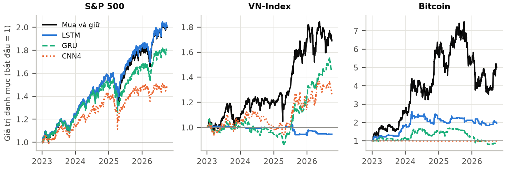

Bảng 4.5 và Hình 4.5 cho thấy sau khi trừ phí, không chiến lược theo tín hiệu nào thắng mua và giữ một cách thuyết phục. Ở S&P 500, LSTM cho kết quả gần trùng mua và giữ (lợi suất năm 20,6% so với 20,5%) đơn giản vì nó hầu như luôn dự báo "tăng" và nắm giữ tới 98% thời gian: mô hình học lại xu hướng tăng dài hạn chứ không phải một tín hiệu ngắn hạn. Ở VN-Index, nơi có ROC-AUC tốt nhất, cột "trước phí" cho thấy tín hiệu là có thật: chỉ nắm giữ 63% thời gian, chiến lược theo GRU đạt 22,2% mỗi năm với Sharpe 1,85, vượt mua và giữ (15,4%, Sharpe 0,89). Nhưng sau 92 lần mua và bán với mức phí của thị trường Việt Nam, tổng phí cộng dồn tương đương 36,8% giá trị danh mục, và lợi suất năm chỉ còn 10,5%, thua mua và giữ. Đường cơ sở "lặp lại hướng phiên trước" còn rõ hơn: trước phí đạt 15,5% mỗi năm, sau phí lỗ −9,2% vì phải mua 221 lần. LSTM trên VN-Index, dù ROC-AUC tương đương GRU, lại có ngưỡng (chọn trên validation 2020–2022) quá cao so với giai đoạn test nên chỉ nắm giữ 5% thời gian. ROC-AUC đo khả năng **xếp hạng**, không bảo đảm một ngưỡng quyết định tốt. Ở Bitcoin, mua và giữ đạt 53,8% mỗi năm trong giai đoạn test, mức mà không chiến lược đứng ngoài nào theo kịp.

Kết quả này trùng với bài học của Fischer và Krauss. Trong nghiên cứu năm 2018, LSTM dự báo cổ phiếu nào sẽ vượt trung vị thị trường với độ chính xác khoảng 54,3% và tạo lợi nhuận 0,46% mỗi ngày trước chi phí trên giai đoạn 1992–2015. Nhưng từ khoảng năm 2010, lợi nhuận sau chi phí chỉ còn dao động quanh 0, vì thị trường đã "học" và triệt tiêu quy luật [@fischer2018]. Riêng với Việt Nam còn một rào cản thực tế: chu kỳ thanh toán T+2 khiến cổ phiếu hay chứng chỉ quỹ mua hôm nay chưa thể bán ngay hôm sau. Một chiến lược vào – ra theo từng phiên vì thế chỉ thực hiện được qua hợp đồng tương lai, mà hợp đồng tương lai lại theo chỉ số VN30 chứ không phải VN-Index.

## 4.10. Xu hướng mới: sự trở lại của mạng hồi quy

Từ năm 2017, Transformer gần như thay thế RNN trong xử lý ngôn ngữ nhờ khả năng tính song song trên toàn chuỗi [@vaswani2017]. Nhưng Transformer có chi phí tăng theo bình phương độ dài chuỗi, và điều này mở đường cho một **"thời kỳ phục hưng" của mạng hồi quy** từ năm 2023. Ý tưởng chung là thiết kế phép cập nhật trạng thái sao cho vừa huấn luyện song song được như Transformer, vừa suy luận tuần tự với bộ nhớ cố định như RNN (Bảng 4.6).

Bảng 4.6. Một số hướng mạng hồi quy và mô hình chuỗi thời gian mới (2023–2026).
| Mô hình | Năm, nơi công bố | Ý tưởng chính |
|---|---|---|
| Mamba [@gu2023mamba] | 2023 | Mô hình không gian trạng thái có cơ chế "chọn lọc" thông tin theo nội dung |
| Mamba-2, Mamba-3 [@dao2024mamba2; @lahoti2026mamba3] | ICML 2024; ICLR 2026 | Liên hệ chặt với attention; cải tiến cách cập nhật trạng thái |
| xLSTM [@beck2024xlstm] | NeurIPS 2024 | LSTM với cổng hàm mũ và ô nhớ dạng ma trận |
| minLSTM, minGRU [@feng2024minrnn] | 2024 | Bỏ phụ thuộc của cổng vào trạng thái cũ để huấn luyện song song |
| RWKV-7 [@peng2025rwkv7] | 2025 | RNN cạnh tranh với Transformer ở quy mô mô hình ngôn ngữ |
| Titans [@behrouz2025titans] | 2025 | Bộ nhớ dài hạn được học ngay trong lúc suy luận |
| Chronos, Chronos-2 [@ansari2024chronos; @ansari2025chronos2] | 2024; 2025 | Mô hình nền tảng dự báo chuỗi thời gian, mã hóa giá trị thành token |
| TimesFM [@das2024timesfm] | ICML 2024 | Mô hình nền tảng dạng decoder cho chuỗi thời gian |
| TiRex [@auer2025tirex] | NeurIPS 2025 | Dự báo zero-shot dựa trên xLSTM |
| Kronos [@shi2026kronos] | AAAI 2026 | Mô hình nền tảng cho dữ liệu nến giá của 45 sàn |

Đáng chú ý, minLSTM và minGRU cho thấy chỉ cần bỏ sự phụ thuộc của các cổng vào trạng thái cũ hₜ₋₁, LSTM và GRU có thể huấn luyện song song bằng thuật toán quét song song (parallel scan) mà vẫn cạnh tranh với các kiến trúc hiện đại [@feng2024minrnn]. Đồng thời, TiRex – một bộ dự báo xây trên xLSTM – cho thấy ý tưởng bộ nhớ có cổng của LSTM năm 1997 vẫn là nền tảng của các mô hình dự báo hàng đầu năm 2025 [@auer2025tirex]. Với tài chính, Kronos mã hóa mỗi cây nến (mở, cao, thấp, đóng, khối lượng) thành token và tiền huấn luyện trên hơn 12 tỉ bản ghi nến, mở ra khả năng dự báo "zero-shot" cho cả những thị trường ít dữ liệu như Việt Nam [@shi2026kronos]. Một lưu ý khi đánh giá các mô hình nền tảng: nếu dữ liệu tiền huấn luyện đã chứa giai đoạn được dùng để kiểm tra, kết quả sẽ lạc quan giả tạo. Kiểm tra trên giai đoạn sau ngày phát hành mô hình là cách đánh giá công bằng nhất.

## 4.11. RNN và LSTM xếp chồng trên 5 lớp

Mạng hồi quy có hai chiều độ sâu khác nhau: độ dài thời gian T và số lớp xếp chồng L. Đọc 20 bước thời gian bằng một lớp RNN không có nghĩa là đã xây dựng 20 lớp học độc lập. Để đáp ứng rõ yêu cầu trên 5 layer, tiểu luận bổ sung **năm lớp hồi quy xếp chồng và một lớp Dense**, tức sáu lớp học được, cho cả SimpleRNN lẫn LSTM. Cách đếm này áp dụng đồng nhất cho Scratch, Keras và PyTorch.

Đầu vào X có kích thước B × 20 × 1. Lớp hồi quy thứ nhất đổi một đặc trưng thành tám trạng thái ở mỗi bước; bốn lớp tiếp theo giữ tám chiều. Bốn lớp đầu phải trả về toàn bộ chuỗi. Lớp cuối được lấy trạng thái ở bước 20 rồi chiếu qua Dense(8, 1). Keras dùng `return_sequences=True` ở bốn lớp đầu; PyTorch lấy tensor đầu ra của từng RNN/LSTM; Scratch dùng các lớp tự viết vốn trả về cả chuỗi [@keras_lstm_api; @torch_rnn_api].

Bảng 4.7. Kiến trúc chung của RNN sáu lớp và LSTM sáu lớp, theo một bias hiệu dụng mỗi lớp hồi quy.
| Vị trí | SimpleRNN | LSTM | Dạng tensor ra |
|---|---|---|---|
| 1 | RNN(1 → 8), 80 tham số | LSTM(1 → 8), 320 tham số | B × 20 × 8 |
| 2–5 | Mỗi RNN(8 → 8), 136 tham số | Mỗi LSTM(8 → 8), 544 tham số | B × 20 × 8 |
| Lấy bước cuối | LastStep, không tham số | LastStep, không tham số | B × 8 |
| 6 | Dense(8 → 1), 9 tham số | Dense(8 → 1), 9 tham số | B × 1 |
| Tổng | 633 tham số học được | 2.505 tham số học được | Một logit mỗi mẫu |

PyTorch và thư viện Scratch lưu hai bias cho mỗi lớp hồi quy. Để khớp số tham số học với Keras, bias hồi quy thứ hai được giữ bằng không và không cập nhật. Trong Scratch, gradient của bias này được xóa trước bước Adam; trong PyTorch đặt `requires_grad_(False)`. Hai bias vẫn có thể tồn tại trong trạng thái lưu, nhưng chỉ một bias hiệu dụng được học.

### 4.11.1. Hợp các hàm của RNN sâu

Gọi Rₗ là hàm biến đổi toàn chuỗi của lớp hồi quy l, S là LastStep, D là Dense và σ là sigmoid. Hợp hàm của mô hình là:

$$z=(D\circ S\circ R_5\circ R_4\circ R_3\circ R_2\circ R_1)(X),\qquad p=\sigma(z)$$ (4.11)

Trong mỗi Rₗ, phép cập nhật tại bước t là:

$$h_t^{(l)}=\tanh\left(W_x^{(l)}h_t^{(l-1)}+W_h^{(l)}h_{t-1}^{(l)}+b^{(l)}\right),\qquad h_t^{(0)}=x_t$$ (4.14)

Có hai đầu vào khác nhau: h ở lớp dưới cùng thời điểm t và h ở cùng lớp tại thời điểm t − 1. Nối dọc tạo khả năng học biểu diễn nhiều mức; nối ngang giữ quan hệ thời gian. Khi trình bày cần vẽ rõ hai mũi tên này, tránh nhầm trạng thái của lớp dưới với trạng thái của phiên trước.

**R₁ đến R₅.** Mỗi hàm nhận một chuỗi và trả về một chuỗi. Trọng số được dùng chung theo thời gian trong cùng một lớp; trọng số của năm lớp khác nhau. Trạng thái ban đầu bằng không khi bắt đầu một cửa sổ mới. Việc đặt lại trạng thái giúp tránh mang thông tin của mẫu trước sang mẫu sau ngoài thiết kế.

**tanh.** Hàm đưa số thực vào (−1, 1), có đạo hàm 1 − tanh²(a). Khi giá trị gần ±1, đạo hàm nhỏ, nên RNN sâu vẫn có thể tiêu biến gradient. Xếp thêm lớp không bảo đảm cải thiện chất lượng; đó là lý do cần giữ mô hình nông làm đối chứng.

**S – LastStep.** S(H) = H[:, T − 1, :]. Gradient được đưa về đúng lát cắt cuối, các vị trí còn lại của tensor gradient ban đầu bằng không. BPTT sau đó vẫn truyền gradient từ trạng thái cuối về các thời điểm trước thông qua quan hệ hồi quy. Lấy bước cuối không đồng nghĩa bỏ qua lịch sử.

**D và σ.** Dense tạo logit từ trạng thái cuối; sigmoid đổi logit thành xác suất. Dùng chung cách tính BCE từ logit như CNN để so sánh ba công cụ trên cùng bài toán phân loại nhị phân.

### 4.11.2. Hợp các hàm của LSTM sâu

Thay mỗi Rₗ bằng Lₗ, một phép biến đổi toàn chuỗi bằng ô LSTM. Các công thức cổng ở mục 4.4 áp dụng độc lập cho từng lớp:

$$z=(D\circ S\circ L_5\circ L_4\circ L_3\circ L_2\circ L_1)(X),\qquad p=\sigma(z)$$ (4.15)

**Cổng quên f.** Hàm sigmoid của đầu vào và trạng thái cũ quyết định phần ô nhớ cũ được giữ lại. f gần một cho phép thông tin đi qua nhiều bước; f gần không xóa thông tin. Đây là cơ chế điều tiết số học, không phải thao tác xóa một dòng văn bản.

**Cổng vào i và ứng viên g.** i nằm trong (0, 1), g nằm trong (−1, 1). Tích từng phần tử i ⊙ g là lượng thông tin mới ghi vào ô nhớ. Ví dụ c cũ = 0,4, f = 0,8, i = 0,3 và g = 0,5 cho c mới = 0,8 × 0,4 + 0,3 × 0,5 = 0,47.

**Cổng ra o.** Hàm h = o ⊙ tanh(c) quyết định phần ô nhớ được đưa ra thành trạng thái ẩn. Nếu o = 0,6 và c = 0,47 thì h xấp xỉ 0,263. Trong LSTM sâu, chuỗi h được chuyển sang lớp kế; c là bộ nhớ nội bộ của chính lớp đó, không chuyển thẳng làm c của lớp trên.

**BPTT và quy tắc dây chuyền.** Gradient đi qua cả năm lớp và qua các bước thời gian. Với hợp hàm F = fₖ ∘ … ∘ f₁, Jacobian của F là tích các Jacobian theo đúng thứ tự. Trong LSTM, đường qua c có thành phần f ở từng bước, giúp duy trì gradient trong một số điều kiện, nhưng không loại bỏ hoàn toàn vấn đề tiêu biến hay bùng nổ. Mã áp dụng cắt chuẩn gradient toàn cục ở mức 1.

### 4.11.3. Quy trình huấn luyện, đánh giá và giải thích hàm

`scratch_deep`, `keras_deep`, `torch_deep` dựng cùng đặc tả kiến trúc. `align_weights` khớp trọng số hiệu dụng, bao gồm thứ tự cổng (i, f, g, o) và một bias hiệu dụng. `train_batch` thực hiện một lần forward, tính loss, backward, cắt gradient và cập nhật. Chức năng từng nhánh được diễn giải ở Phụ lục C. Mã kiểm chứng mới chỉ xác nhận triển khai và khả năng thực hiện bước học trên mini-batch tổng hợp; các chỉ số AUC, bootstrap và backtest ở mục 4.7–4.9 thuộc mô hình cũ đã được huấn luyện trên dữ liệu thị trường.

Nếu mở rộng thực nghiệm thị trường cho mạng sáu lớp, phải giữ nguyên cách chia thời gian, scaler chỉ fit trên train, cùng số lượt thử siêu tham số và cùng dữ liệu test như mô hình nông. Chọn checkpoint bằng validation, sau đó mới tính AUC test, AP và phí giao dịch. Không dùng loss giảm trên bốn mẫu để suy ra mạng tổng quát hóa tốt hơn.

Demo bắt đầu từ một chuỗi 20 phiên, thể hiện shape B × 20 × 1, rồi lần lượt năm tensor B × 20 × 8 và vector B × 8. Một thành viên giải thích hợp hàm; thành viên tiếp theo tính ví dụ ô LSTM bằng số; thành viên phụ trách mã chạy đối chiếu ba framework. Khi thảo luận, dùng hai câu hỏi kiểm tra: vì sao `return_sequences=False` ở lớp đầu làm hỏng xếp chồng, và vì sao 20 thời điểm không được đếm là 20 lớp học được?


### 4.11.4. Cell notebook: RNN xếp chồng và forward từng lớp

Notebook `notebooks/tieuluan/complete/04a_rnn_6_layers.ipynb` đã chạy Run All. Các cell dưới được chèn trực tiếp từ notebook, giữ nhãn cell để tra lại. Mỗi cell code đi cùng giải thích đầu vào, đầu ra và ý nghĩa của hàm; không chỉ đưa ảnh chụp code.

**Cell RNN-05 – notebook `04a_rnn_6_layers.ipynb`.**

```python
# Cell RNN-05
def torch_deep(kind, seed=42):
    import torch
    from torch import nn
    torch.manual_seed(seed)
    if kind == 'cnn':
        layers = []
        for cin, cout in [(1, 4), (4, 4), (4, 8), (8, 8)]:
            layers += [nn.Conv2d(cin, cout, 3), nn.ReLU()]
        return nn.Sequential(*layers, nn.Flatten(),
                             nn.Linear(8*12*12, 8), nn.ReLU(),
                             nn.Linear(8, 1))

    class Stacked(nn.Module):
        def __init__(self):
            super().__init__()
            cell = {'rnn': nn.RNN, 'lstm': nn.LSTM}[kind]
            self.cells = nn.ModuleList([cell(1, 8, batch_first=True)])
            self.cells.extend([cell(8, 8, batch_first=True)
                               for _ in range(4)])
            self.head = nn.Linear(8, 1)

        def forward(self, x):
            for cell in self.cells:
                x, _ = cell(x)
            return self.head(x[:, -1])
    return Stacked()
```

**Giải thích hàm và liên hệ công thức.** torch_deep tạo ModuleList gồm năm RNN và một Linear. Stacked.forward đưa toàn bộ chuỗi của lớp dưới sang lớp trên, sau đó lấy x[:, -1] cho đầu ra một logit. Trong mỗi lớp, h_t phụ thuộc đầu vào tại t và trạng thái t−1; trọng số dùng chung theo thời gian nhưng khác giữa năm lớp. Cell tương ứng bản Scratch và Keras nằm ngay trong cùng notebook, không chỉ có bản PyTorch.

**Cell RNN-07 – notebook `04a_rnn_6_layers.ipynb`.**

```python
# Cell RNN-07
# Quan sát hợp hàm bằng cách in shape sau từng hàm, trên một mẫu thật.
trace_model = scratch_deep(KIND)
value = data['train_x'][:1]
trace = []
for index, layer in enumerate(trace_model.layers, 1):
    before = value.shape
    value = layer.forward(value)
    trace.append({'step':index, 'function':type(layer).__name__,
                  'input':str(before), 'output':str(value.shape)})
display(pd.DataFrame(trace))
print('Logit:', value.ravel())
print('Sigmoid:', (0.5*(1+np.tanh(value/2))).ravel())
```

**Đầu ra đã chạy (trích phần văn bản):**

```text
step   function       input      output
0     1  SimpleRNN  (1, 20, 1)  (1, 20, 8)
1     2  SimpleRNN  (1, 20, 8)  (1, 20, 8)
2     3  SimpleRNN  (1, 20, 8)  (1, 20, 8)
3     4  SimpleRNN  (1, 20, 8)  (1, 20, 8)
4     5  SimpleRNN  (1, 20, 8)  (1, 20, 8)
5     6   LastStep  (1, 20, 8)      (1, 8)
6     7      Dense      (1, 8)      (1, 1)
Logit: [-0.07917508]
Sigmoid: [0.48021656]
```

**Giải thích hàm và liên hệ công thức.** Vòng lặp áp dụng từng hàm forward vào kết quả của hàm trước, đúng với biểu thức hợp hàm đã trình bày. Cột input/output cho phép kiểm tra miền xác định và miền giá trị ở từng bước. Sigmoid chỉ áp dụng sau logit để hiển thị xác suất; nó không được chèn trước BCEWithLogits khi học.

**Cell huấn luyện và kết quả trên dữ liệu thật.** Các cell RNN-09 đến RNN-12 chứa train_batch, các hàm lưu checkpoint, vòng huấn luyện ba công cụ và đồ thị loss. Thực nghiệm demo dùng 256 mẫu train, 128 validation và 256 test của VN-Index, giữ cách chia thời gian của dữ liệu gốc; ba epoch, batch 32, cùng trọng số hiệu dụng và cùng thứ tự batch. Checkpoint được chọn bằng BCE validation; test chỉ được đánh giá sau khi chọn checkpoint. Đây là tập con phục vụ trình bày, không thay thế kết quả toàn bộ dữ liệu trong chương.

- scratch: checkpoint epoch 3; validation BCE = 0.736459; test BCE = 0.731804; test AUC = 0.481883.
- keras: checkpoint epoch 3; validation BCE = 0.736459; test BCE = 0.731804; test AUC = 0.481883.
- pytorch: checkpoint epoch 3; validation BCE = 0.736459; test BCE = 0.731804; test AUC = 0.481883.

Các chỉ số trên đọc trực tiếp từ kết quả notebook. Không dùng AUC của tập con để kết luận có lợi nhuận, và không gán các số này cho mô hình nông đã đánh giá trên toàn bộ tập test.


### 4.11.5. Cell notebook: LSTM, return_sequences và trạng thái cuối

Notebook `notebooks/tieuluan/complete/04b_lstm_6_layers.ipynb` đã chạy Run All. Các cell dưới được chèn trực tiếp từ notebook, giữ nhãn cell để tra lại. Mỗi cell code đi cùng giải thích đầu vào, đầu ra và ý nghĩa của hàm; không chỉ đưa ảnh chụp code.

**Cell LSTM-04 – notebook `04b_lstm_6_layers.ipynb`.**

```python
# Cell LSTM-04
def keras_deep(kind, seed=42):
    import keras
    keras.utils.set_random_seed(seed)
    if kind == 'cnn':
        x = keras.Input((1, 20, 20))
        z = keras.layers.Permute((2, 3, 1))(x)
        for width in [4, 4, 8, 8]:
            z = keras.layers.Conv2D(width, 3, activation='relu')(z)
        z = keras.layers.Permute((3, 1, 2))(z)
        z = keras.layers.Flatten()(z)
        z = keras.layers.Dense(8, activation='relu')(z)
    else:
        x = keras.Input((20, 1))
        z = x
        cell = {'rnn': keras.layers.SimpleRNN,
                'lstm': keras.layers.LSTM}[kind]
        for depth in range(5):
            z = cell(8, return_sequences=(depth < 4))(z)
    return keras.Model(x, keras.layers.Dense(1)(z))
```

**Giải thích hàm và liên hệ công thức.** keras_deep dựng năm LSTM và Dense. Bốn lớp đầu trả cả chuỗi, lớp thứ năm trả trạng thái cuối. Mỗi LSTM cập nhật các cổng i, f, g, o và ô nhớ c theo công thức mục 4.4; output truyền lên lớp trên là h, không phải ô nhớ c. Nhánh CNN trong hàm dùng Permute để khớp quy ước kênh; trong demo KIND=lstm nên chỉ nhánh hồi quy chạy. Các cell Scratch và PyTorch có trong cùng notebook để đối chiếu.

**Cell LSTM-07 – notebook `04b_lstm_6_layers.ipynb`.**

```python
# Cell LSTM-07
# Quan sát hợp hàm bằng cách in shape sau từng hàm, trên một mẫu thật.
trace_model = scratch_deep(KIND)
value = data['train_x'][:1]
trace = []
for index, layer in enumerate(trace_model.layers, 1):
    before = value.shape
    value = layer.forward(value)
    trace.append({'step':index, 'function':type(layer).__name__,
                  'input':str(before), 'output':str(value.shape)})
display(pd.DataFrame(trace))
print('Logit:', value.ravel())
print('Sigmoid:', (0.5*(1+np.tanh(value/2))).ravel())
```

**Đầu ra đã chạy (trích phần văn bản):**

```text
step  function       input      output
0     1      LSTM  (1, 20, 1)  (1, 20, 8)
1     2      LSTM  (1, 20, 8)  (1, 20, 8)
2     3      LSTM  (1, 20, 8)  (1, 20, 8)
3     4      LSTM  (1, 20, 8)  (1, 20, 8)
4     5      LSTM  (1, 20, 8)  (1, 20, 8)
5     6  LastStep  (1, 20, 8)      (1, 8)
6     7     Dense      (1, 8)      (1, 1)
Logit: [0.00264347]
Sigmoid: [0.50066084]
```

**Giải thích hàm và liên hệ công thức.** Vòng lặp áp dụng từng hàm forward vào kết quả của hàm trước, đúng với biểu thức hợp hàm đã trình bày. Cột input/output cho phép kiểm tra miền xác định và miền giá trị ở từng bước. Sigmoid chỉ áp dụng sau logit để hiển thị xác suất; nó không được chèn trước BCEWithLogits khi học.

**Cell huấn luyện và kết quả trên dữ liệu thật.** Các cell LSTM-09 đến LSTM-12 chứa train_batch, các hàm lưu checkpoint, vòng huấn luyện ba công cụ và đồ thị loss. Thực nghiệm demo dùng 256 mẫu train, 128 validation và 256 test của VN-Index, giữ cách chia thời gian của dữ liệu gốc; ba epoch, batch 32, cùng trọng số hiệu dụng và cùng thứ tự batch. Checkpoint được chọn bằng BCE validation; test chỉ được đánh giá sau khi chọn checkpoint. Đây là tập con phục vụ trình bày, không thay thế kết quả toàn bộ dữ liệu trong chương.

- scratch: checkpoint epoch 3; validation BCE = 0.692489; test BCE = 0.692665; test AUC = 0.489339.
- keras: checkpoint epoch 3; validation BCE = 0.692490; test BCE = 0.692666; test AUC = 0.489435.
- pytorch: checkpoint epoch 3; validation BCE = 0.692489; test BCE = 0.692665; test AUC = 0.489339.

Các chỉ số trên đọc trực tiếp từ kết quả notebook. Không dùng AUC của tập con để kết luận có lợi nhuận, và không gán các số này cho mô hình nông đã đánh giá trên toàn bộ tập test.


## 4.12. Tiểu kết chương

Chương 4 đã trình bày mạng hồi quy từ SimpleRNN đến LSTM, GRU, cùng hai vấn đề cốt lõi của chúng: tiêu biến và bùng nổ gradient. Thực nghiệm khẳng định ba điều. Thứ nhất, LSTM tự viết bằng NumPy, kể cả phần BPTT, cho kết quả trùng với Keras và PyTorch. Thứ hai, trên cùng bài toán, mạng hồi quy đọc chuỗi lợi suất nhỉnh hơn và ổn định hơn CNN đọc ảnh, nhưng chỉ ở VN-Index mới có khả năng dự báo nhỏ, có ý nghĩa thống kê, phần lớn đến từ quán tính ngắn hạn của chỉ số. Thứ ba, khả năng dự báo đó có thật nhưng nhỏ: trước phí, chiến lược theo GRU thắng mua và giữ ở VN-Index; sau phí giao dịch thì thua, chưa kể các ràng buộc thực tế như chu kỳ thanh toán T+2. Các hướng mới như xLSTM, Mamba, minGRU hay mô hình nền tảng Kronos cho thấy ý tưởng "bộ nhớ có cổng" vẫn đang tiếp tục phát triển, và là đối tượng đánh giá phù hợp cho các nghiên cứu tiếp theo.


# CHƯƠNG 5. KNOWLEDGE GRAPH VÀ RAG

## 5.1. Mở đầu

### 5.1.1. Knowledge Graph, Knowledge Base và RAG là gì?

Các chương trước học một ánh xạ từ dữ liệu sang nhãn. Khi cần trả lời “chỉ tiêu này xuất hiện trong báo cáo nào?” hay “có bao nhiêu lượt nhập viện tái nhập trong 30 ngày?”, một xác suất do CNN hoặc LSTM tạo ra chưa giải quyết được nhu cầu tra cứu. Hệ thống cần tổ chức tri thức, tìm bằng chứng và trả lời theo nguồn. Chương này bổ sung ba thành phần: cơ sở tri thức, đồ thị tri thức và sinh câu trả lời có truy hồi.

**Knowledge Base (KB)** là kho tri thức có tổ chức: có thể gồm bảng, luật, tài liệu và đồ thị. **Knowledge Graph (KG)** biểu diễn các thực thể và quan hệ giữa chúng dưới dạng đồ thị. Ví dụ, bộ ba (Công ty A, công bố, Báo cáo 2023) nối hai thực thể bằng một quan hệ có tên. KG là một cách tổ chức KB; hai thuật ngữ liên quan nhưng không đồng nghĩa hoàn toàn [@hogan2021kg].

**Retrieval-Augmented Generation (RAG)** kết hợp truy hồi bằng chứng từ kho ngoài với mô hình sinh văn bản. Câu hỏi được dùng để tìm các đoạn liên quan; các đoạn này đi vào ngữ cảnh để mô hình tạo câu trả lời. Tri thức không chỉ nằm trong trọng số mô hình: có thể cập nhật kho tài liệu mà không huấn luyện lại toàn bộ bộ sinh [@lewis2020rag].

### 5.1.2. Vai trò và ý nghĩa của KB và RAG

KB cung cấp dữ liệu đã tổ chức; KG giúp đi theo quan hệ và nguồn gốc; RAG giúp hỏi bằng ngôn ngữ tự nhiên. Trong bài toán báo cáo tài chính, đồ thị hỗ trợ xác định công ty, niên độ và báo cáo, còn truy hồi tìm dòng bảng hoặc đoạn giải thích. Trong bài toán bệnh tiểu đường, bảng dữ liệu hỗ trợ thống kê lượt khám; tài liệu nguồn giải thích ý nghĩa trường dữ liệu. Cách chọn công cụ phải phù hợp với câu hỏi: đếm chính xác nên dùng mã thống kê, thay vì yêu cầu mô hình ngôn ngữ đoán số.

Bảng 5.1. Phân biệt các thành phần của hệ hỏi đáp có căn cứ.
| Thành phần | Dữ liệu đầu vào | Đầu ra | Vai trò trong tiểu luận |
|---|---|---|---|
| KB | Tài liệu, bảng và metadata | Kho tri thức có nguồn | Lưu corpus và bảng thống kê |
| KG | Thực thể, quan hệ, thuộc tính | Đồ thị truy vấn được | Liên kết công ty–báo cáo–đoạn trích |
| Retriever | Câu hỏi và chỉ mục | Danh sách đoạn xếp hạng | BM25, dense và hybrid |
| Generator | Câu hỏi cùng bằng chứng | Văn bản trả lời | FLAN-T5-small chạy CPU |
| Calculator | Phép toán và toán hạng có đơn vị | Số và công thức | Tách tính toán khỏi sinh văn bản |
| Agent | Yêu cầu có cấu trúc | Chọn công cụ và trace | Triển khai ở cuối chương và Chương 6 |

Tiểu luận thống nhất số chương theo đề cương tổng thể: CNN ở Chương 3, RNN–LSTM ở Chương 4, KG–RAG ở Chương 5 và Hệ đa Agent ở Chương 6. Thư mục mã `src/chapter04` giữ tên lịch sử của bài thực hành “Knowledge & RAG”; đường dẫn này không làm thay đổi số chương của bản báo cáo.

## 5.2. Knowledge Graph và cơ sở tri thức

### 5.2.1. Mô hình dữ liệu, thực thể và quan hệ

KG có thể viết G = (V, E), trong đó V là tập nút và E là tập cạnh có nhãn. Thuộc tính của nút mô tả thực thể, thuộc tính cạnh mô tả mối liên hệ. Trong hệ minh họa, nút Company có ticker; Report có year, filename và source_url; Passage hoặc TableRow có chunk_id và text. Mã định danh ổn định giúp phân biệt hai báo cáo cùng tên công ty nhưng khác niên độ.

Ví dụ minh họa cấu trúc, không phải số liệu kinh doanh thật: (company:A, PUBLISHED, report:A:2023) và (report:A:2023, HAS_PASSAGE, passage:A:2023:row_5). Câu hỏi về công ty A năm 2023 cần đi đến đúng Report trước khi tìm row_5. Một giá trị doanh thu không được đặt trên nút Company mà thiếu năm và đơn vị, vì cùng một doanh nghiệp có nhiều giá trị theo thời gian.

Kho bệnh tiểu đường có hai lớp dữ liệu: đồ thị tài liệu và đồ thị lượt khám. Ở đồ thị lượt khám, Patient nối Encounter bằng HAS_ENCOUNTER; Encounter nối DiagnosisCode bằng HAS_RECORDED_CODE và nối Dataset bằng FROM_DATASET. Quan hệ “có mã chẩn đoán được ghi” mô tả dữ liệu quan sát, không suy ra quan hệ nhân quả giữa hai bệnh.

### 5.2.2. Quy trình xây dựng và quản lý nguồn gốc

Quy trình gồm xác định câu hỏi → thiết kế schema → đọc dữ liệu → chuẩn hóa mã → tạo nút/cạnh → kiểm tra ràng buộc → lưu đồ thị. Tệp `src/chapter04/knowledge.py` cài các hàm `build_document_graph`, `build_encounter_graph`, `save_graph` và `load_graph` bằng NetworkX. Đồ thị được lưu JSON nén gzip; bản minh họa không yêu cầu máy chủ Neo4j.

Đối với báo cáo, mã `report_key` kết hợp định danh báo cáo với hash nội dung để tránh trộn tài liệu cùng tên. `build_finance_chunks` đưa cả tiêu đề cột vào dòng bảng, nhờ đó một ô số đi kèm tên chỉ tiêu và năm. Metadata tối thiểu gồm id, domain, report, source_url và locator. Nếu bỏ locator, đường dẫn về cả kho GitHub vẫn khó giúp người đọc tìm đúng dòng bằng chứng.

Với dữ liệu thiếu, dấu “?” được nhận diện là giá trị thiếu. Không tạo nút DiagnosisCode có mã “?” rồi xem đó là một bệnh mới. Với tập dữ liệu có nhiều lượt khám của cùng bệnh nhân, số lượt khám và số người phải được tính riêng. Để kiểm tra, lấy một Patient có nhiều Encounter và truy vết các cạnh, sau đó đối chiếu với dòng nguồn.

### 5.2.3. Truy vấn và giới hạn suy luận

Một truy vấn đồ thị có thể lấy tất cả Report là nút kế của Company, rồi lấy Passage là nút kế của Report. Ví dụ Cypher dưới đây diễn tả cùng ý tưởng nếu chuyển schema sang Neo4j; mã thực tế của chương sử dụng NetworkX:

```cypher
MATCH (c:Company {ticker: $ticker})-[:PUBLISHED]->(r:Report)
MATCH (r)-[:HAS_PASSAGE]->(p:Passage)
WHERE r.year = $year
RETURN r.filename, p.chunk_id, p.text, p.source_url
LIMIT 10
```

Truy vấn phải truyền tham số thay vì nối trực tiếp chuỗi người dùng. Schema tài chính hiện tại chủ yếu tổ chức tài liệu; nó chưa tự động trích xuất mọi sự kiện doanh thu, lợi nhuận và quan hệ sở hữu. Vì vậy đây là KG tài liệu có truy vết nguồn, chưa phải đồ thị tri thức tài chính đầy đủ. Không suy diễn rằng cạnh HAS_PASSAGE chứng minh một nhận định kinh doanh nào đó.

## 5.3. RAG: truy hồi, sinh và đánh giá

### 5.3.1. Hai luồng xử lý

Luồng lập chỉ mục chạy khi nạp hoặc cập nhật dữ liệu: đọc tài liệu, chia đoạn, gắn metadata, tạo chỉ mục từ khóa, tính embedding và lưu bộ nhớ đệm. Luồng trả lời chạy cho từng câu hỏi: kiểm tra đầu vào, chọn miền, lọc phạm vi nếu có, truy hồi, ghép ngữ cảnh, sinh câu trả lời và đính kèm nguồn.

Gọi I là hàm tạo chỉ mục của kho D; R là truy hồi; B là dựng prompt; G là sinh; A là đóng gói đáp án. Với I(D) đã có, hệ trả lời được biểu diễn bằng hợp hàm:

$$E_q=R(q,I(D)),\qquad y=A\left(G\left(B(q,E_q)\right),E_q\right)$$ (5.1)

R trả về danh sách bằng chứng, B trả về văn bản đầu vào, G trả về văn bản sinh và A trả về cấu trúc chứa answer, citations và status. Việc phân biệt kiểu dữ liệu này giúp giải thích từng hàm thay vì gọi toàn bộ hệ thống là một “mô hình RAG” khó kiểm tra.

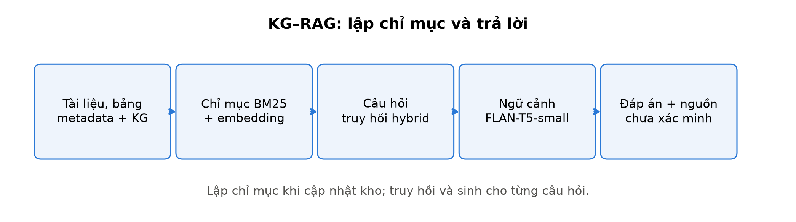

### 5.3.2. BM25, dense retrieval và hợp nhất thứ hạng

**BM25** dùng tần suất từ trong đoạn, độ hiếm của từ trong kho và độ dài đoạn để chấm điểm. Mã tự viết tạo postings từ token tới các đoạn chứa token. Nó phù hợp khi câu hỏi chứa đúng tên công ty, tên chỉ tiêu hoặc cụm từ xuất hiện trong tài liệu. Với từ chưa xuất hiện trong chỉ mục, phương pháp không tự hiểu các cách diễn đạt đồng nghĩa.

**Dense retrieval** đưa câu hỏi và đoạn vào cùng không gian vector bằng all-MiniLM-L6-v2. Mã lấy trung bình có attention mask trên trạng thái token rồi chuẩn hóa L2. Khi vector đã có độ dài một, tích vô hướng bằng cosine similarity. Truy hồi dense có thể đưa các đoạn gần về nghĩa lên cao nhưng không bảo đảm phân biệt chính xác các con số hoặc niên độ gần nhau [@minilm_model].

**Hybrid** lấy 30 ứng viên từ mỗi nhánh rồi dùng Reciprocal Rank Fusion (RRF). Điểm của đoạn d là tổng nghịch đảo hạng đã làm trơn:

$$s(d)=\sum_{j\in\{lexical,dense\}}\frac{1}{60+rank_j(d)}$$ (5.2)

Đoạn không có trong một danh sách không nhận đóng góp từ danh sách đó. Ví dụ d ở hạng 2 của BM25 và hạng 5 của dense có điểm 1/62 + 1/65, xấp xỉ 0,03151. Hợp nhất hạng tránh cộng trực tiếp hai loại điểm có thang đo khác nhau; nó không khẳng định hai hệ truy hồi có độ tin cậy giống nhau [@rrf2009].

### 5.3.3. Dựng ngữ cảnh và sinh câu trả lời

`build_prompt` đặt câu hỏi trước ngữ cảnh, kèm yêu cầu chỉ trả lời theo nguồn và nói unknown khi không có đáp án. Bộ sinh `google/flan-t5-small` chạy cục bộ, tối đa 512 token đầu vào và 64 token sinh mới, không lấy mẫu ngẫu nhiên. Các cấu hình này đọc trực tiếp từ `src/chapter04/rag.py`; việc đặt câu hỏi trước giúp giảm rủi ro mất câu hỏi khi cắt ngữ cảnh dài [@flan_model].

`RAGEngine.answer` lấy ba đoạn, gọi bộ sinh rồi đính kèm id, source_url và locator. Khi không có bằng chứng, hệ trả `insufficient_evidence`. Khi có câu trả lời được sinh, trạng thái là `generated_unverified`. Nguồn đính kèm là các đoạn đã truy hồi, chưa phải ánh xạ từng mệnh đề trong câu trả lời tới đoạn chứng minh. Kiểm tra id hợp lệ chỉ xác nhận nguồn tồn tại, không xác nhận câu trả lời được nguồn hỗ trợ.

### 5.3.4. Chỉ số và thiết kế thí nghiệm

Hit@k đo có ít nhất một đoạn đúng trong k kết quả; Recall@k đo phần bằng chứng chuẩn đã thu hồi; MRR@k đo vị trí của kết quả đúng đầu tiên. Với một câu cần hai đoạn chuẩn và truy hồi chỉ có một đoạn, Hit@5 vẫn bằng một nhưng Recall@5 chỉ bằng 0,5. Complete@5 yêu cầu có đủ tất cả đoạn chuẩn nên phù hợp hơn khi câu hỏi cần nhiều toán hạng.

Phần sinh được đo riêng: Exact Match so chuỗi chuẩn hóa; token-F1 đo mức trùng token; numeric accuracy kiểm tra kết quả số theo quy trình đánh giá đã lưu. So sánh ba điều kiện: không ngữ cảnh, ngữ cảnh chuẩn và RAG thực tế. “Gold context oracle” cung cấp bằng chứng chuẩn trực tiếp để chẩn đoán lỗi bộ sinh, không đại diện một hệ triển khai phải tự tìm tài liệu.

### 5.3.5. Giải thích từng hàm trong mã KG–RAG

Các hàm dưới được nhóm theo luồng dữ liệu để người trình bày có thể nối từ công thức đến mã. Đầu ra mỗi hàm là đầu vào của bước kế; chỉ bộ sinh trả văn bản, các bước truy hồi chủ yếu trả cấu trúc dữ liệu và danh sách bằng chứng.

- `tokenize(text)` chuyển chữ về dạng thường và tách token theo biểu thức chính quy. Bản hiện tại ưu tiên chữ/số Latin nên không được mặc định là bộ tách từ tiếng Việt hoàn chỉnh.
- `report_key(item)` tạo id báo cáo từ tên và hash nội dung. Hàm giúp phân biệt các ngữ cảnh báo cáo khác nhau, không chấm điểm mức liên quan của tài liệu.
- `build_finance_chunks(items, table_headers=True)` nhận các mẫu FinQA, tách đoạn văn và dòng bảng, loại đoạn trùng id, gắn công ty/năm/nguồn/locator. Khi bật table_headers, ô số đi kèm tiêu đề cột.
- `BM25.__init__(chunks)` tạo độ dài đoạn, độ dài trung bình và chỉ mục đảo postings. `BM25.search(query, k, allowed)` tính điểm theo các token câu hỏi, lọc id được phép rồi trả top k; allowed không phải nhãn đáp án.
- `Encoder.encode(texts, batch_size)` tokenize thành tensor, chạy mô hình embedding, lấy trung bình có attention mask và chuẩn hóa L2. Đầu ra là ma trận số đoạn × số chiều embedding, không phải câu trả lời.
- `DenseRetriever.__init__` tính hoặc đọc embedding cache; hash corpus giúp tránh dùng cache không đúng nội dung. `DenseRetriever.search` tính tích vô hướng với vector câu hỏi, áp dụng bộ lọc id và trả danh sách xếp hạng.
- `reciprocal_rank_fusion(rankings, k, c)` nhận các danh sách id và cộng 1/(c + hạng), bỏ qua đóng góp của danh sách không chứa id đó. `hybrid_search` lấy ứng viên từ BM25 và dense, hợp nhất hạng rồi khôi phục nội dung các đoạn.
- `retrieval_metrics(rankings, golds)` so danh sách truy hồi với id bằng chứng chuẩn, tính Hit@1/5, Recall@5, MRR@5 và Complete@5. Hàm dùng nhãn chuẩn để đánh giá, không được đưa gold vào luồng trả lời người dùng.
- `build_prompt(question, evidence)` ghép yêu cầu trả lời, câu hỏi và nội dung bằng chứng. Khi evidence là None, nó dựng điều kiện đối chứng không ngữ cảnh; đây là một điều kiện khác với corpus không có kết quả phù hợp.
- `LocalGenerator.generate(question, evidence)` dựng prompt, tokenize tối đa 512 token, sinh tối đa 64 token và decode. Hàm trả văn bản; nó không tự chứng minh từng mệnh đề được bằng chứng hỗ trợ.
- `RAGEngine.retrieve(question, domain, k, report, method)` chọn chỉ mục miền, tạo tập id được phép theo report nếu có và gọi BM25/dense/hybrid. `RAGEngine.answer` gọi retrieve, xử lý rỗng, gọi generate và đóng gói answer, nguồn cùng status.
- `normalized_answer(text)` chuẩn hóa chuỗi để so khớp. `token_f1(prediction, reference)` đếm token chung có xét số lần xuất hiện, tính precision/recall rồi trung bình điều hòa; token-F1 không kiểm tra đầy đủ số học hoặc ngữ nghĩa.
- `build_document_graph(chunks, domain)` tạo các nút và cạnh nguồn tài liệu. `build_encounter_graph(frame)` tạo Patient–Encounter–DiagnosisCode từ dòng dữ liệu; không tự suy ra quan hệ nhân quả hay chỉ định điều trị.
- `save_graph(graph, path)` ghi JSON node-link nén gzip; `load_graph(path)` đọc lại cùng cấu trúc. Hai hàm phục vụ lưu trữ, không huấn luyện embedding đồ thị.
- `safe_calculate(operation, values, units)` kiểm tra phép toán/toán hạng/đơn vị, tính kết quả và trả value, formula, unit. Nguồn của từng toán hạng vẫn phải do bên gọi cung cấp, hàm không tự trích số từ văn bản.

## 5.4. KB và RAG cho bệnh tiểu đường

### 5.4.1. Dữ liệu và câu hỏi

Dữ liệu UCI Diabetes 130-US Hospitals gồm các lượt điều trị nội trú trong giai đoạn 1999–2008 [@uci_diabetes296]. Kết quả xử lý cục bộ ghi nhận 101.766 lượt khám, 71.518 bệnh nhân phân biệt và 50 cột. Nhãn tái nhập viện có 54.864 lượt NO, 35.545 lượt >30 và 11.357 lượt <30. Đây là số liệu toàn bộ bảng; đồ thị minh họa chỉ lấy mẫu 5.000 lượt với seed 42, trong đó có 570 lượt <30. Hai con số 570 và 11.357 thuộc hai phạm vi khác nhau.

Corpus hỏi đáp gồm 183 đoạn; bộ câu hỏi minh họa gồm 16 câu tự xây dựng. Câu “How many encounters are in the dataset?” cần lấy thống kê từ bảng. Câu hỏi giải thích trường `readmitted` cần truy hồi mô tả bộ dữ liệu. Hệ không dùng những câu hỏi này để suy ra phác đồ hay hướng dẫn điều trị cá nhân.

### 5.4.2. Kết quả và phân tích

Bảng 5.2. Truy hồi trên 16 câu hỏi minh họa bệnh tiểu đường.
|Phương pháp|Hit@1|Hit@5|MRR@5|
|---|---|---|---|
|bm25|37,50%|68,75%|0,510|
|dense|50,00%|81,25%|0,635|
|hybrid|43,75%|87,50%|0,615|

Bảng 5.3. Sinh câu trả lời trên cùng 16 câu hỏi.
|Điều kiện|Exact Match|Token-F1|
|---|---|---|
|gold_context_oracle|56,25%|0,807|
|hybrid_rag|31,25%|0,547|
|no_context|6,25%|0,094|


Hybrid tìm được ít nhất một đoạn đúng trong top 5 cho 14/16 câu, nhưng Exact Match của toàn bộ câu trả lời chỉ 5/16. Khi đưa ngữ cảnh chuẩn, Exact Match tăng lên 9/16; không ngữ cảnh chỉ đạt 1/16. Khoảng cách giữa truy hồi và sinh cho thấy phải đánh giá hai khâu riêng. Token-F1 cao hơn Exact Match không có nghĩa mọi chi tiết số đều đúng.

Với câu hỏi đếm, dùng `ToolAgent` nhánh statistics cho kết quả xác định: 11.357 lượt tái nhập dưới 30 ngày. Nó trả trạng thái computed và trace dataset_statistics. Câu trả lời được lấy bằng truy vấn dữ liệu, không gán cho chất lượng suy luận của FLAN-T5-small. Bộ 16 câu quá nhỏ và do người triển khai biên soạn nên kết quả chỉ minh họa kỹ thuật, chưa đủ chứng minh hiệu quả trong môi trường lâm sàng.

## 5.5. KB và RAG cho chứng khoán, báo cáo tài chính

### 5.5.1. Dữ liệu FinQA và biểu diễn bảng

FinQA cung cấp câu hỏi cần suy luận số trên báo cáo doanh nghiệp, kèm văn bản, bảng và chương trình tính đáp án [@finqa2021]. Bản dữ liệu cục bộ có 6.251 mẫu train, 883 dev và 1.147 test. Thí nghiệm của chương đánh giá truy hồi trên **883 câu dev**, tạo 9.177 đoạn thuộc 299 báo cáo phân biệt. Đây là tập phát triển để phân tích phương pháp; không trình bày kết quả như một đánh giá cuối cùng trên test độc lập.

Hai cách chia đoạn được so sánh: dòng bảng thô và dòng bảng gắn tiêu đề cột. Ví dụ minh họa, dòng “2022: 100; 2023: 120” giữ được ngữ cảnh thời gian tốt hơn chuỗi “100 | 120”. Thông tin metadata về công ty, niên độ và id báo cáo được lưu cùng đoạn để có thể truy vết.

### 5.5.2. Kết quả truy hồi và điều kiện oracle

Bảng 5.4. Truy hồi trên 883 câu FinQA dev; lọc oracle biết sẵn báo cáo đúng.
|Phương pháp|Phạm vi|Hit@5|Recall@5|Complete@5|
|---|---|---|---|---|
|bm25_raw|global|51,98%|40,34%|30,58%|
|bm25_raw|oracle_report|80,97%|67,69%|55,27%|
|bm25_headers|global|61,95%|50,94%|40,88%|
|bm25_headers|oracle_report|89,47%|78,38%|67,38%|
|dense|global|62,17%|50,50%|39,52%|
|dense|oracle_report|91,39%|79,80%|67,16%|
|hybrid|global|68,29%|56,07%|44,85%|
|hybrid|oracle_report|92,64%|82,00%|70,55%|


Hybrid toàn kho đạt Hit@5 khoảng 68,29%, so với khoảng 51,98% của BM25 trên dòng thô. BM25 gắn tiêu đề cột đạt khoảng 61,95%, thể hiện ích lợi của tiền xử lý bảng ngay cả khi chưa đổi mô hình embedding. Khi cung cấp sẵn báo cáo đúng, hybrid đạt khoảng 92,64%. Mức này là **oracle_report**: biết sẵn báo cáo đúng theo dữ liệu chuẩn, nên không được dùng thay cho kết quả tìm kiếm toàn kho của người dùng mới.

Complete@5 thấp hơn Hit@5 vì nhiều câu cần nhiều bằng chứng. Điều này có ý nghĩa trực tiếp với tính toán: tìm được doanh thu năm nay mà thiếu năm trước chưa đủ để tính tăng trưởng. Có thể dùng KG để lọc báo cáo khi người dùng thật sự cung cấp công ty và niên độ, nhưng bộ định tuyến không được âm thầm lấy report chuẩn từ nhãn đánh giá.

### 5.5.3. Sinh câu trả lời và tính toán có kiểm soát

Thử nghiệm sinh trên 24 câu được lưu trong `finance_rag_results.json`. Numeric accuracy bằng 0/24 ở cả ba điều kiện không ngữ cảnh, ngữ cảnh chuẩn và hybrid RAG trong báo cáo chuẩn. Đây là một kết quả âm: mô hình sinh nhỏ chưa giải được bài toán suy luận số trong mẫu thử, ngay cả khi đã có ngữ cảnh đúng. Không lấy Hit@5 cao để tuyên bố hệ đã trả lời tài chính chính xác.

Giải pháp kỹ thuật được minh họa là tách phép tính sang `safe_calculate`. Với số giả định doanh thu từ 100 lên 120, growth trả ((120 − 100)/100) × 100 = 20%. Hàm kiểm tra phép toán nằm trong danh sách cho phép, hai toán hạng hữu hạn, mẫu số khác không và các đơn vị phù hợp. Không dùng eval để chạy mã tự do từ văn bản.

Trong bản hiện tại, người gọi phải truyền toán hạng có cấu trúc; hệ chưa tự động trích số đáng tin cậy từ đoạn báo cáo. Vì thế việc máy tính cho kết quả đúng khi được nhập đúng số không sửa được kết quả 0/24 của bộ sinh. Một hệ mở rộng phải có bước xác định chỉ tiêu–niên độ–đơn vị–nguồn cho từng toán hạng và được đánh giá đầu cuối trên câu hỏi chưa từng dùng để phát triển.

RAG trên FinQA trả lời về tài liệu doanh nghiệp, còn CNN/RNN dự báo hướng thị trường. Đây là hai bài toán khác nhau về đầu vào, mục tiêu và chỉ số. Không dùng độ chính xác trả lời FinQA để suy ra khả năng chọn cổ phiếu hoặc lợi nhuận giao dịch.

## 5.6. Deploy với Agent

Ứng dụng FastAPI ở `deployment/chapter04/app.py` cung cấp `/health`, `/docs` và POST `/api/v1/knowledge/ask`. Bộ định tuyến `ToolAgent.resolve_task` chọn một trong bốn công cụ: statistics, calculate, graph và rag. Domain chỉ nhận diabetes hoặc finance; câu hỏi rỗng, phép toán sai và yêu cầu không hợp lệ bị từ chối. Bản triển khai đã có log HTTP cục bộ trong `results/chapter04/agent_deployment_results.json`; log ghi rõ tiến trình kiểm tra đã được dừng sau thử nghiệm.

```powershell
.venv/Scripts/python.exe -m uvicorn deployment.chapter04.app:app --host 127.0.0.1 --port 8044
```

Mở http://127.0.0.1:8044/docs, thử yêu cầu có cấu trúc:

```json
{
  "domain": "diabetes",
  "question": "How many encounters were readmitted within 30 days?",
  "task": "statistics"
}
```

Kết quả dự kiến từ bảng đã xử lý là answer = “11357”, status = computed, nguồn uci296 và trace cho công cụ thống kê. Tiếp theo thử calculate với operation = growth, values = [100, 120], units = ["USD", "USD"], rồi thử mẫu số bằng không để thấy đường xử lý lỗi. Với RAG, phải xem cả evidence và trạng thái generated_unverified.

Gói Docker có sẵn để đóng gói môi trường nhưng kết quả xác nhận của bài là triển khai HTTP cục bộ, chưa khẳng định đã triển khai dịch vụ KG–RAG trên cloud. Agent ở bước này là một bộ định tuyến xác định; Chương 6 mở rộng thành các tác tử có vai trò, trạng thái và thông điệp riêng.

### 5.6.1. Cell notebook: truy vết KG và công cụ tính toán

Notebook `notebooks/tieuluan/complete/05_knowledge_rag.ipynb` chạy các bước KG, RRF, truy hồi và sinh thật. Hai cell sau minh họa hàm có đầu vào–đầu ra dễ kiểm chứng; dữ liệu công ty DEMO là số giả định để tính tay, không phải số liệu kinh doanh.

**Cell KG-02 – notebook `05_knowledge_rag.ipynb`.**

```python
# Cell KG-02
from src.chapter04.knowledge import build_document_graph, safe_calculate
chunks = [{'id':'demo:row1','company':'DEMO','report':'DEMO:2023',
    'year':'2023','filename':'demo-report','kind':'table',
    'text':'Revenue 2022: 100 USD; 2023: 120 USD',
    'source_url':'https://example.org/demo'}]
graph = build_document_graph(chunks,'finance')
print('Nút:',list(graph.nodes))
print('Cạnh:',list(graph.edges(data=True)))
print('Nguồn cha:',list(graph.predecessors('passage:demo:row1')))
print(inspect.getsource(build_document_graph))
```

**Đầu ra đã chạy (trích phần văn bản):**

```text
Nút: ['company:DEMO', 'report:DEMO:2023', 'passage:demo:row1']
Cạnh: [('company:DEMO', 'report:DEMO:2023', {'relation': 'PUBLISHED'}), ('report:DEMO:2023', 'passage:demo:row1', {'relation': 'HAS_PASSAGE'})]
Nguồn cha: ['report:DEMO:2023']
def build_document_graph(chunks,domain):
    graph=nx.DiGraph(domain=domain)
    for chunk in chunks:
        if domain=='finance':
            company='company:'+chunk['company'];report='report:'+chunk['report']
            graph.add_node(company,type='Company',ticker=chunk['company'])
            graph.add_node(report,type='Report',year=chunk['year'],filename=chunk['filename'],source_url=chunk['source_url'])
            graph.add_edge(company,report,relation='PUBLISHED')
        else:
            report='document:'+chunk['source_url']
            graph.add_node(report,type='Document',source_url=chunk['source_url'])
        node='passage:'+chunk['id']
        graph.add_node(node,type='TableRow' if chunk.get('kind')=='table' else 'Passage',chunk_id=chunk['id'],text=chunk['text'],source_url=chunk['source_url'])
        graph.add_edge(report,node,relation='HAS_PASSAGE')
    return graph
```

**Giải thích hàm và liên hệ công thức.** build_document_graph nhận chunks và domain, tạo nút Company, Report, TableRow cùng các cạnh PUBLISHED và HAS_PASSAGE. predecessors trả nguồn cha của đoạn; đây là truy vết tài liệu, không phải suy luận doanh thu hay dự báo giá. inspect.getsource trong cell giúp xem mã thực của hàm đã gọi; phần output in mã dài được xem đầy đủ trong notebook.

**Cell KG-05 – notebook `05_knowledge_rag.ipynb`.**

```python
# Cell KG-05
print(safe_calculate('growth',[100,120],['USD','USD']))
for operation, values, units in [
    ('divide',[1,0],['USD','USD']),
    ('growth',[100,120],['USD','VND'])]:
    try:
        safe_calculate(operation,values,units)
    except ValueError as exc:
        print('Từ chối đúng:',exc)
    else:
        raise AssertionError('Đầu vào sai không bị chặn')
```

**Đầu ra đã chạy (trích phần văn bản):**

```text
{'value': 20.0, 'formula': '(120.0 - 100.0) / 100.0 × 100%', 'unit': '%'}
Từ chối đúng: Division by zero
Từ chối đúng: Units must match
```

**Giải thích hàm và liên hệ công thức.** safe_calculate tính growth theo (b−a)/a × 100, nên 100 lên 120 cho 20%. Hai nhánh try/except minh họa kiểm tra mẫu số bằng không và đơn vị không khớp. Hàm không tự trích toán hạng từ báo cáo; trả kết quả số đúng khi được cung cấp đúng hai giá trị có cấu trúc.


## 5.7. Tiểu kết chương

KG tổ chức quan hệ và nguồn gốc; truy hồi chọn bằng chứng; bộ sinh diễn đạt câu trả lời. Các kết quả cho thấy hybrid và tiền xử lý bảng cải thiện khả năng tìm bằng chứng trong thiết kế này, nhưng câu trả lời số vẫn là nút thắt. Phân tách chức năng thành các hàm có kiểu dữ liệu rõ ràng giúp xác định lỗi nằm ở chọn miền, tìm báo cáo, tìm đoạn, sinh hay tính toán, đồng thời tạo nền tảng cho hệ đa Agent ở chương tiếp theo.


# CHƯƠNG 6. HỆ ĐA AGENT

## 6.1. Từ Agent đơn đến hệ đa Agent

Một tác tử (agent) nhận thông tin từ môi trường, duy trì trạng thái và chọn hành động theo mục tiêu. Hệ đa Agent gồm nhiều tác tử trao đổi thông tin để phối hợp hoặc cạnh tranh. Tác tử có thể dựa trên luật, mô hình học máy hoặc mô hình ngôn ngữ; không bắt buộc mỗi tác tử là một LLM riêng [@russell2021].

Trong bài toán của tiểu luận, câu hỏi tài chính thường cần tìm báo cáo, theo dõi nguồn, đọc văn bản và kiểm tra kết quả. Nếu giao toàn bộ cho một lời gọi sinh, lỗi rất khó định vị. Tách vai trò tạo ra các điểm kiểm tra riêng: tác tử truy hồi chịu trách nhiệm danh sách bằng chứng, tác tử đồ thị chịu trách nhiệm quan hệ tài liệu, tác tử viết tạo câu trả lời và tác tử kiểm tra rà soát cấu trúc. AutoGen là một hướng nghiên cứu tổ chức tương tác giữa các tác tử thông qua hội thoại; chương này dùng một minh họa Python nhỏ để làm rõ cơ chế, không phụ thuộc framework đó [@wu2023autogen].

Bảng 6.1. Mức độ tổ chức Agent trong các phần của bài.
| Cách tổ chức | Cơ chế quyết định | Cơ chế trao đổi | Phạm vi đã cài đặt |
|---|---|---|---|
| Hàm RAG đơn | Truy hồi rồi sinh | Truyền đối số | RAGEngine ở Chương 5 |
| Agent dùng công cụ | Luật chọn một công cụ | Trace công cụ | ToolAgent và API cục bộ |
| Hệ tác tử theo vai trò | Bốn tác tử có trách nhiệm riêng | Message, State và điều phối | Mã minh họa Chương 6 |
| Nhóm LLM tự lập kế hoạch | LLM quyết định người nói và hành động | Hội thoại nhiều vòng | Hướng mở rộng, chưa đánh giá |

Không đồng nhất nhiều hàm với hệ tự trị: bản cài đặt ở chương này có luồng phối hợp cố định và bốn lượt xử lý, nên được mô tả chính xác là **hệ đa tác tử theo vai trò, điều phối xác định**. Nó minh họa thông điệp, trách nhiệm và điểm dừng; chưa chứng minh ưu thế của các nhóm LLM tự tổ chức.

## 6.2. Kiến trúc, vai trò và dữ liệu trao đổi

### 6.2.1. Đặc tả bốn tác tử

**RetrievalAgent** nhận câu hỏi, miền và bộ lọc report. Nó gọi hybrid retrieval, lấy tối đa ba đoạn và gửi danh sách id cho tác tử đồ thị. Tác tử không có nhiệm vụ tự suy ra đáp án. Nếu bộ lọc không khớp tài liệu nào, nó giữ danh sách rỗng để các bước sau xử lý thiếu bằng chứng.

**GraphAgent** nhận id các đoạn, tra nút passage tương ứng và lấy các nút cha trong đồ thị tài liệu. Đầu ra graph_context ghi id cùng nguồn cha. Ở bản minh họa, tác tử này bổ sung thông tin truy vết; nó chưa xếp hạng lại kết quả hay cung cấp suy luận nhiều bước cho bộ sinh. Với miền chưa nạp đồ thị, kết quả graph_context có thể rỗng mà luồng RAG vẫn tiếp tục.

**WriterAgent** nhận câu hỏi và bằng chứng để gọi cùng bộ sinh FLAN-T5-small đã dùng ở Chương 5. Dùng chung mô hình giúp làm rõ thay đổi về tổ chức phần mềm; không dùng thêm mô hình lớn để tạo ra một so sánh không công bằng. Nếu không có bằng chứng, tác tử bỏ qua sinh và chuyển trạng thái thiếu bằng chứng.

**VerifierAgent** kiểm tra các id có thuộc corpus đã chọn không, có ít nhất một nguồn và văn bản trả lời có rỗng không. Nó gửi cờ citation_ids_valid, semantic_support_checked và trạng thái cho bộ điều phối. Cờ semantic_support_checked luôn bằng false trong bản này vì chưa cài đánh giá hỗ trợ ngữ nghĩa từng mệnh đề. Câu trả lời vượt kiểm tra cấu trúc vẫn có trạng thái generated_unverified.

Bảng 6.2. Hợp đồng đầu vào–đầu ra và điều kiện thất bại của từng tác tử.
| Vai trò | Đầu vào chính | Đầu ra chính | Điều kiện cần theo dõi |
|---|---|---|---|
| Truy hồi | question, domain, report | evidence và id nguồn | Không có đoạn phù hợp |
| Đồ thị | id đoạn và graph | graph_context | Đoạn không có nút tương ứng |
| Viết | question và evidence | answer | Hết ngữ cảnh hoặc câu trả lời rỗng |
| Kiểm tra | answer, evidence, tập id hợp lệ | status và cờ kiểm tra | Id sai hoặc thiếu bằng chứng |
| Điều phối | Yêu cầu ban đầu | State và danh sách Message | Domain sai, câu hỏi rỗng |

### 6.2.2. Trạng thái dùng chung và thông điệp

`State` chứa question, domain, report, evidence, graph_context, answer, status và messages. `Message` chứa sender, receiver và payload. Mỗi bước ghi lại thông tin cần thiết cho tác tử tiếp theo, đồng thời lưu dấu vết để người xem biết ai tạo đầu ra nào. Không sao chép toàn bộ tài liệu vào mọi Message; phần bằng chứng dùng chung nằm trong State.

Trong môi trường triển khai nhiều tiến trình, State cần được chuyển thành dữ liệu có schema và cơ chế đồng bộ. Bản bài tập chạy tuần tự trong một tiến trình nên không phát sinh cập nhật đồng thời. Đây là chủ ý để dễ giải thích quá trình phối hợp. Mỗi yêu cầu tạo State mới; không dùng chung danh sách messages giữa các yêu cầu, nhờ `default_factory=list` trong dataclass.

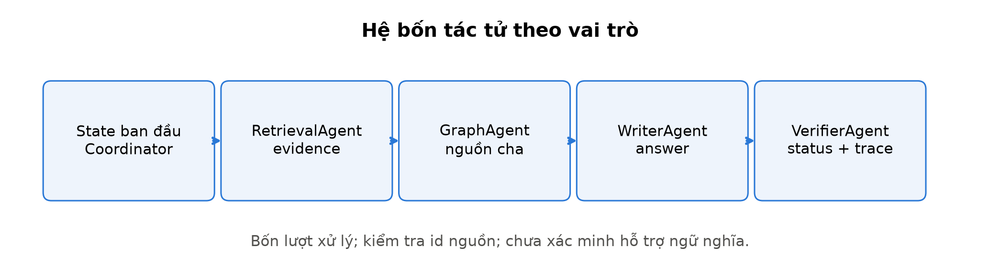

## 6.3. Hợp các hàm và điều kiện dừng

Gọi S₀ là trạng thái ban đầu. R, K, W và V lần lượt là phép chuyển trạng thái của tác tử truy hồi, đồ thị, viết và kiểm tra. Hàm O đóng gói trạng thái cuối thành kết quả để trình bày. Hệ có dạng:

$$S_4=(V\circ W\circ K\circ R)(S_0),\qquad output=O(S_4)$$ (6.1)

Mỗi hàm nhận State và cập nhật phần thuộc trách nhiệm của mình. Các Message là kết quả quan sát được sau từng phép chuyển, giúp biến hợp hàm từ một công thức trừu tượng thành chuỗi bước có thể theo dõi. Ví dụ R thêm evidence; K thêm graph_context; W thêm answer; V quyết định status. O không được tự sửa một câu trả lời sai thành “đã xác minh” chỉ vì có nhiều tác tử tham gia.

Điều phối gọi mỗi tác tử đúng một lần. Do đó một yêu cầu hợp lệ có tối đa bốn lượt tác tử ở tầng ứng dụng; số token sinh vẫn bị chặn bởi max_new_tokens ở bộ sinh. Không có vòng lặp “hãy thử lại đến khi đồng ý”. Nếu sau này thêm phản biện và truy hồi lại, phải đặt ngân sách lượt, timeout và tiêu chí dừng rõ ràng, chẳng hạn dừng khi không có bằng chứng mới hoặc đã đạt số lượt tối đa.

### 6.3.1. Giải thích các hàm và phương thức riêng

`State.send(sender, receiver, **payload)` tạo một Message và nối vào danh sách. Hàm chỉ ghi nhật ký thông điệp; việc điều phối thực tế do MultiAgentTeam quyết định, không phải mạng truyền tin phân tán.

`RetrievalAgent.act(state)` gọi `engine.retrieve` với k = 3 và bộ lọc đang có. Nó sao chép id vào payload để tác tử sau biết phạm vi tài liệu đang xử lý. Hàm không đọc gold report từ dữ liệu đánh giá.

`GraphAgent.act(state)` dùng đồ thị của domain. Với mỗi id, nó kiểm tra nút passage có tồn tại, lấy predecessor và ghi số trường hợp khớp. Hàm không suy ra quan hệ bệnh học hay dự báo xu hướng giá từ cạnh tài liệu.

`WriterAgent.act(state)` sinh khi có evidence; nếu evidence rỗng, đặt trạng thái insufficient_evidence. Nó gửi answer cho verifier ngay cả khi answer rỗng để đường lỗi được ghi lại và kiểm tra.

`VerifierAgent.act(state)` so id với tập id đã tạo từ corpus của miền tương ứng. Nếu id không hợp lệ hoặc answer rỗng, nó thay câu trả lời hiển thị bằng “Insufficient evidence”. Khi kiểm tra cấu trúc đạt, giữ generated_unverified, đồng thời ghi rõ chưa kiểm tra hỗ trợ ngữ nghĩa.

`MultiAgentTeam.ask(question, domain, report)` kiểm tra domain và câu hỏi, tạo State mới rồi gọi tuần tự các tác tử. Domain ngoài diabetes/finance hoặc câu hỏi chỉ chứa khoảng trắng gây ValueError trước khi tải tài liệu hay sinh. Đây là kiểm tra đầu vào ở cấp ứng dụng.

`MultiAgentTeam.__init__` gắn các phụ thuộc engine, generator, corpora và graphs cho từng vai trò. Dùng chung generator không làm bốn vai trò biến thành bốn mô hình độc lập; tính đa tác tử nằm ở phân công, giao thức trạng thái và thông điệp trong thiết kế này.

## 6.4. Mã nguồn và biểu diễn luồng phối hợp

Mã đầy đủ của `scripts/tieuluan/complete_agents.py` được chèn ở Phụ lục D. Cách khởi tạo trên corpus và mô hình thật đang có trong dự án:

```python
from deployment.chapter04.app import rag
from src.chapter04.knowledge import load_graph
from scripts.tieuluan.complete_agents import MultiAgentTeam

graphs = {'finance': load_graph(
    'knowledge_graph/chapter04/finance_graph.json.gz')}
team = MultiAgentTeam(rag(), graphs)
state = team.ask('What is the percentage change in revenue?', 'finance')
print(state.status, state.answer)
for message in state.messages:
    print(message.sender, '->', message.receiver, message.payload)
```

Câu hỏi tài chính trong ví dụ chưa chỉ định doanh nghiệp và năm, nên mục tiêu demo là quan sát truy hồi toàn kho và dấu vết trao đổi. Không lấy câu trả lời của ví dụ làm nhận định về một doanh nghiệp cụ thể. Để truy vấn đúng thực thể, người dùng cần chỉ định báo cáo hoặc hệ phải có bước làm rõ danh tính trước khi tính chỉ tiêu.

Bảng 6.3. Kết quả chạy thật hai yêu cầu qua hệ bốn tác tử.
|Miền|Câu trả lời sinh|Message|Khớp KG|Trạng thái|
|---|---|---|---|---|
|diabetes|2|4|0|generated_unverified|
|finance|unknown|4|3|generated_unverified|

Câu hỏi đếm lượt khám ở miền diabetes được bộ sinh trả lời “2”, trong khi số đúng của toàn bộ bảng là 101.766. Đây là lỗi nội dung dù id nguồn hợp lệ. Hệ ghi đúng trạng thái generated_unverified; phép kiểm tra cấu trúc chưa phát hiện được sai số này. Đối chiếu với nhánh statistics của ToolAgent ở Chương 5 cho thấy cần chọn công cụ thống kê cho câu hỏi đếm, thay vì dùng bộ sinh. Câu hỏi tài chính chung chung trả “unknown” và có ba đoạn khớp đồ thị; kết quả này chưa xác định được chỉ tiêu của một công ty cụ thể.

Trường hợp bộ lọc report không tồn tại trả insufficient_evidence. Hai đầu vào không hợp lệ (câu hỏi rỗng và domain sai) đều bị từ chối bằng ValueError. Tổng cộng có năm kịch bản kiểm chứng luồng đa Agent; không dùng tỷ lệ vượt kiểm tra phần mềm làm tỷ lệ đúng về nội dung.


Các lần chạy dùng corpus, chỉ mục embedding và FLAN-T5-small cục bộ. Kiểm tra yêu cầu bốn Message theo đúng thứ tự; với câu hỏi tài chính, các đoạn khớp đồ thị được ghi trong kết quả. Các trường hợp thiếu report, câu hỏi rỗng và domain sai được kiểm tra riêng. Đây là xác nhận luồng phần mềm và đường lỗi, không phải benchmark chứng minh nhiều tác tử trả lời đúng hơn một tác tử.

### 6.4.1. Cell notebook: chạy riêng từng Agent và quan sát thông điệp

Notebook `notebooks/tieuluan/complete/06_multi_agent.ipynb` định nghĩa đầy đủ State, Message và bốn tác tử ở cell AGENT-02. Các cell dưới không chỉ in kết quả cuối mà đi qua từng phép chuyển trạng thái, phù hợp yêu cầu giải thích hợp các hàm.

**Cell AGENT-04 – notebook `06_multi_agent.ipynb`.**

```python
# Cell AGENT-04
state = State('What is the percentage change in revenue?','finance')
trace = []
for worker in team.agents:
    worker.act(state)
    trace.append({'agent':type(worker).__name__,
        'evidence':len(state.evidence),'graph':len(state.graph_context),
        'answer':state.answer,'status':state.status})
    message = state.messages[-1]
    print(message.sender,'->',message.receiver,message.payload)
display(pd.DataFrame(trace))
assert len(state.messages)==4
assert not state.messages[-1].payload['semantic_support_checked']
```

**Đầu ra đã chạy (trích phần văn bản):**

```text
retrieval -> graph {'ids': ['ETR/2004/page_213.pdf:d81f966dc19b::text_6', 'ETR/2008/page_377.pdf:26c3c754ec34::text_6', 'ETR/2011/page_341.pdf:ce32d713fc20::text_2']}
graph -> writer {'matched': 3}

writer -> verifier {'answer': 'unknown'}
verifier -> coordinator {'citation_ids_valid': True, 'semantic_support_checked': False, 'status': 'generated_unverified'}

            agent  evidence  graph   answer                status
0  RetrievalAgent         3      0                        pending
1      GraphAgent         3      3                        pending
2     WriterAgent         3      3  unknown               pending
3   VerifierAgent         3      3  unknown  generated_unverified
```

**Giải thích hàm và liên hệ công thức.** State tạo trạng thái ban đầu; worker.act là một hàm chuyển trạng thái; mỗi lần chạy thêm một Message. Bảng trace ghi evidence, graph_context, answer và status sau từng hàm. assert cuối xác nhận bốn thông điệp và ghi rõ chưa kiểm tra ngữ nghĩa. GraphAgent chỉ bổ sung nguồn cha trong bản minh họa, chưa thay đổi xếp hạng hay prompt.

**Cell AGENT-05 – notebook `06_multi_agent.ipynb`.**

```python
# Cell AGENT-05
missing = team.ask('Find revenue','finance',report='__missing_report__')
print('Không có nguồn:',missing.status,missing.answer)
assert missing.status=='insufficient_evidence'
for question, domain in [('', 'finance'), ('test','invalid')]:
    try:
        team.ask(question,domain)
    except ValueError as exc:
        print('Đầu vào bị chặn:',exc)
    else:
        raise AssertionError('Đầu vào sai không bị chặn')
```

**Đầu ra đã chạy (trích phần văn bản):**

```text
Không có nguồn: insufficient_evidence Insufficient evidence
Đầu vào bị chặn: Empty question
Đầu vào bị chặn: Unsupported domain
```

**Giải thích hàm và liên hệ công thức.** MultiAgentTeam.ask kiểm tra domain và câu hỏi trước khi xử lý. Report không tồn tại tạo bằng chứng rỗng và kết thúc bằng insufficient_evidence; domain sai/câu hỏi rỗng gây ValueError. Đây là ba đường lỗi riêng, không phải một câu trả lời thất bại được che bằng thử lại nhiều vòng.


## 6.5. Đánh giá hệ đa Agent và phân tích lỗi

### 6.5.1. Cần đo những gì?

Đánh giá kỹ thuật cần đo số lượt tác tử, độ trễ đầu cuối, số token, nguồn được truy vết và tỷ lệ từ chối đúng. Đánh giá nội dung cần tập câu hỏi độc lập, đáp án chuẩn, bằng chứng chuẩn và tiêu chí hỗ trợ từng mệnh đề. Với tài chính cần xác định sai số số học, đơn vị và niên độ; với câu hỏi dữ liệu bệnh cần phân biệt số người với số lượt khám.

So sánh có ý nghĩa là cùng mô hình sinh, cùng corpus, cùng câu hỏi và ngân sách tài nguyên: RAG đơn → Agent công cụ → đa Agent. Một phép loại bỏ thành phần có thể tắt GraphAgent để xem mất khả năng truy vết nào; không mặc định độ chính xác giảm vì graph hiện chỉ thêm metadata. Nếu muốn cải thiện chất lượng, cần đưa kiểm tra niên độ, đơn vị hoặc bằng chứng vào quyết định, rồi đo trên tập giữ lại.

### 6.5.2. Các nhóm lỗi cần giải thích khi bảo vệ

**Lỗi truy hồi.** Đoạn đúng không có trong top k. Các tác tử sau không thể khôi phục một con số chưa được cung cấp. Biện pháp kiểm tra là so evidence id với gold và phân biệt lỗi chọn báo cáo với lỗi chọn đoạn.

**Lỗi nguồn.** Id có thật nhưng đoạn không hỗ trợ câu trả lời. Verifier cấu trúc hiện tại chưa phát hiện được trường hợp này. Cần một kiểm tra mệnh đề–bằng chứng hoặc chấm thủ công; thêm một nhãn “Verifier” không tự tạo ra năng lực xác minh.

**Lỗi số học.** Bộ sinh nhầm dấu, tỷ lệ hoặc đơn vị. Calculator có thể xử lý phép toán nhưng chỉ khi nhận đúng toán hạng. Cần lưu từng số gốc, nguồn và phép chuyển đổi, ví dụ USD triệu sang USD tỷ, trước khi tính.

**Lỗi phối hợp.** Hai tác tử dùng khác report, hoặc câu trả lời được tạo trước khi bằng chứng cập nhật. State chung và luồng tuần tự giảm loại lỗi này trong demo. Khi chuyển sang chạy song song, cần khóa phiên bản bằng chứng và schema thông điệp, không chỉ tăng số tiến trình.

**Lỗi đánh giá.** Dùng câu hỏi đã điều chỉnh prompt để kết luận trên dữ liệu mới, dùng oracle report như truy hồi toàn kho hoặc dùng kết quả computed của calculator để thay cho kết quả generator. Báo cáo giữ riêng các điều kiện để tránh trộn các năng lực khác nhau.

## 6.6. Triển khai, demo và tổ chức trình bày nhóm

### 6.6.1. Kịch bản demo có thể tái lập

Bước một, giới thiệu đầu vào và phạm vi dữ liệu bằng sơ đồ tổng thể. Chọn một trong hai miền diabetes hoặc finance; nếu có báo cáo cụ thể, ghi rõ bộ lọc report do người dùng cung cấp.

Bước hai, chạy `python -m scripts.tieuluan.verify_complete` trong môi trường dự án. Phần đầu xác nhận chín mô hình sáu lớp; phần sau khởi tạo hệ bốn tác tử trên mô hình và corpus cục bộ. Đọc tệp kết quả `results/tieuluan/complete/verification.json` để thấy dữ liệu đầu vào, id bằng chứng, Message và trạng thái cuối.

Bước ba, đối chiếu một trace thành công về cấu trúc với trường hợp report không tồn tại. Ở trường hợp sau, phải thấy insufficient_evidence thay vì một câu trả lời được bịa. Sau đó thử domain sai và câu hỏi rỗng để chỉ ra kiểm tra đầu vào.

Bước bốn, mở Swagger của Agent công cụ Chương 5 để biểu diễn thống kê hoặc tính toán chính xác. Nêu rõ đây là API ToolAgent đã triển khai; bản MultiAgentTeam được gọi bằng Python trong demo Chương 6, chưa được tích hợp thành endpoint riêng. Không gọi URL `/health` là bằng chứng rằng hệ đa Agent đã chạy.

### 6.6.2. Phân công trình bày và họp nhóm

Phần này là **kế hoạch tổ chức và tiêu chí trình bày**, không phải biên bản xác nhận các cuộc họp đã diễn ra. Tên và số thành viên do nhóm điền theo tình hình thực tế; tài liệu không tự tạo danh tính hay thời gian họp.

Bảng 6.4. Phân công theo nhóm công việc để mọi phần đều được giải thích.
| Nhóm công việc | Nội dung phụ trách | Kết quả mang đến buổi họp | Câu hỏi phải giải thích được |
|---|---|---|---|
| Dữ liệu và nền tảng | Chương 1–2, nguồn dữ liệu, chia tập | Sơ đồ dữ liệu và bảng chất lượng | Vì sao không chia ngẫu nhiên chuỗi? |
| CNN | Chương 3 và ba bản sáu lớp | Bảng shape, hợp hàm, log đối chiếu | ReLU/Flatten có được đếm là lớp học? |
| RNN–LSTM | Chương 4 và BPTT | Ví dụ cổng, tensor qua từng lớp | Chiều thời gian khác chiều sâu thế nào? |
| KG–RAG | Chương 5, schema và truy hồi | Một truy vấn nguồn và bảng chỉ số | Hit@5 cao có bảo đảm đáp án đúng? |
| Đa Agent và demo | Chương 6, Message và điều phối | Trace thành công/lỗi, kịch bản chạy | Verifier hiện kiểm tra được điều gì? |

Họp chuẩn bị thứ nhất chốt schema, đường dẫn dữ liệu và cách đếm lớp; sản phẩm là bảng yêu cầu và giao diện hàm thống nhất. Họp thứ hai đối chiếu cùng mẫu đầu vào giữa ba framework và ghép luồng KG–RAG–Agent; ghi lại khác biệt trọng số, kiểu tensor và lỗi tích hợp. Họp thứ ba chạy thử bảo vệ với giới hạn thời gian, đổi người hỏi chéo giữa các nhóm công việc và kiểm tra khả năng chạy lại từ lệnh đã ghi. Chỉ khi thực sự tổ chức mới lập biên bản kèm ngày, người tham gia và việc đã hoàn thành.

### 6.6.3. Hợp các hàm như một cách giải thích chung

Khi báo cáo, mỗi nhóm dùng cùng mẫu: nêu đầu vào → viết hợp hàm → tách từng hàm → tính ví dụ nhỏ → chỉ đoạn code → đọc kết quả và giới hạn. CNN minh họa hợp các phép biến đổi ảnh; RNN/LSTM minh họa hợp theo lớp và cập nhật theo thời gian; RAG minh họa hợp các bước trên dữ liệu khác kiểu; đa Agent minh họa hợp các phép chuyển trạng thái có thông điệp.

Ví dụ câu hỏi kiểm tra chéo: nếu bỏ sigmoid ở lúc hiển thị thì logit 2 có phải xác suất 200% không? Nếu trả `return_sequences=False` quá sớm thì lớp sau nhận sai tensor thế nào? Nếu một citation id tồn tại thì vì sao câu trả lời vẫn có thể sai? Nếu hai tác tử cùng đồng ý về một số không xuất hiện trong nguồn thì đó có phải xác minh không? Mỗi câu buộc người trình bày liên hệ công thức, hàm và hành vi thực tế.

## 6.7. Tiểu kết chương

Hệ bốn tác tử làm rõ việc phân công và truy vết: truy hồi lấy đoạn, đồ thị bổ sung nguồn, bộ viết tạo văn bản và bộ kiểm tra xác nhận cấu trúc. Minh họa có điểm dừng xác định, thông điệp và trạng thái lỗi rõ ràng. Chất lượng nội dung vẫn bị giới hạn bởi truy hồi và bộ sinh, trong khi kiểm tra ngữ nghĩa chưa được triển khai. Giá trị của phần cài đặt là tạo một cấu trúc có thể kiểm tra và mở rộng; hiệu quả của hệ tự lập kế hoạch hoặc phản biện nhiều vòng cần thực nghiệm riêng.


# KẾT LUẬN

## 1. Trả lời các câu hỏi nghiên cứu

**CH1 – Ba bản cài đặt có tương đương không?** Có. Khi dùng chung trọng số khởi tạo và thứ tự mini-batch, bản NumPy tự viết và bản PyTorch cho ROC-AUC theo từng hạt giống chênh nhau dưới 0,0001 với MLP, tối đa 0,0002 với CNN4 và dưới 0,0001 với LSTM. Kiểm tra gradient bằng sai phân cho sai số tương đối (tính trên toàn vector gradient) chỉ từ 9,5 × 10⁻¹¹ đến 9,3 × 10⁻⁹. Bản Keras lệch nhiều hơn một chút, ROC-AUC của MLP chênh tối đa 0,0011, do hằng số ε của Adam được đặt ở vị trí khác và thứ tự phép tính khác; mức lệch này vẫn nhỏ hơn nhiều so với chênh lệch giữa các hạt giống. Khác biệt thực sự giữa ba cách nằm ở công sức và tốc độ. Bản NumPy buộc người viết hiểu từng đạo hàm, và nhanh nhất với MLP rất nhỏ (2,2 giây mỗi lượt huấn luyện trên bộ vỡ nợ, so với 11,0 giây của PyTorch và 24,7 giây của Keras). PyTorch nhanh nhất với CNN và LSTM. Keras cần ít dòng mã nhất nhưng thường chậm nhất khi huấn luyện theo từng batch nhỏ.

**CH2 – Thuật toán nào phân biệt rủi ro tốt nhất trên dữ liệu bảng?** Rừng ngẫu nhiên là lựa chọn tốt nhất, nhưng không bỏ xa MLP. Ở bộ phá sản, rừng ngẫu nhiên đạt ROC-AUC 0,975, so với 0,926 của MLP và 0,918 của hồi quy logistic. Tuy vậy, với chỉ 44 ca phá sản trong tập test, ưu thế so với MLP chưa đạt ý nghĩa thống kê. Ở bộ vỡ nợ, rừng ngẫu nhiên và MLP ngang nhau (0,781 và 0,778) và cùng vượt hồi quy logistic một cách có ý nghĩa. Thứ hạng này giữ nguyên khi thay đổi cách tiền xử lý (mục 2.11).

**CH3 – CNN và RNN có dự báo được hướng đi của phiên kế tiếp không?** Với S&P 500 và Bitcoin thì không: mọi khoảng tin cậy 95% của ROC-AUC đều chứa 0,5. Với VN-Index thì có, nhưng rất nhỏ. LSTM (0,545 [0,506; 0,574]) và GRU (0,547 [0,510; 0,576]) có khoảng tin cậy nằm trên 0,5, còn các CNN ở sát ranh giới. Tín hiệu này chủ yếu đến từ quán tính ngắn hạn của VN-Index (hệ số tự tương quan bậc một 0,086), mà một quy tắc đơn giản như "lặp lại hướng phiên trước" cũng đã khai thác được một phần. Trên cùng bài toán, mạng hồi quy đọc chuỗi lợi suất nhỉnh hơn và ổn định hơn CNN đọc ảnh GASF.

**CH4 – Khả năng dự báo có chuyển thành lợi nhuận sau phí không?** Không, với thiết kế của tiểu luận. Trước phí, chiến lược theo GRU trên VN-Index đạt 22,2% mỗi năm, vượt mua và giữ (15,4%). Sau phí, con số giảm còn 10,5% và thua mua và giữ (15,3%). Ở S&P 500 và Bitcoin, không chiến lược nào theo kịp mua và giữ. Kết quả này phù hợp với giả thuyết thị trường hiệu quả hiểu theo nghĩa thực tế: tín hiệu nhỏ có thể tồn tại, nhưng không đủ lớn để bù chi phí khai thác nó [@fama1970; @fischer2018].

## 2. Bài học rút ra

Thứ nhất, **cách đánh giá quan trọng không kém mô hình**. Chỉ cần chia dữ liệu ngẫu nhiên thay vì theo thời gian, hoặc dự báo mức giá thay vì lợi suất, một mô hình vô dụng cũng có thể đạt con số đẹp: dự báo "giá mai bằng giá hôm nay" đã có R² = 0,9978. Đường cơ sở, khoảng tin cậy và chi phí giao dịch là ba "phép thử" giúp tránh tự đánh lừa.

Thứ hai, **chất lượng dữ liệu quyết định kết quả**. Chuỗi VN-Index từ một nguồn duy nhất chứa một mức "tăng 23%" không có thật do thiếu dữ liệu năm 2009. Lỗi này chỉ lộ ra khi đối chiếu ba nguồn. Nếu không phát hiện, mô hình sẽ học từ một sự kiện chưa từng xảy ra.

Thứ ba, **hiểu nền tảng giúp phát hiện lỗi tinh vi**. Việc tự cài đặt bằng NumPy và đối chiếu với hai thư viện đã làm lộ ra những chi tiết dễ bị bỏ qua: thứ tự cổng của GRU trong Keras khác PyTorch, PyTorch có hai vector bias cho mỗi lớp hồi quy, và cách chuẩn hóa [−1, 1] của GASF làm mất thông tin về chiều giá.

## 3. Hạn chế

Dự báo trực tiếp chỉ áp dụng trọng số cũ lên giá mới, phụ thuộc độ trễ và tính sẵn có của nguồn dữ liệu; việc cập nhật giá không bảo đảm mô hình còn phù hợp với thị trường hiện tại.

- **Thông tin đầu vào hẹp.** Các mô hình thị trường chỉ dùng giá đóng cửa của ba chỉ số; chưa dùng khối lượng, tin tức, dữ liệu vĩ mô hay dữ liệu từng cổ phiếu.
- **Mô hình nhỏ và không tinh chỉnh siêu tham số một cách hệ thống.** Đây là lựa chọn có chủ đích, để giảm nguy cơ "học thuộc" tập validation vốn nhỏ, nhưng có thể chưa khai thác hết khả năng của từng kiến trúc.
- **Kiểm định nhiều mô hình cùng lúc.** Với 18 cặp mô hình – thị trường, nếu không có tín hiệu thật, trung bình vẫn có khoảng một kết quả "có ý nghĩa" ở mức 5% chỉ do ngẫu nhiên [@harvey2016]. Tiểu luận vì thế báo cáo toàn bộ kết quả thay vì chọn mô hình tốt nhất trên tập test [@bailey2014]. Kết luận về VN-Index đáng tin hơn một phát hiện đơn lẻ vì nó nhất quán qua cả sáu kiến trúc (ROC-AUC của dự báo trung bình từ 0,524 đến 0,547) và được giải thích bởi một đặc điểm độc lập của dữ liệu là tự tương quan dương.
- **Backtest đơn giản hóa.** Mô phỏng giả định khớp lệnh đúng giá đóng cửa, không tính trượt giá, lãi tiền gửi và chu kỳ thanh toán T+2; kết quả chỉ mang tính minh họa.
- **Dữ liệu bảng không phải của Việt Nam.** Hai bộ dữ liệu rủi ro đến từ Đài Loan, trong các giai đoạn 1999–2009 và 2005, nên kết quả chưa chắc đúng với doanh nghiệp và khách hàng Việt Nam hiện nay.


## 4. Kết quả của phần mở rộng đến Chương 6

**CH5 – KG và RAG hỗ trợ được gì?** KG tài liệu giúp truy vết công ty–báo cáo–đoạn trích. Trên 883 câu FinQA dev, hybrid toàn kho đạt Hit@5 khoảng 68,29%; khi biết sẵn báo cáo đúng, chỉ số đạt khoảng 92,64%. Hai điều kiện có độ khó khác nhau. Với 16 câu bệnh tiểu đường tự biên soạn, hybrid tìm được bằng chứng trong top 5 cho 14 câu nhưng Exact Match câu trả lời chỉ 5 câu. Bộ sinh nhỏ sai toàn bộ 24 câu tính toán tài chính trong mẫu đánh giá, nên truy hồi tốt chưa đủ tạo hệ hỏi đáp số đáng tin cậy.

**CH6 – Đa Agent phối hợp và xác minh ra sao?** Bản minh họa đã có bốn vai trò, State, Message, kiểm tra đầu vào và điểm dừng. Trace cho thấy id nguồn hợp lệ vẫn có thể đi cùng câu trả lời sai; Verifier hiện kiểm tra cấu trúc, chưa kiểm tra hỗ trợ ngữ nghĩa. Nhánh thống kê và calculator của ToolAgent minh họa lý do cần chọn đúng công cụ cho câu hỏi đếm hoặc tính số. Chưa có benchmark cho thấy bản đa Agent vượt RAG đơn.

**Yêu cầu mô hình sâu.** CNN có bốn Conv và hai Dense; RNN/LSTM có năm lớp hồi quy và một Dense. Chín bản Scratch, Keras và PyTorch đã được kiểm tra đầu ra và chạy bước cập nhật thật trên mini-batch tổng hợp. Sai lệch ban đầu và gradient nhỏ cho thấy các bản triển khai khớp trong điều kiện kiểm tra. Ngoài kiểm chứng tổng hợp, ba notebook mô hình đã chạy huấn luyện ba epoch trên tập con VN-Index thật (256 train, 128 validation, 256 test), với checkpoint chọn bằng validation. Các cell và chỉ số được chèn trong Chương 3–4; thực nghiệm tập con này chưa thay thế benchmark toàn bộ dữ liệu.

## 5. Hạn chế bổ sung và hướng phát triển

Phần KG–RAG dùng mô hình sinh nhỏ, corpus tiếng Anh và bộ câu hỏi minh họa hạn chế. FinQA dev được dùng để phát triển và phân tích; cần một tập test giữ lại cho đánh giá cuối. KG hiện tổ chức nguồn tài liệu, chưa tự động trích mọi quan hệ tài chính. Calculator nhận toán hạng có cấu trúc, chưa trích số đầu cuối. Hệ đa Agent có điều phối cố định, chưa tự lập kế hoạch và chưa xác minh từng mệnh đề.

Hướng tiếp theo là huấn luyện, đánh giá chín mô hình sâu trên cùng cách chia thời gian với mô hình nông; mở rộng câu hỏi RAG độc lập; trích toán hạng có nguồn, năm và đơn vị; bổ sung kiểm tra hỗ trợ ngữ nghĩa; và đo chất lượng–độ trễ–chi phí của RAG đơn, Agent công cụ và đa Agent trên cùng điều kiện. Tất cả cải tiến cần đi cùng đường cơ sở và phân tích lỗi, thay vì kết luận tốt hơn từ số lớp hoặc số tác tử.


# PHỤ LỤC

## Phụ lục A. Mã nguồn và cách tái lập thực nghiệm

Toàn bộ mã nguồn, dữ liệu đã xử lý, kết quả và trọng số mô hình nằm trong kho mã của tiểu luận ([github.com/Sagitoaz/intelligent-system-assignment-01](https://github.com/Sagitoaz/intelligent-system-assignment-01)). Phần dành cho tiểu luận được tổ chức như sau:

```text
src/tieuluan/
  config.py              mốc thời gian, danh sách tài sản, đường dẫn
  data/sources.py        tải dữ liệu: Yahoo Finance, SSI, DNSE, VNDirect, UCI
  experiment_data.py     cửa sổ 20 phiên, ảnh GASF, chia dữ liệu
  experiment_models.py   kiến trúc, chép trọng số, vòng huấn luyện
  scratch/               thư viện NumPy tự viết (Dense, Conv2d, LSTM, GRU…)
  analysis.py            bootstrap khoảng tin cậy, backtest có phí
scripts/tieuluan/        các bước chạy (Bảng A.1)
deployment/tieuluan/     ứng dụng Streamlit và Dockerfile
notebooks/tieuluan/      notebook minh họa cho Chương 2, 3, 4
tests/                   kiểm thử tự động (pytest)
```

Bảng A.1. Trình tự tái lập toàn bộ kết quả (chạy từ thư mục gốc, Windows PowerShell).
| Bước | Lệnh (.venv\Scripts\python.exe -m …) | Kết quả |
|---|---|---|
| 1 | scripts.tieuluan.download_data | Dữ liệu gốc, nguồn gốc và kiểm tra chất lượng (data/tieuluan) |
| 2 | src.tieuluan.experiment_data | Năm bộ dữ liệu đã chia và tiền xử lý (data/tieuluan/processed) |
| 3 | scripts.tieuluan.run_experiments | 128 bản ghi kết quả, dự báo từng mẫu, trọng số (results, models) |
| 4 | scripts.tieuluan.analyze_results | Khoảng tin cậy bootstrap và backtest (analysis.json) |
| 5 | scripts.tieuluan.verify_implementations | Kiểm tra gradient và song trùng ba bản cài đặt |
| 6 | scripts.tieuluan.sensitivity_tabular, scripts.tieuluan.ablation_gasf | Hai phép thử phụ ở mục 2.11 và 3.9 |
| 7 | scripts.tieuluan.audit_experiments | Kiểm toán chỉ đọc: tính lại mọi thước đo, nạp lại các mô hình đã lưu |
| 8 | scripts.tieuluan.build_notebooks --execute | Ba notebook minh họa Chương 2, 3, 4 (có kết quả chạy) |
| 9 | scripts.tieuluan.build_report | Báo cáo Word với mọi số liệu, bảng và hình sinh từ kết quả |

Bước 3 chạy trên CPU; tổng thời gian huấn luyện của 120 lượt là khoảng 9 phút. Mỗi bản ghi lưu kèm hạt giống, cấu hình, lịch sử huấn luyện và "dấu vân tay" của lần chạy; file results/tieuluan/full/run_manifest.json ghi mã băm SHA-256 của dữ liệu đã xử lý và của mã nguồn tạo ra kết quả, nên có thể kiểm tra một con số trong báo cáo đến từ phiên bản dữ liệu và mã nào. Bước 7 tính lại toàn bộ 128 bản ghi từ dự báo đã lưu và nạp lại 52 mô hình đã huấn luyện; xác suất dự báo lại trùng khớp tuyệt đối với file đã lưu. Mỗi notebook ở bước 8 huấn luyện lại hạt giống 11 bằng cả ba cách cài đặt ngay trong notebook và tái lập đúng ROC-AUC đã báo cáo. Các kiểm thử tự động, gồm kiểm tra gradient, kiểm tra không rò rỉ dữ liệu qua ranh giới thời gian và kiểm tra ứng dụng minh họa, được chạy bằng lệnh:

```text
.venv\Scripts\python.exe -m pytest tests/test_tieuluan.py tests/test_tieuluan_app.py tests/test_tieuluan_live.py tests/test_tieuluan_credit.py -q
```

## Phụ lục B. Ứng dụng minh họa và triển khai

Ứng dụng Streamlit dành cho người chưa học tài chính, gồm bảy thẻ, mỗi thẻ có ô “Cách đọc”. **Giới thiệu** giải thích hai bài toán và kết luận chính; **Thử trên dữ liệu kiểm tra** chọn ngày hoặc hồ sơ thật để đối chiếu dự báo; **Dự báo phiên tới** tải giá mới; **Tự chấm điểm tín dụng** nhận thông tin người dùng nhập; **So sánh mô hình** tổng hợp 128 bản ghi và biểu đồ ROC-AUC, với vạch đoán mò; **Backtest** mô phỏng vốn bằng tiền trước, sau phí; **Dữ liệu và giới hạn** giải thích nguồn và phạm vi sử dụng. Ứng dụng không huấn luyện lại và không thay đổi kết quả Chương 2–4.

**Đối chiếu lịch sử.** Chọn thị trường, CNN4 hoặc LSTM và ngày cuối cửa sổ; biểu đồ hiển thị giá đóng cửa theo ngày thật, dự báo được so với biến động phiên tiếp theo (Hình B.1). Với dữ liệu bảng, chọn hoặc lấy ngẫu nhiên một dòng kiểm tra, xem thông tin gốc và kết quả thật. Ảnh GASF và vector chuẩn hóa nằm trong phần mở rộng; dự báo NumPy hạt giống 11 được đối chiếu với xác suất đã lưu.

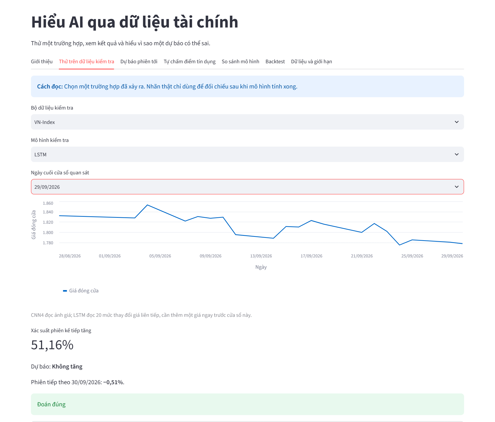{w=12}

**Dự báo phiên tới.** Nút tải lấy giá ngày từ Yahoo Finance cho S&P 500 và Bitcoin [@yahoo_live2026], dự phòng lần lượt FRED [@fred_live2026] và Coinbase Exchange [@coinbase_live2026]; VN-Index dùng SSI iBoard [@ssi_live2026], dự phòng DNSE [@dnse_live2026]. Giao diện ghi nguồn thực tế, phiên cuối và giờ cập nhật Việt Nam (Hình B.2). Chỉ dùng phiên đã đóng cửa: bỏ phiên hôm nay trước 15:00 giờ Việt Nam với VN-Index, trước 16:30 giờ New York với S&P 500 và bỏ nến ngày UTC hiện tại với Bitcoin. UTC là giờ quốc tế, chậm hơn Việt Nam bảy giờ. Cần ít nhất 21 giá hợp lệ; giá quá cũ được cảnh báo, lỗi mạng không được thay bằng dữ liệu giả.

LSTM nhận 20 lợi suất logarit, tức thay đổi giá trên thang logarit, với tham số chuẩn hóa của tập học; CNN4 nhận ảnh GASF của 20 giá cuối. Công thức và thứ tự ép kiểu được kiểm thử khớp đặc trưng thực nghiệm. Dự báo lấy trung bình xác suất ba hạt giống NumPy; ngưỡng và khoảng tin cậy ROC-AUC lấy từ analysis.json, vốn phân tích trung bình ba bản PyTorch gần tương đương NumPy. Độ chính xác cân bằng hiển thị là trung bình ba bản NumPy trên tập kiểm tra, không phải độ tin cậy riêng của phiên mới. Tải giá không cập nhật trọng số; nguồn dự phòng có thể khác nguồn huấn luyện.

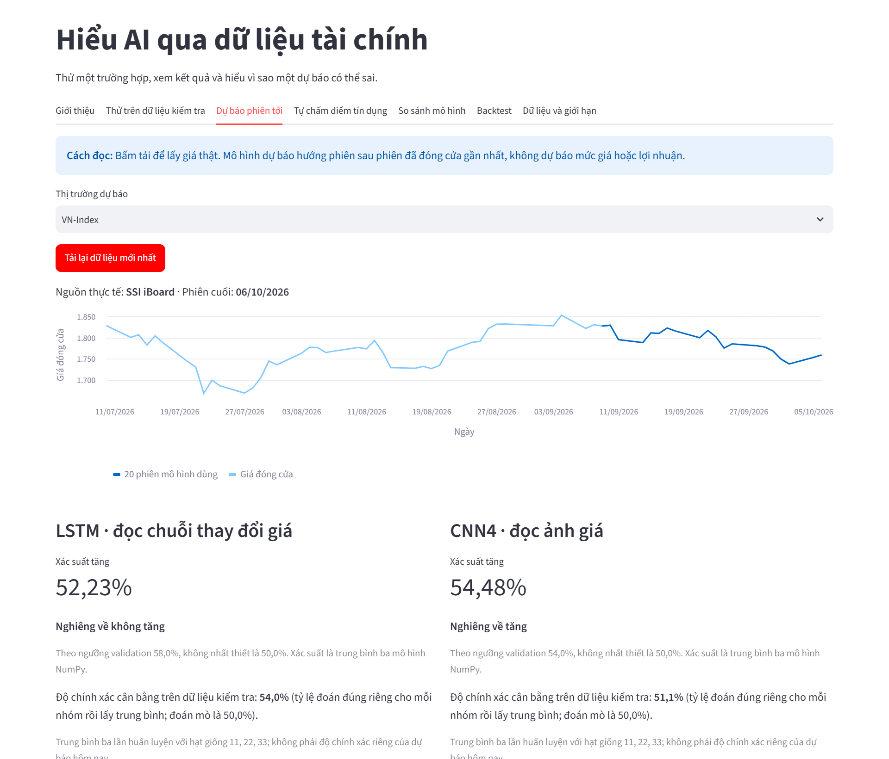{w=12}

**Chấm điểm tín dụng.** Chọn một hồ sơ thật ở nhóm xác suất thấp, giữa hoặc cao trong tập kiểm tra, sửa hạn mức, tuổi, lịch sử trả nợ và số tiền rồi bấm chấm điểm (Hình B.3). Các thông tin khác nằm trong phần mở rộng. Đơn vị là Đài tệ (TWD), không phải VND; dữ liệu thuộc Đài Loan năm 2005. Mã trả nợ được giải thích cạnh biểu mẫu; hai mã −2 và 0 dùng diễn giải phổ biến nhưng không được tài liệu UCI gốc mô tả. MLP sử dụng đủ đặc trưng theo thứ tự gốc, điền thiếu và chuẩn hóa bằng tham số tập học, rồi lấy trung bình ba xác suất. Ngưỡng 21,0% được chọn trước từ trung bình dự báo validation; tỷ lệ vỡ nợ chung để so sánh là 22,12%. Ba mức thấp, trung bình, cao lần lượt ứng với xác suất dưới nửa ngưỡng, từ nửa ngưỡng đến dưới ngưỡng và từ ngưỡng trở lên; đây là quy ước minh họa chưa được kiểm định như thang tín dụng. Giới tính, tuổi và tình trạng hôn nhân có thể gây phân biệt đối xử nếu dùng để quyết định tín dụng thực tế; ứng dụng chỉ phục vụ học tập.

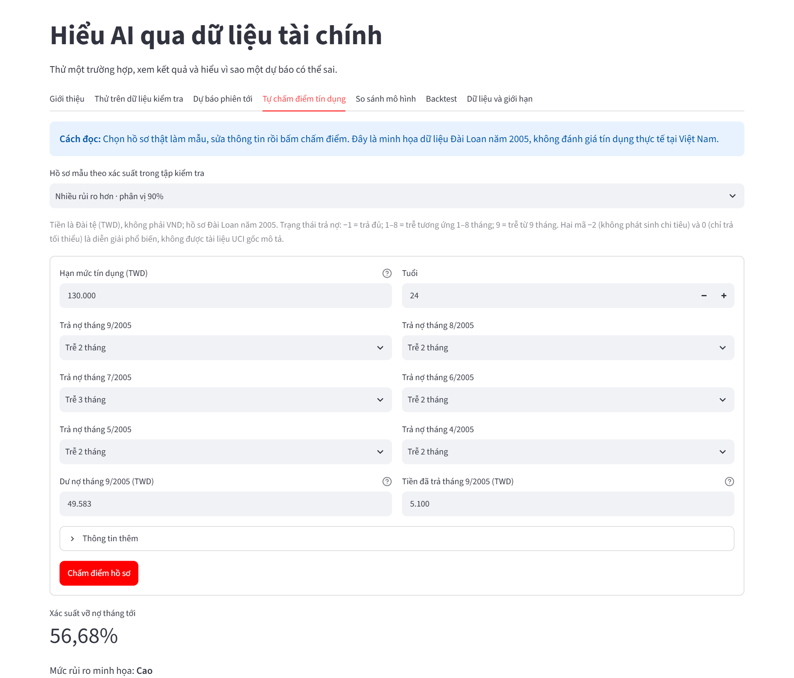{w=12}

**Mô phỏng bằng tiền.** Backtest là thử cách mua bán trên dữ liệu quá khứ. Hình B.4 quy đổi về vốn ban đầu 100 triệu đồng, so sánh mua và giữ, theo mô hình và lặp lại hướng phiên trước; bảng trình bày số tiền trước, sau phí. Đây là vốn quy đổi để dễ đọc, không tính tỷ giá và không khẳng định có thể mua trực tiếp chỉ số. Mọi dự báo đều kèm kết quả lịch sử và câu “Không phải khuyến nghị đầu tư”; riêng S&P 500, Bitcoin nêu rõ không tốt hơn đoán mò trên giai đoạn kiểm tra.

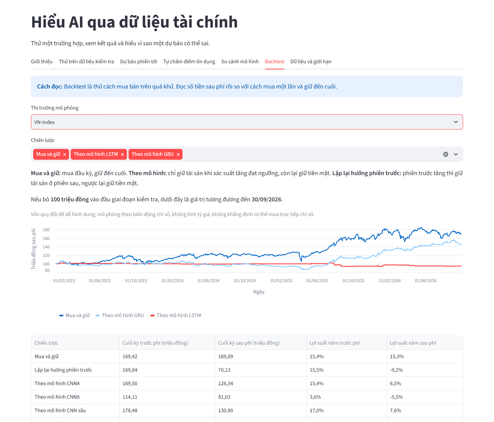{w=12}

**Chạy và triển khai.** Tài nguyên nhẹ trong data/tieuluan/app được tạo trước bằng lệnh `.venv\Scripts\python.exe -m scripts.tieuluan.prepare_app_assets`; script đọc dữ liệu gốc theo chỉ số dòng kiểm tra, tính ngưỡng từ validation và lưu mẫu, tham số, thống kê. Máy chủ chỉ cài NumPy, pandas, Streamlit; không đọc Excel, không nạp thư viện huấn luyện. Tệp và mô hình có bộ nhớ đệm; giá tải mạng được giữ tối đa 30 phút. Nút tải lại xóa bộ nhớ đệm giá. Mỗi nguồn chờ tối đa chín giây mỗi lần, chỉ thử lại một lần.

Ứng dụng đã được thử từ bản git archive trong môi trường Python sạch chỉ cài requirements triển khai: Edge đi qua các thẻ, lựa chọn mô hình, hồ sơ mẫu và dự báo mạng thật; đỉnh bộ nhớ tiến trình máy chủ đo bằng Get-Process là 178,4 MB. Đây là phép đo trên Windows, không phải cam kết bộ nhớ cho mọi mức truy cập trên Render.

Ứng dụng trực tuyến: [financial-investment-ai.onrender.com](https://financial-investment-ai.onrender.com/). Render lấy mã trực tiếp từ GitHub và tự triển khai khi nhánh main được cập nhật [@render_free]. Các bước:

1. Đăng nhập render.com, chọn **New → Web Service → Public Git Repository**, dán địa chỉ kho mã ở Phụ lục A rồi bấm **Connect**.
2. Chọn **Language: Python 3**, **Branch: main**, gói **Free**; Python 3.12 khai báo tại `.python-version`.
3. **Build Command:** `pip install -r deployment/tieuluan/requirements.txt`.
4. **Start Command:** `streamlit run deployment/tieuluan/app.py --server.port $PORT --server.address 0.0.0.0 --server.headless true`.
5. Bấm **Create Web Service**, chờ **Live** rồi mở địa chỉ Render được cấp.

Gói Free có 512 MB bộ nhớ, ngủ sau 15 phút không truy cập; nên mở trước khi trình bày khoảng một phút. Gói Docker cho Hugging Face vẫn có thể tạo bằng `scripts.tieuluan.package_demo`, gồm tài nguyên và trọng số ba hạt giống. Chạy tại máy bằng `.venv\Scripts\python.exe -m streamlit run deployment/tieuluan/app.py`, rồi mở http://localhost:8501.


## Phụ lục C. Mã CNN, RNN và LSTM sáu lớp bằng ba công cụ

### C.1. Quy ước và cách chạy

Các khối mã sau được chèn trực tiếp từ mã nguồn đã chạy kiểm chứng, không viết lại riêng cho báo cáo. Chạy từ thư mục gốc dự án; các import `src.tieuluan.scratch` trỏ tới thư viện NumPy tự viết của bài, không phải thư viện deep learning có sẵn. NumPy cung cấp mảng và phép nhân ma trận; forward, backward, BCE và Adam được cài riêng. Các lớp Scratch gốc được giải thích trong Chương 2–4 và bảng C.3.

```powershell
.venv/Scripts/python.exe -m scripts.tieuluan.verify_complete
.venv/Scripts/python.exe -m scripts.tieuluan.build_complete_report
```

Môi trường sử dụng Python 3.12.0, NumPy, Keras với backend TensorFlow, PyTorch và các gói xuất Word có sẵn của dự án. Để tái chạy phần RAG cần corpus trong `data/chapter04`, embedding và generator trong `models/chapter04`, cùng đồ thị tài chính. Không cần API key cho mô hình cục bộ. Tệp verification.json chỉ được ghi sau khi tất cả các assertion hoàn thành.

Các notebook bổ sung đã chạy và lưu output tại `notebooks/tieuluan/complete/`:

- `03_cnn_6_layers.ipynb`: CNN sáu lớp, ba công cụ.
- `04a_rnn_6_layers.ipynb`: RNN sáu lớp, ba công cụ.
- `04b_lstm_6_layers.ipynb`: LSTM sáu lớp, ba công cụ.
- `05_knowledge_rag.ipynb`: KG, RRF, RAG và công cụ tính toán.
- `06_multi_agent.ipynb`: bốn Agent, thông điệp và xử lý lỗi.

Tạo và chạy lại bằng `python -m scripts.tieuluan.build_complete_notebooks`. Mỗi cell có nhãn để đối chiếu với các trích đoạn trong Chương 3–6; xem README trong thư mục notebook để chọn kernel và kiểm tra dữ liệu cần có.

### C.2. Kiến trúc và vòng huấn luyện đầy đủ

```python
"""Six trainable layers for CNN/RNN/LSTM, using existing NumPy primitives."""
import os
os.environ.setdefault('KERAS_BACKEND', 'tensorflow')
os.environ.setdefault('TF_CPP_MIN_LOG_LEVEL', '3')
import numpy as np
from src.tieuluan.scratch.core import Sequential
from src.tieuluan.scratch.layers import Conv2d, Dense, Flatten, ReLU
from src.tieuluan.scratch.recurrent import SimpleRNN, LSTM, LastStep


def scratch_deep(kind, seed=42):
    rng = np.random.default_rng(seed)
    if kind == 'cnn':
        layers = []
        for cin, cout in [(1, 4), (4, 4), (4, 8), (8, 8)]:
            layers += [Conv2d(cin, cout, 3, rng=rng), ReLU()]
        return Sequential(*layers, Flatten(),
                          Dense(8*12*12, 8, rng=rng), ReLU(),
                          Dense(8, 1, rng=rng))
    cell = {'rnn': SimpleRNN, 'lstm': LSTM}[kind]
    layers = [cell(1, 8, rng=rng)]
    layers += [cell(8, 8, rng=rng) for _ in range(4)]
    return Sequential(*layers, LastStep(), Dense(8, 1, rng=rng))


def keras_deep(kind, seed=42):
    import keras
    keras.utils.set_random_seed(seed)
    if kind == 'cnn':
        x = keras.Input((1, 20, 20))
        z = keras.layers.Permute((2, 3, 1))(x)
        for width in [4, 4, 8, 8]:
            z = keras.layers.Conv2D(width, 3, activation='relu')(z)
        z = keras.layers.Permute((3, 1, 2))(z)
        z = keras.layers.Flatten()(z)
        z = keras.layers.Dense(8, activation='relu')(z)
    else:
        x = keras.Input((20, 1))
        z = x
        cell = {'rnn': keras.layers.SimpleRNN,
                'lstm': keras.layers.LSTM}[kind]
        for depth in range(5):
            z = cell(8, return_sequences=(depth < 4))(z)
    return keras.Model(x, keras.layers.Dense(1)(z))


def torch_deep(kind, seed=42):
    import torch
    from torch import nn
    torch.manual_seed(seed)
    if kind == 'cnn':
        layers = []
        for cin, cout in [(1, 4), (4, 4), (4, 8), (8, 8)]:
            layers += [nn.Conv2d(cin, cout, 3), nn.ReLU()]
        return nn.Sequential(*layers, nn.Flatten(),
                             nn.Linear(8*12*12, 8), nn.ReLU(),
                             nn.Linear(8, 1))

    class Stacked(nn.Module):
        def __init__(self):
            super().__init__()
            cell = {'rnn': nn.RNN, 'lstm': nn.LSTM}[kind]
            self.cells = nn.ModuleList([cell(1, 8, batch_first=True)])
            self.cells.extend([cell(8, 8, batch_first=True)
                               for _ in range(4)])
            self.head = nn.Linear(8, 1)

        def forward(self, x):
            for cell in self.cells:
                x, _ = cell(x)
            return self.head(x[:, -1])
    return Stacked()


def align_weights(source, target, framework, kind):
    """Same effective weights and same trainable parameter counts."""
    weighted = [l for l in source.layers if l.parameters()]
    if framework == 'keras':
        targets = [l for l in target.layers if l.weights]
        for s, t in zip(weighted, targets, strict=True):
            if isinstance(s, Conv2d):
                t.set_weights([s.weight.value.transpose(2, 3, 1, 0),
                               s.bias.value])
            elif isinstance(s, Dense):
                t.set_weights([s.weight.value.T, s.bias.value])
            else:
                t.set_weights([s.weight_ih.value.T,
                               s.weight_hh.value.T,
                               s.bias_ih.value + s.bias_hh.value])
    else:
        import torch
        with torch.no_grad():
            for s, t in zip(source.parameters(), target.parameters(),
                            strict=True):
                t.copy_(torch.from_numpy(s.value))
        if kind != 'cnn':
            for cell in target.cells:
                cell.bias_hh_l0.requires_grad_(False)
    if kind != 'cnn':
        for layer in weighted[:-1]:
            layer.bias_hh.grad[...] = 0


def train_batch(model, framework, x, y, optimizer):
    """One actual optimization step, binary classification on logits."""
    if framework == 'scratch':
        from src.tieuluan.scratch.losses import BCEWithLogitsLoss
        from src.tieuluan.scratch.optim import clip_grad_norm
        model.train()
        model.zero_grad()
        loss = BCEWithLogitsLoss()
        value = loss.forward(model.forward(x), y)
        model.backward(loss.backward())
        # One effective bias, matching Keras and the frozen Torch bias.
        for layer in model.layers:
            if isinstance(layer, (SimpleRNN, LSTM)):
                layer.bias_hh.grad[...] = 0
        clip_grad_norm(model.parameters(), 1.0)
        optimizer.step()
        return value
    if framework == 'pytorch':
        import torch
        model.train()
        optimizer.zero_grad()
        loss = torch.nn.functional.binary_cross_entropy_with_logits(
            model(torch.from_numpy(x)), torch.from_numpy(y))
        loss.backward()
        torch.nn.utils.clip_grad_norm_(model.parameters(), 1.0)
        optimizer.step()
        return float(loss.detach())
    import tensorflow as tf
    with tf.GradientTape() as tape:
        logits = model(x, training=True)
        loss = tf.reduce_mean(tf.nn.sigmoid_cross_entropy_with_logits(
            labels=y, logits=logits))
    grads = tape.gradient(loss, model.trainable_variables)
    grads, _ = tf.clip_by_global_norm(grads, 1.0)
    optimizer.apply_gradients(zip(grads, model.trainable_variables))
    return float(loss.numpy())

```

`scratch_deep(kind, seed)` tạo CNN bằng bốn Conv và hai Dense; với rnn/lstm tạo năm lớp hồi quy và Dense. Generator của NumPy được truyền lần lượt cho các lớp, tránh khởi tạo giống nhau ngoài ý muốn ở nhiều lớp cùng shape.

`keras_deep(kind, seed)` đổi quy ước kênh cho CNN và giữ toàn bộ chuỗi ở bốn lớp hồi quy đầu. Hai Permute không thêm tham số học. `torch_deep(kind, seed)` dùng Sequential cho CNN và ModuleList cho hồi quy; phương thức Stacked.forward truyền chuỗi qua từng cell, sau đó lấy bước cuối.

`align_weights(source, target, framework, kind)` chuyển kernel Conv từ [F,C,H,W] sang [H,W,C,F], chuyển vị Dense và ma trận cổng khi đưa sang Keras. Với PyTorch, thứ tự tham số được khớp bằng zip(strict=True) để phát hiện danh sách không cùng độ dài. Các bias hồi quy thứ hai được giữ bằng không trong vòng học.

`train_batch(model, framework, x, y, optimizer)` nhận nhãn B × 1 và logit B × 1. Nhánh Scratch gọi zero_grad, forward, loss.backward, model.backward, xóa gradient bias phụ, clip và Adam.step. Nhánh PyTorch dùng autograd và BCEWithLogits. Nhánh Keras dùng GradientTape và sigmoid_cross_entropy_with_logits. Cả ba nhánh cắt chuẩn gradient toàn cục về tối đa 1 trước cập nhật.

### C.3. Kết quả kiểm chứng và cách đọc

Bảng C.1. Kiểm chứng chín bản cài đặt trên mini-batch tổng hợp, không phải kết quả thị trường.
|Mạng|Công cụ|Tham số học|Loss bước 1|Loss bước 3|Lệch logit đầu|
|---|---|---|---|---|---|
|CNN|scratch|10.301|0,706986|0,670980|0.00e+00|
|CNN|pytorch|10.301|0,706986|0,670980|3.73e-08|
|CNN|keras|10.301|0,706986|0,670982|3.73e-08|
|RNN|scratch|633|0,566423|0,497003|0.00e+00|
|RNN|pytorch|633|0,566423|0,497003|1.34e-07|
|RNN|keras|633|0,566423|0,497003|4.62e-07|
|LSTM|scratch|2.505|0,692558|0,692146|0.00e+00|
|LSTM|pytorch|2.505|0,692558|0,692145|1.63e-09|
|LSTM|keras|2.505|0,692558|0,692147|2.10e-09|

Bảng C.2. Sai lệch lớn nhất giữa gradient Scratch và PyTorch trước cập nhật.
|Mô hình|Sai lệch tuyệt đối lớn nhất|Ngưỡng kiểm tra|
|---|---|---|
|CNN|4.098e-08|1e-4|
|RNN|1.788e-07|1e-4|
|LSTM|1.583e-08|1e-4|

Mỗi mạng dùng bốn mẫu tổng hợp với cùng đầu vào và trọng số hiệu dụng, ba bước tối ưu. Kiểm tra logit ban đầu và gradient có ngưỡng 1e-4. Chín bản cho đầu ra [4,1], loss hữu hạn và giảm trong lần chạy này. Adam của Keras có khác biệt chi tiết ổn định số nên không yêu cầu loss sau cập nhật giống tuyệt đối. Những kiểm tra này bổ sung cho kiểm tra gradient bằng sai phân của thư viện gốc; chúng chưa thay thế thực nghiệm dữ liệu thị trường trên mạng sâu.

### C.4. Tra cứu từng hàm của thư viện Scratch

Bảng C.3. Đầu vào, đầu ra và vai trò của các hàm lõi được dùng trong mã sáu lớp.
| Hàm/phương thức | Biến đổi hoặc trách nhiệm | Lưu ý khi giải thích |
|---|---|---|
| Parameter.zero_grad | Đặt mảng gradient về không | Phải gọi trước batch mới |
| Module.parameters | Thu thập trọng số của mô hình con | Dùng cho Adam và đếm tham số |
| Module.train/eval | Đổi chế độ huấn luyện/suy luận | Không tự thực hiện bước học |
| Sequential.forward | Áp dụng lớp từ trái sang phải | Là hiện thực của hợp các hàm |
| Sequential.backward | Áp dụng backward theo thứ tự ngược | Quy tắc dây chuyền |
| glorot_uniform | Khởi tạo theo fan_in và fan_out | Phân phối phụ thuộc số chiều |
| orthogonal | Tạo trọng số hồi quy trực giao bằng QR | Seed dùng để tái lập |
| Dense.forward | XWᵀ + b | Lưu X để tính gradient |
| Dense.backward | dW = GᵀX; db = tổng G; dX = GW | Gradient cộng dồn trong tham số |
| ReLU.forward/backward | max(0,x); G nhân mặt nạ x>0 | Không có tham số |
| Flatten.forward/backward | Đổi shape và phục hồi shape cũ | Bảo toàn thứ tự phần tử |
| Conv2d.output_shape | Tính kích thước theo kernel/stride/padding | Kiểm tra trước khi dựng Dense |
| Conv2d.forward | im2col và nhân kernel | Cùng quy ước tương quan chéo |
| Conv2d.backward | Gradient kernel, bias và col2im | Cộng vùng cửa sổ chồng lấp |
| SimpleRNN.forward | Cập nhật tanh từng bước | Trả toàn bộ chuỗi trạng thái |
| SimpleRNN.backward | BPTT; cộng đóng góp qua thời gian | Một bộ trọng số cho mọi bước |
| LSTM.forward | Tính i,f,g,o rồi cập nhật c,h | Lưu cổng và ô nhớ |
| LSTM.backward | BPTT qua cả nhánh h và c | Duy trì gradient ô nhớ riêng |
| LastStep.forward/backward | Lấy bước cuối; đặt gradient vào lát cắt cuối | BPTT tiếp tục về quá khứ |
| BCEWithLogitsLoss.forward | Trung bình softplus ổn định số | Nhận logit, không nhận xác suất |
| BCEWithLogitsLoss.backward | (sigmoid(z)−y)/B khi trọng số lớp bằng 1 | Đúng shape của logit |
| clip_grad_norm | Co gradient nếu chuẩn vượt ngưỡng | Không đổi hướng gradient |
| Adam.step | Cập nhật hai moment và trọng số | Có hiệu chỉnh độ lệch moment |
| state_dict/load_state_dict | Lấy hoặc nạp mảng trọng số | Kiểm tra đúng kiến trúc |
| save/load | Ghi hoặc đọc tệp npz | Lưu mô hình, không lưu dữ liệu test |

## Phụ lục D. Mã hệ đa Agent và thông điệp

### D.1. Mã nguồn đầy đủ của minh họa theo vai trò

```python
"""Bounded, role-based multi-agent demonstration with explicit messages."""
from dataclasses import dataclass, field


@dataclass
class Message:
    sender: str
    receiver: str
    payload: dict


@dataclass
class State:
    question: str
    domain: str
    report: str | None = None
    evidence: list = field(default_factory=list)
    graph_context: list = field(default_factory=list)
    answer: str = ''
    status: str = 'pending'
    messages: list = field(default_factory=list)

    def send(self, sender, receiver, **payload):
        self.messages.append(Message(sender, receiver, payload))


class RetrievalAgent:
    def __init__(self, engine):
        self.engine = engine

    def act(self, state):
        state.evidence = self.engine.retrieve(
            state.question, state.domain, k=3, report=state.report)
        state.send('retrieval', 'graph',
                   ids=[e['id'] for e in state.evidence])


class GraphAgent:
    def __init__(self, graphs):
        self.graphs = graphs

    def act(self, state):
        graph = self.graphs.get(state.domain)
        if graph is not None:
            for item in state.evidence:
                node = 'passage:' + item['id']
                if node in graph:
                    state.graph_context.append({
                        'id': item['id'],
                        'parents': list(graph.predecessors(node))})
        state.send('graph', 'writer',
                   matched=len(state.graph_context))


class WriterAgent:
    def __init__(self, generator):
        self.generator = generator

    def act(self, state):
        if not state.evidence:
            state.status = 'insufficient_evidence'
        else:
            state.answer = self.generator.generate(
                state.question, state.evidence)
        state.send('writer', 'verifier', answer=state.answer)


class VerifierAgent:
    def __init__(self, corpora):
        self.allowed = {d: {x['id'] for x in c}
                        for d, c in corpora.items()}

    def act(self, state):
        ids = [e['id'] for e in state.evidence]
        valid = bool(ids) and all(
            cid in self.allowed[state.domain] for cid in ids)
        if not valid or not state.answer.strip():
            state.answer = 'Insufficient evidence'
            state.status = 'insufficient_evidence'
        else:
            state.status = 'generated_unverified'
        state.send('verifier', 'coordinator', citation_ids_valid=valid,
                   semantic_support_checked=False, status=state.status)


class MultiAgentTeam:
    def __init__(self, engine, graphs):
        self.agents = [RetrievalAgent(engine), GraphAgent(graphs),
                       WriterAgent(engine.generator),
                       VerifierAgent(engine.corpora)]

    def ask(self, question, domain, report=None):
        if domain not in ('diabetes', 'finance'):
            raise ValueError('Unsupported domain')
        if not question.strip():
            raise ValueError('Empty question')
        state = State(question, domain, report)
        for agent in self.agents:  # Four bounded turns; no retry loop.
            agent.act(state)
        return state

```

### D.2. Đối chiếu yêu cầu môn học với nội dung báo cáo

Bảng D.1. Ma trận yêu cầu và vị trí đáp ứng.
| Yêu cầu | Vị trí trong tài liệu | Bằng chứng hoặc sản phẩm |
|---|---|---|
| Cập nhật Chương 1 và 2 | Chương 1–2 và Mở đầu bản sáu chương | Giữ nghiên cứu nền tảng, nối sang KG–RAG–Agent |
| CNN bằng Scratch, Keras, PyTorch | 3.8, 3.10, Phụ lục C | Ba bản CNN sáu lớp, kiểm tra đầu ra/gradient |
| RNN bằng ba công cụ | 4.7, 4.11, Phụ lục C | Ba bản RNN sáu lớp |
| LSTM bằng ba công cụ | 4.4, 4.7, 4.11, Phụ lục C | Ba bản LSTM sáu lớp |
| Mô hình trên 5 layer | Bảng 3.7, 4.7 và C.1 | Đếm sáu lớp có tham số học được |
| Giải thích bằng hợp các hàm | 3.10, 4.11, 5.3, 6.3 | Công thức và luồng đầu vào–đầu ra |
| Giải thích từng hàm riêng | 3.10, 4.11, 6.3 và C.4 | Vai trò, shape, đạo hàm hoặc trạng thái |
| KG/KB, RAG, bệnh tiểu đường | 5.1–5.4 | Schema, code, nguồn, bảng kết quả |
| KG–RAG cho chứng khoán | 5.5 | FinQA, truy hồi và phân tích lỗi sinh số |
| Deploy với Agent | 5.6 | Lệnh uvicorn, API, HTTP log đã lưu |
| Hệ đa Agent | Chương 6, Phụ lục D | Bốn vai trò, Message, State và luồng kiểm chứng |
| Demo và họp/giải thích nhóm | 3.10.3, 4.11.3, 6.6 | Kịch bản chạy, phân công và kế hoạch họp |
| Bản nộp Word | Tệp DOCX sáu chương | Mục lục, hình, bảng và tài liệu tham khảo |

Các kết quả thực nghiệm cũ, kết quả KG–RAG và kiểm chứng mới được ghi riêng theo nguồn. Không coi kế hoạch họp là cuộc họp đã diễn ra; không coi demo mini-batch là mô hình thị trường đã được đánh giá; không coi kiểm tra citation id là xác minh ngữ nghĩa. Các thông tin nhóm lớp và nhóm tiểu luận trên bìa cần điền theo thông tin chính thức trước khi nộp.
